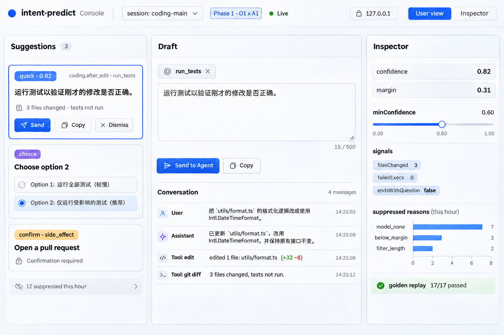
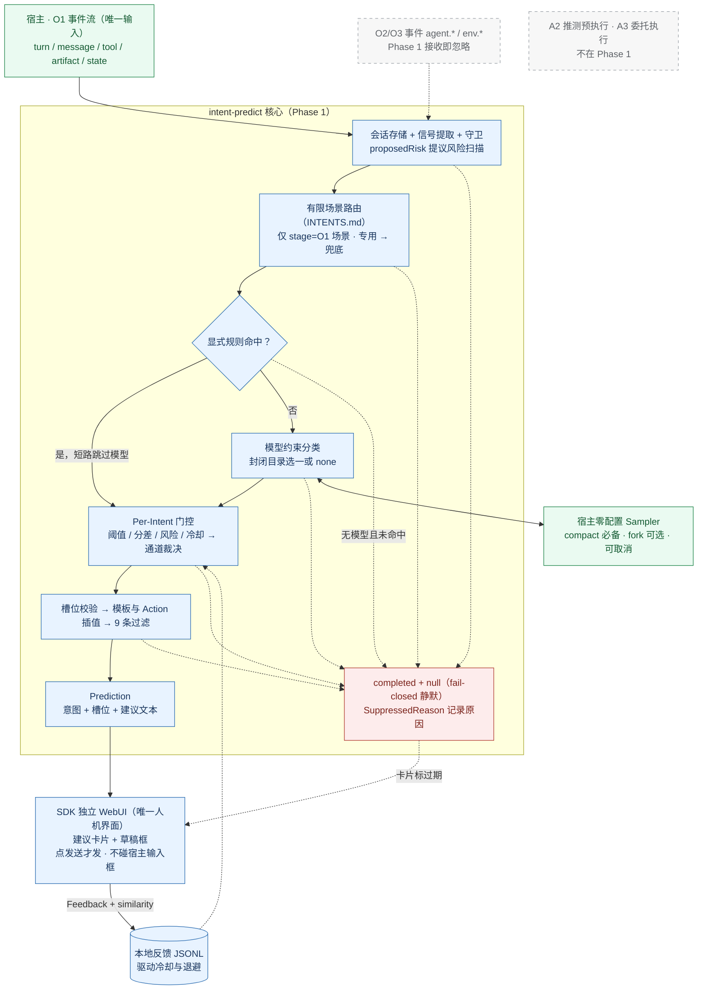

# intent-predict

**intent-predict** 是一个让**任意 Agent 成为全场景意图预测 Agent（Intent Predict Agent）**的通用 SDK。它的观察范围不局限于对话气泡，还可以感知终端命令、Git 工作区、文件变动、IDE 焦点与桌面/剪贴板环境；在识别出的有限场景里从一个封闭集合中预测用户下一步最可能的意图，并支持从「纯建议输出」渐进升级到「推测预执行」与「委托执行」。没有把握时就不给建议（fail-closed）。

> 当前状态：**设计规范 v0.4（审查修订版，尚无实现代码），当前位于 Phase 1（O1 × A1）**。第一阶段只做好单会话观察 + 纯建议输出这一格，实现顺序、明确不做清单与出口标准见 [ROADMAP.md](ROADMAP.md)；规范与机读契约可直接照着实现；效果指标待回放数据验证。
> - 阶段路线图（O×A 五阶段）：[ROADMAP.md](ROADMAP.md)
> - 语言无关实现规范（Spec-as-Prompt，含权威划分）：[SPEC.md](SPEC.md)
> - 场景与提示词契约（内置包的单一来源）：[INTENTS.md](INTENTS.md)
> - 非规范详细设计说明：[docs/design.md](docs/design.md)
> - 形式化 JSON Schema：[spec/](spec/)（`events`、`scenario-pack`、`prediction`、`feedback`、`rpc`）
> - 内置编程场景包（由 `tools/build_pack.py` 从 INTENTS.md 生成）：[packages/pack-coding/pack.json](packages/pack-coding/pack.json)
> - 确定性黄金用例：[eval/golden.jsonl](eval/golden.jsonl)；非编程示例包：[examples/support.intents.md](examples/support.intents.md)
> - 仓库一致性校验：`python tools/validate.py`（需 `pip install jsonschema pyyaml`）
> - 调研笔记：[docs/prior-art.md](docs/prior-art.md)；审查问题与处理记录：[docs/review-issues.md](docs/review-issues.md)

## 如何用一句话让你的 Agent 实现或接入它（Symphony 模式）

你可以像使用 [OpenAI Symphony](https://github.com/openai/symphony) 一样，直接让你的 Coding Agent（Hermes、Codex、Claude Code 等）根据本仓库的规范自行实现或接入：

> Implement `intent-predict` according to https://github.com/susyimes/intent-predict/blob/main/SPEC.md, load scenarios from https://github.com/susyimes/intent-predict/blob/main/INTENTS.md, and verify against https://github.com/susyimes/intent-predict/blob/main/eval/golden.jsonl

## 一个例子

agent 改完代码（或子任务完成）后，SDK 的独立 WebUI 里会多出一张卡片「跑一下测试验证看看」；点卡片就把这句话载入 WebUI 的草稿框，改不改字都行，再点发送喂回会话（宿主不支持发送桥时一键复制）。若是确认类或有外部副作用的意图（如创建 PR），卡片会强制走 `confirm` 分级多确认一步。宿主输入框从头到尾不被触碰。同时引擎返回一份结构化结果：

```json
{
  "scenarioId": "coding.after_edit",
  "qualifiedIntentId": "builtin/coding@0.4.0/coding.after_edit#run_tests",
  "displayChannel": "quick",
  "agencyStage": "suggest_only",
  "intent": { "id": "run_tests", "confidence": 0.82, "slots": {} },
  "text": "跑一下测试验证看看",
  "risk": "reversible"
}
```

宿主可以根据这份结果绑定确定性的动作，比如 `/review`、后台只读预备任务（Stage A2）或快捷按钮，不需要从文本里猜用户的意思。

Phase 1 的独立 WebUI 界面示意图（概念图，随实现打磨迭代；左侧卡片流、中间草稿、右侧检查面）：



## 架构图（当前 Phase 1：O1 × A1）

双轴五阶段怎么走见 [ROADMAP.md](ROADMAP.md)；每阶段单独的说明图（含全景总图与后续增量图）见 [docs/diagrams.md](docs/diagrams.md)。下面只画当前阶段这一格：输入只有当前会话，输出只进 SDK 独立 WebUI 的卡片流（与宿主输入框完全解耦，见 [docs/design.md](docs/design.md) 决策 D10），流水线任一级不过就静默（红框）。



Phase 1 的时序图与 UI 状态图见 [docs/diagrams.md](docs/diagrams.md#1-phase-1o1--a1当前精修范围)。

## 和 Codex composer predictions 有什么不同

本项目借鉴了 OpenAI Codex 的 [composer predictions](docs/prior-art.md#1-openai-codexcomposer-predictions)，两者的主要区别如下：

| | Codex composer predictions | intent-predict |
|---|---|---|
| 预测什么 | 一句开放文本 | 场景内有限意图集合中的一项（或 `none`），附带槽位、置信度、文本和动作 |
| 能在哪里用 | 只能在 Codex 桌面版里用 | 任意 agent（第一个深度落地 Hermes Agent，见路线图），通过适配器或 JSON-RPC sidecar 接入 |
| 模型配置 | 绑定 Codex 自身后端 | **零配置优先**：通过 `Sampler` 直接复用宿主 Agent 已有的模型或缓存分叉 |
| 什么时候出现 | 策略未公开 | 显式门控：阈值、领先幅度、冷却、风险等级 |
| 怎么评估 | 看接受率 | 分类指标 + 接受率 + 校准 |

## 设计要点

- **零配置复用宿主模型**：不需要用户单独为 SDK 配 API Key。SDK 通过 `Sampler`（`fork` 缓存共享分叉或 `compact` 紧凑上下文委托）直接调用宿主 Agent 自己的模型。
- **数据流向**：宿主传入事件，SDK 返回预测，宿主再回传用户反馈。UI 和动作执行都由宿主负责。
- **四级接入与自动降级**：
  - L2（Fork Sampler）：宿主在缓存共享的分叉上采样（如 Hermes 同前缀分叉、Codex `thread/sample`）
  - L1（Host-Delegated）：宿主传入实时事件流，并委托宿主自身模型执行紧凑分类
  - L0（Simple Messages）：每轮结束时传入消息数组
  - L-Local（纯本地）：无模型时只有 `RuleSource` 的显式候选能产出建议（转移先验只排备选，不单独猜测）
- **宁缺毋滥**：识别不出场景就不预测，出现任何异常都不给建议（fail-closed，标准化 34 种 `SuppressedReason`）。
- **不自动发送、不碰宿主输入框**：建议只出现在 SDK 独立 WebUI 里；发送永远是用户在 WebUI 里点下的显式动作（或复制粘贴），SDK 从不自动发送、从不自动执行，也永不向宿主输入控件写字。
- **可评估与隐私安全**：内置脱敏管道、本地 Bigram Dice 相似度计算和离线回放评测。

## 计划中的包

| 包 | 作用 |
|---|---|
| `@intent-predict/core` | 事件和信号、谓词引擎、场景路由、候选来源、融合、门控、渲染、过滤、脱敏 |
| `@intent-predict/webui` | SDK 独立 WebUI（用户建议面 + 检查面），与任何宿主输入框零耦合；静态资源随包分发，由 sidecar 或独立小服务本地回环提供 |
| `@intent-predict/sidecar` | JSON-RPC stdio 服务，支持 `sampler/sample` 反向调用，供 Python（如 Hermes）、Rust、Go 等宿主使用；也可同进程托管 WebUI |
| `@intent-predict/adapters/*` | 适配 Hermes Agent（首个深度落地宿主，见路线图）、Codex、ACP、Claude Agent SDK、OpenAI Agents、Vercel AI、LangGraph |
| `@intent-predict/pack-coding` | 内置的编程场景包（[`pack.json`](packages/pack-coding/pack.json)） |
| `@intent-predict/models` | 可选的独立模型客户端（当宿主不提供 Sampler 时的兜底） |

路线图见 [ROADMAP.md](ROADMAP.md)（当前：Phase 1，仅 O1 × A1）。

## 许可证

[MIT](LICENSE)
