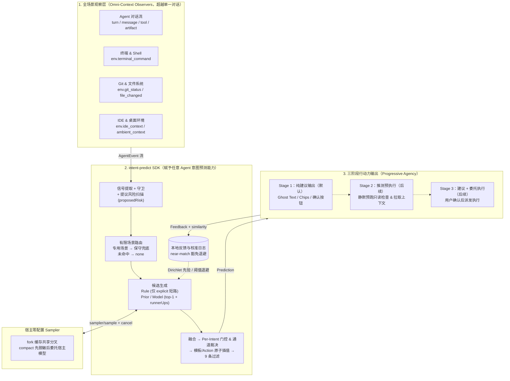

# intent-predict

**intent-predict** 是一个让**任意 Agent 成为全场景意图预测 Agent（Intent Predict Agent）**的通用 SDK。它的观察范围不局限于对话气泡，还可以感知终端命令、Git 工作区、文件变动、IDE 焦点与桌面/剪贴板环境；在识别出的有限场景里从一个封闭集合中预测用户下一步最可能的意图，并支持从「纯建议输出」渐进升级到「推测预执行」与「委托执行」。没有把握时就不给建议（fail-closed）。

> 当前状态：**施工级设计规范已完成（v0.3）**，已产出完整 JSON Schema 与内置编程场景包。
> - 设计文档：[docs/design.md](docs/design.md)
> - 形式化规范：[spec/](spec/)（`events`、`scenario-pack`、`prediction`、`feedback`、`rpc`）
> - 内置编程场景包：[packages/pack-coding/pack.json](packages/pack-coding/pack.json)
> - 调研笔记：[docs/prior-art.md](docs/prior-art.md)

## 一个例子

agent 改完代码（或用户在终端手动跑完命令）后，输入框里会出现灰色的建议文字「跑一下测试验证看看」，按 Tab 就能填入；若遇到确认或外部副作用意图（如创建 PR），则自动切换为显式的 Chips 或确认按钮。同时 SDK 会返回一份结构化结果：

```json
{
  "scenarioId": "coding.after_edit",
  "qualifiedIntentId": "builtin/coding@0.1.0/coding.after_edit#run_tests",
  "displayChannel": "ghost_text",
  "agencyStage": "suggest_only",
  "intent": { "id": "run_tests", "confidence": 0.82, "slots": {} },
  "text": "跑一下测试验证看看",
  "risk": "reversible"
}
```

宿主可以根据这份结果绑定确定性的动作，比如 `/review`、后台只读预备任务（Stage 2）或快捷按钮，不需要从文本里猜用户的意思。

## 架构与工作流程



## 和 Codex composer predictions 有什么不同

本项目借鉴了 OpenAI Codex 的 [composer predictions](docs/prior-art.md#1-openai-codexcomposer-predictions)，两者的主要区别如下：

| | Codex composer predictions | intent-predict |
|---|---|---|
| 预测什么 | 一句开放文本 | 场景内有限意图集合中的一项（或 `none`），附带槽位、置信度、文本和动作 |
| 能在哪里用 | 只能在 Codex 桌面版里用 | 任意 agent（首发适配 **Hermes Agent**），通过适配器或 JSON-RPC sidecar 接入 |
| 模型配置 | 绑定 Codex 自身后端 | **零配置优先**：通过 `Sampler` 直接复用宿主 Agent 已有的模型或缓存分叉 |
| 什么时候出现 | 策略未公开 | 显式门控：阈值、领先幅度、冷却、风险等级 |
| 怎么评估 | 看接受率 | 分类指标 + 接受率 + 校准 |

## 设计要点

- **零配置复用宿主模型**：不需要用户单独为 SDK 配 API Key。SDK 通过 `Sampler`（`fork` 缓存共享分叉或 `compact` 紧凑上下文委托）直接调用宿主 Agent 自己的模型。
- **数据流向**：宿主传入事件，SDK 返回预测，宿主再回传用户反馈。UI 和动作执行都由宿主负责。
- **四级接入与自动降级**：
  - L2（Fork Sampler）：宿主在缓存共享的分叉上采样（如 Hermes 同前缀分叉、Codex `thread/sample`）
  - L1（Host-Delegated）：宿主传入实时事件流，并委托宿主自身模型执行紧凑分类
  - L0（Simple Messages）：每轮结束时传入消息数组
  - L-Local（纯本地）：无模型时仅用本地规则（`RuleSource`）与转移先验（`PriorSource`）
- **宁缺毋滥**：识别不出场景就不预测，出现任何异常都不给建议（fail-closed，标准化 34 种 `SuppressedReason`）。
- **不自动发送**：从不自动发送消息，也从不自动执行有副作用的动作。
- **可评估与隐私安全**：内置脱敏管道、本地 Bigram Dice 相似度计算和离线回放评测。

## 计划中的包

| 包 | 作用 |
|---|---|
| `@intent-predict/core` | 事件和信号、谓词引擎、场景路由、候选来源、融合、门控、渲染、过滤、脱敏 |
| `@intent-predict/ui` | 不依赖 UI 框架的建议控制器状态机，提供 React 和 Ink 绑定 |
| `@intent-predict/sidecar` | JSON-RPC stdio 服务，支持 `sampler/sample` 反向调用，供 Python（如 Hermes）、Rust、Go 等宿主使用 |
| `@intent-predict/adapters/*` | 适配 **Hermes Agent（首发）**、Codex、ACP、Claude Agent SDK、OpenAI Agents、Vercel AI、LangGraph |
| `@intent-predict/pack-coding` | 内置的编程场景包（[`pack.json`](packages/pack-coding/pack.json)） |
| `@intent-predict/models` | 可选的独立模型客户端（当宿主不提供 Sampler 时的兜底） |

路线图见 [design.md §17](docs/design.md#17-路线图)。

## 许可证

[MIT](LICENSE)
