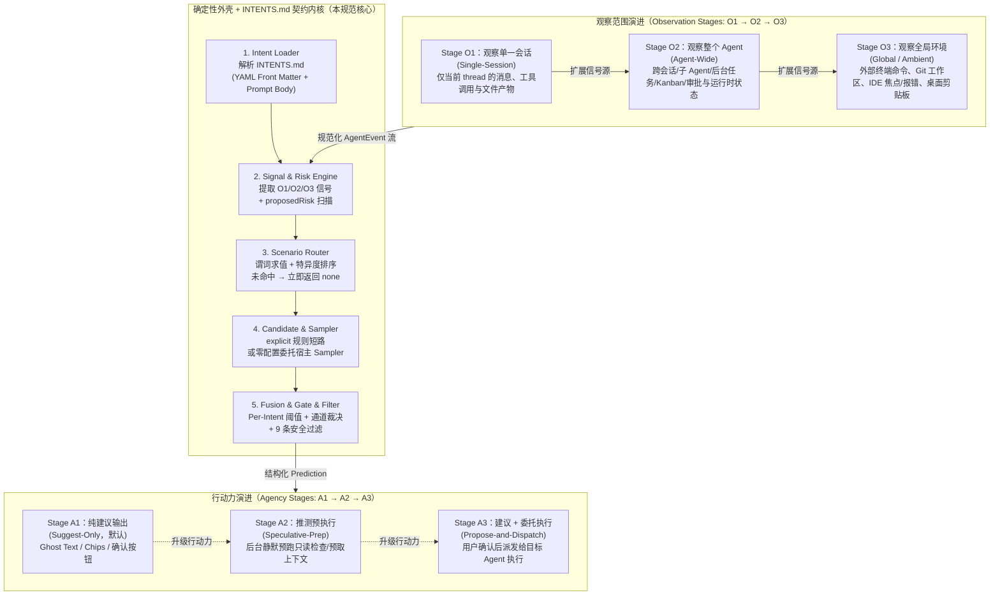

# Intent-Predict Specification (SPEC.md)

Status: Draft v1.0 (Language-Agnostic, Symphony-Style Implementation Contract)

Purpose: Define a deterministic-outer-shell + prompt-contract system that upgrades any host coding or general agent into an **Intent Predict Agent**, evolving across three observation stages (**O1 Single-Session → O2 Agent-Wide → O3 Global Environment**) and three agency stages (**A1 Suggest-Only → A2 Speculative-Prep → A3 Propose-and-Dispatch**).

> **Current implementation phase: Phase 1 (O1 × A1)** — see [ROADMAP.md](ROADMAP.md). Implementations claim conformance per phase. The O2/O3 (§2.2–§2.4) and A2/A3 (§3) material is forward-compatible specification: a Phase 1 implementation MUST accept-and-ignore `agent.*`/`env.*` events and MUST NOT execute `prepPlan` or dispatch actions, but is NOT required to implement those sections.

> **How to use this specification with a coding agent:**
>
> `"Implement intent-predict for <target host/language> according to https://github.com/susyimes/intent-predict/blob/main/SPEC.md and verify conformance against eval/golden.jsonl."`

---

## Normative Language

The key words `MUST`, `MUST NOT`, `REQUIRED`, `SHOULD`, `SHOULD NOT`, `RECOMMENDED`, `MAY`, and `OPTIONAL` in this document are to be interpreted as described in RFC 2119.

`Implementation-defined` means the behavior is part of the implementation contract, but this specification does not prescribe one universal policy. Implementations MUST document the selected behavior.

## Authority & Precedence

There is exactly one normative source per concern:

1. **Data shapes** (events, scenario packs, predictions, feedback, RPC envelopes): `spec/*.schema.json` (Draft 2020-12) govern. Cross-file `$ref`s MUST be resolved offline against the `spec/` directory (a schema's `$id` is a canonical identifier, not a URL to fetch).
2. **Behavior** (pipeline, gates, safety rules): this `SPEC.md` governs.
3. **Built-in coding pack content**: `INTENTS.md` is the source; `packages/pack-coding/pack.json` is a generated artifact (`tools/build_pack.py`) and MUST NOT be hand-edited.
4. `docs/design.md` is **non-normative**: it records rationale, examples, and host-integration notes. Where it disagrees with items 1–3, items 1–3 prevail.

Run `python tools/validate.py` to check that the documents above agree.

---

## 1. Problem Statement & Core Architecture

Open-ended next-message prediction (generating an arbitrary sentence after every turn) suffers from four structural problems: it cannot be offline-evaluated as classification, it cannot bind deterministic actions or per-intent risk policies, it is tightly coupled to a single host UI, and it wastes model calls when no meaningful next step exists.

`intent-predict` solves this by combining:

1. **Bounded Scenarios (`INTENTS.md`)**: Repository-versioned or bundled Markdown contracts with YAML front matter (declaring trigger predicates, a closed catalog of 3–15 intents + `none`, risk levels, slots, and gate overrides) and a Markdown prompt body (the classification instructions).
2. **Deterministic Safety Shell**: Strict signal extraction, proposed-action risk scanning (`proposedRisk`), per-intent gating, atomic slot/action interpolation, and a 9-rule post-filter pipeline that fails closed on any anomaly.
3. **Zero-Config Host Sampler Delegation**: Implementations reuse the host agent's own model connection (`fork` mode sharing the prompt cache prefix, or `compact` mode using the host's active/auxiliary model after SDK redaction).

### 1.1 Two Orthogonal Evolution Axes

Implementations MUST structure capabilities along two orthogonal 3-stage axes so hosts can adopt incrementally without re-architecting:



---

## 2. Three Observation Stages (O1 / O2 / O3)

An implementation MUST declare which Observation Stage(s) it supports (`["O1"]`, `["O1", "O2"]`, or `["O1", "O2", "O3"]`). Each stage is a strict superset of the previous stage's events and signals.

| Stage | Scope | Observed Events | Key Derived Signals | Typical Trigger |
|---|---|---|---|---|
| **Stage O1: Single-Session** (`single_session`) | Inside one conversation thread | `turn.started`, `message.user`, `message.agent`, `tool.call`, `tool.result`, `artifact`, `state`, `turn.completed` | `session.*`, `lastTurn.*`, `lastAgentMessage.*`, `user.locale`, `state.*` | `turn.completed` |
| **Stage O2: Agent-Wide** (`agent_wide`) | Across the host agent runtime (all sessions, subagents, background jobs, kanban/tasks) | All O1 events + `agent.subagent_completed`, `agent.background_job`, `agent.task_updated`, `agent.session_switched` | `agent.lastSubagent.{subagentId,status,summary}`, `agent.lastBackgroundJob.{jobId,command,status,exitCode,summary}`, `agent.pendingReviews`, `agent.openTasksCount` | `agent.subagent_completed`, `agent.background_job`, `agent.task_updated` |
| **Stage O3: Global Environment** (`global_ambient`) | Across the user's workstation (shell, git worktree, filesystem, IDE, window/clipboard) | All O1+O2 events + `env.terminal_command`, `env.git_status`, `env.file_changed`, `env.ide_context`, `env.ambient_context` | `env.lastTerminalCommand.*`, `env.git.*`, `env.ide.*`, `env.ambient.*` | Any O1/O2 trigger or debounced `env.*` event |

### 2.1 Stage O1 Requirements (Single-Session — Baseline REQUIRED)

Every conformant implementation MUST implement Stage O1:
- Track per-session turn count (`session.turnCount`), last accepted/edited intent (`session.lastIntent`), current turn tool calls/results, and file artifacts.
- Extract `lastAgentMessage.tail` (last 1,500 chars), `endsWithQuestion`, `options` (numbered lists `1..9`), `preferredOptionIndex`, `hints` (explicit `/slash` commands or `"type X"` prompts), and `proposedRisk`.
- Infer `user.locale` (`zh-CN` | `ja` | `ko` | `en`) from the user's last 3 messages.

### 2.2 Stage O2 Requirements (Agent-Wide — OPTIONAL)

When Stage O2 is enabled, the predictor observes the entire agent instance beyond a single chat tab:
- **Subagent & Delegation Tracking (`agent.subagent_completed`)**: When a background subagent or delegated task finishes, derive `agent.lastSubagent.{subagentId, status, summary}` (field names mirror the event in `spec/events.schema.json`) so scenarios can suggest reviewing or merging the subagent's findings.
- **Background Process Tracking (`agent.background_job`)**: When a background terminal job, build, or test watcher exits or emits a readiness match, derive `agent.lastBackgroundJob.{jobId, command, status, exitCode, summary}`.
- **Task / Kanban Board Tracking (`agent.task_updated`)**: `agent.pendingReviews` and `agent.openTasksCount` are **host-authoritative counts**: the SDK copies them from the event fields and MUST NOT count tasks itself. If an event omits a count, the corresponding signal keeps its previous value; before any count is reported the signal is absent (fail-closed, §5.2).

### 2.3 Stage O3 Requirements (Global Environment — OPTIONAL)

When Stage O3 is enabled, external lightweight observers (shell hooks, git watchers, IDE extensions, clipboard monitors) feed `env.*` events into the engine:
- Events arriving outside an active turn MUST be debounced (`envSettleMs`, default `300ms`) before evaluating scenarios whose `triggers` array includes the corresponding `env.*` event type.
- If a scenario is triggered by an `env.*` event while the agent is idle, `sourceTurnId` MUST be set to the latest completed turn ID (or `"env-0"` if no turn has occurred yet in the session).

### 2.4 Freshness, Consumption & Session Attribution (O2/O3)

"Latest-value" signals (`agent.last*`, `env.last*`, `env.ambient.*`) would otherwise match forever. Implementations MUST apply all three rules:

1. **Freshness window**: each O2/O3 latest-value signal carries its event timestamp `at`. A scenario `match`/`when` predicate that reads such a signal evaluates as missing once `now - at > signalTtlMs` (default `60000` ms). O1 turn-scoped signals are exempt (they reset every turn).
2. **Single consumption**: an O2/O3 trigger event is consumed by the first pipeline evaluation it triggers (whether the outcome is shown, suppressed, or aborted). The same event MUST NOT trigger again; a later `turn.completed` does not resurrect it (its signals may still be read while inside the freshness window if another trigger fires).
3. **Session attribution**: the delivery session is `event.sessionId` when present, else the session on whose observe channel the event arrived, else the host's active session. For O2 triggers, `sourceTurnId` follows the same rule as O3 (latest completed turn of the delivery session, else `"env-0"`). When `sourceTurnId === "env-0"`, `fork` sampling is impossible (no real turn to fork from): implementations MUST use `compact` mode or local rules only, and MUST NOT emit a `sampler/sample` with `expectedTurnId: "env-0"`. If an O2/O3 trigger arrives while a turn is running, it is queued and evaluated once when the agent becomes idle, subject to the freshness window.

---

## 3. Three Agency Stages (A1 / A2 / A3)

| Stage | Identifier | Behavior | Safety Invariant |
|---|---|---|---|
| **Stage A1: Suggest-Only** (`suggest_only`) | Default in v1 | Deliver structured `Prediction` (`text`, `intent`, `displayChannel`, `alternatives`, `action`) to host UI. Pressing `Tab` only fills the composer input. | **Never auto-sends a message; never auto-executes a tool.** |
| **Stage A2: Speculative Preparation** (`speculative_prep`) | Opt-in | While the suggestion is visible, the host MAY execute `prediction.prepPlan` in the background (strictly read-only tools or file prefetches). | **Zero side effects**: no file writes outside disposable memory, no network mutations, immediately aborted if user types something else. |
| **Stage A3: Propose & Dispatch** (`propose_and_dispatch`) | Opt-in | Renders an actionable intent card; once the user explicitly clicks or confirms the card, the host dispatches `prediction.action` to the target agent or tool runner. | **Human-in-the-loop required** on every dispatch; `side_effect` and `irreversible` intents NEVER trigger via single-keystroke `Tab`. |

---

## 4. Repository-Owned `INTENTS.md` Contract Format

Inspired by Symphony's `WORKFLOW.md`, scenario packs MAY be authored either as JSON (`packages/pack-coding/pack.json`, validated by `spec/scenario-pack.schema.json`) or as a self-contained Markdown file **`INTENTS.md`** (or `*.intents.md`) with YAML front matter and a Markdown prompt body.

### 4.1 `INTENTS.md` Structure

An `INTENTS.md` file consists of:
1. **YAML Front Matter** delimited by `---`. The front matter is a `ScenarioPack` exactly as defined by `spec/scenario-pack.schema.json`, written in YAML with the **same camelCase key names** (no renaming):
   - `id`: Pack identifier (e.g. `builtin/coding`).
   - `version`: SemVer string (e.g. `0.3.0`). Quote it (`version: "0.3.0"` is unnecessary but always safe from YAML number coercion).
   - `observationStages`: Stages this pack's scenarios may use (`[O1]`, `[O1, O2]`, or `[O1, O2, O3]`). A scenario's `stage` MUST be listed here; loading a pack whose `observationStages` exceed the implementation's declared stages is NOT an error — out-of-stage scenarios are skipped (§5.3 step 1).
   - `policy`: Optional pack-level `GatePolicy` overrides. Precedence: global policy < pack `policy` < origin-scenario `policy`.
   - `scenarios`: List of `ScenarioSpec` objects.
2. **Markdown Body**:
   - The prompt template and domain-specific classification rules sent to the model when `ModelSource` is invoked. It maps **verbatim** (only leading/trailing blank lines are stripped) to the schema field `promptTemplate`; Markdown markup such as backticks is sent as-is, so authors should write the body as literal prompt text.
   - Supported template syntax (Mustache subset): `{{scenario.id}}`, `{{scenario.stage}}`, `{{scenario.description}}`, `{{#each intents}}…{{id}}…{{description}}…{{#if slots}}{{slots_spec}}{{/if}}{{#if examples}}{{examples}}{{/if}}…{{/each}}`, `{{user.locale}}`, `{{signals_json}}`, and `{{#if compact}}{{transcript}}{{/if}}`. Unknown variables MUST render as empty strings and MUST NOT abort the prediction.
   - If the Markdown body is empty, the engine MUST use the default classification prompt defined in §5.5.

### 4.2 Trust Model for Repository-Owned Packs

A pack's `risk` labels and prompt body are **author claims, not proofs**. Loading a repository-owned `INTENTS.md` (e.g. discovered at a workspace root after `git clone`) requires explicit host/user opt-in per pack `id`; implementations MUST NOT silently auto-load them. Hosts SHOULD additionally apply a risk floor based on action type (e.g. an intent whose `action.type` is `tool` or `command` is treated as at least `reversible` regardless of the label). The deterministic shell (closed catalog, slot validation, filters, human-in-the-loop) always applies.

---

## 5. Deterministic Pipeline Specification

### 5.0 Signal Extraction (normative summary)

Implementations MUST derive at least these signals with these rules (`docs/design.md` §6.3 has the full rationale; on conflict this section governs):

- **Turn scope**: `session.turnCount` = completed turns so far; `session.lastIntent` = last accepted/edited intent id. `lastTurn.toolKinds`/`toolNames` are de-duplicated lists for the just-ended turn; when the host omits `tool.call.kind`, infer from the tool name with this table: `read_file|view|cat|head|tail`→`read`; `search_files|grep|rg|find|glob|web_search|session_search`→`search`; `patch|write_file|edit|apply_patch|notebook_edit`→`edit`; `remove_file|delete_file|rm`→`delete`; `terminal|bash|exec_command|execute_code|run_command`→`execute`; `web_extract|fetch|curl|browser_exec`→`fetch`; `clarify|ask_user|request_user_input`→`ask_user`; anything else→`other`.
- **File changes**: `lastTurn.filesChanged` counts de-duplicated `artifact` file refs this turn; if the host emits no artifacts, count successful (`status === 'ok'`) `edit`/`delete` tool calls. `lastTurn.changedPaths` lists the paths (`slot.from` may index it as `lastTurn.changedPaths.0`). `lastTurn.failedExecs` counts `execute` calls with `status === 'error'` or a non-zero `exitCode`.
- **Agent tail**: `lastAgentMessage.tail` = last 1,500 chars of the final agent message; `.length` = full length. `endsWithQuestion` is true when the last non-empty, non-code-block line, after trimming trailing quotes/brackets, ends with `?`/`？` or matches `/(?:吗|呢|好吗|可以吗|对吗|是吗|如何|怎样|哪一个|哪个)\s*[。！!.]?$/u`.
- **Numbered options**: scan trailing consecutive non-code lines matching `/^\s*(?:(\d{1,2})[.)、]|[(（](\d{1,2})[)）])\s+(.+)$/u`; valid only if numbering starts at 1, is consecutive, and totals 2–9. `preferredOptionIndex` is the 1-based index of an option containing `(Recommended)`/`（推荐）`, else 1.
- **Hints** (last 5 non-code lines): slash commands `` /[a-z][a-z0-9_-]{1,30} `` in backticks/quotes or at line start (single `/` only, paths excluded); and type-literals `/(?:type|run|enter|reply with|输入|发送|回复)\s+["'「『]([^"'」』\n]{1,40})["'」』]/iu`.
- **proposedRisk**: §5.4 step 1.
- **Locale**: from the user's last ≤3 messages (code blocks and URLs stripped): kana >5%→`ja`; Hangul >5%→`ko`; CJK ideographs ≥10% (or ≥2 CJK chars with <5 Latin words)→`zh-CN`; else `en`.
- **O2/O3 signals**: copied from the corresponding events (field names in §2), subject to §2.4 freshness. `state.<key>` passes host state through verbatim.

### 5.1 Guards (`SuppressedReason`)

Before evaluating any scenario, the engine MUST check the following guards in order. If any guard trips, the engine MUST immediately return `{ type: "completed", prediction: null, suppressedReason }` without calling any model:

1. Predictor disabled → `disabled`
2. Host `interactive === false` → `non_interactive`
3. `state.pendingApproval === true` or `state.pendingInput === true` or last tool kind was `ask_user` → `pending_interaction`
4. `lastTurn.status === "interrupted"` → `interrupted_turn`
5. `lastTurn.status === "failed"` and no loaded scenario declares `"failed"` in `triggerOnTurnStatuses` → `failed_turn_unhandled`
6. `session.turnCount < minTurns` (default `1` for `turn.completed` triggers; `0` for O3 `env.*` triggers) → `min_turns_not_met`
7. `state["composer.dirty"] === true` → `composer_dirty`
8. `state.mode` is in `blockedModes` (default `["plan"]`) → `mode_blocked`
9. `state.incognito === true` → `incognito`

*(Note: Model budget exhaustion is checked at §5.4 after `RuleSource`, not here, so zero-cost `explicit` rules still work when model budget is exhausted. For O2/O3 cold-start triggers with no completed turn yet (`sourceTurnId === "env-0"`, §2.4), guards 4–5 are skipped because there is no `lastTurn`.)*

### 5.2 Signal Predicate Evaluation & Specificity

1. **Missing Signals (Fail-Closed)**: When `signal` resolves to `undefined` or `null`:
   - `{ exists: false }` evaluates to `true`.
   - `{ exists: true }` evaluates to `false`.
   - `{ ne: x }` (where `x !== null`) evaluates to `false` (a missing signal MUST NOT pass a `ne` check unless paired with `exists: false`).
   - All other operators (`eq`, `gt`, `gte`, `lt`, `lte`, `in`, `contains`, `matches`) evaluate to `false`.
2. **Specificity Score `specificity(pred)`**:
   - Evaluates to `0` if the predicate returns `false`.
   - Matched leaf predicate: `1.0`.
   - `{ all: [...] }`: sum of children's specificity scores.
   - `{ any: [...] }`: maximum of matched children's specificity scores.
   - `{ not: child }`: `0.5`.

### 5.3 Scenario Routing & Origin-Scoped Merging

1. **Stage gate**: drop scenarios whose `stage` (default `O1`) is not declared by the implementation (§2) or not listed in their pack's `observationStages`. Then filter scenarios whose `triggers` include the triggering event type and whose `match` predicate evaluates to `true` (O2/O3 latest-value signals already expire under §2.4).
2. Sort matched scenarios descending by:
   1. `scenario.priority ?? 0`
   2. `specificity(scenario.match)`
   3. Declaration order
3. **Hard Boundary**: If zero scenarios match, return `suppressedReason: "no_scenario_matched"` immediately. MUST NOT call the model.
4. **Slope Fallback Exclusion**: If at least one matched scenario has `priority >= 10`, exclude any fallback scenario with `priority <= 1` from the merge set.
5. Take the top `k = 2` scenarios. Collect their intents (filtering out `enabledByDefault === false` and intents whose `when` predicate evaluates to `false`), deduplicating by `intent.id` (keeping the higher-priority scenario's definition) and capping at 15 intents.
6. **Origin Policy & Qualified ID Binding**: Every candidate intent retains its `originScenario` reference. When an intent wins, `prediction.scenarioId`, `prediction.qualifiedIntentId` (`<packId>@<packVersion>/<originScenarioId>#<intentId>`), and the active `GatePolicy` overrides MUST come from that intent's `originScenario`.

### 5.4 Candidate Generation & Short-Circuit Rules

1. **Proposed-Action Risk Scanner (`lastAgentMessage.proposedRisk`)**:
   - Scan `lastAgentMessage.tail`:
     - Matches destructive patterns (`rm -rf`, `git push --force`, `git reset --hard`, `git clean -f`, `DROP TABLE/DATABASE`, `TRUNCATE TABLE`, `DELETE FROM`, `kubectl delete`, `terraform destroy`, or CJK equivalents `删库|强制推送|清空数据|不可恢复|永久删除`) → `'irreversible'`.
     - Matches external side-effect patterns (`git push`, `gh pr create/merge`, `npm/cargo publish`, `deploy`, `kubectl/terraform apply`, `docker push`, or CJK equivalents `推送到远端|推到生产|发布到|部署到|合并 PR|发送邮件`) → `'side_effect'`.
     - Otherwise → `'reversible'`.
   - For any intent with `dynamicRiskFromProposedAction: true` (such as `confirm` and `choose_option`), its runtime effective risk is:
     $$\text{effectiveRisk} = \max(\text{intent.risk}, \text{lastAgentMessage.proposedRisk})$$
2. **`RuleSource`**:
   - **Explicit Hints (`explicit: true`)**: If `lastAgentMessage.hints` contains a slash command matching `intent.action.command` or `intent.examples`, or a `"type X"` literal matching `intent.examples`, emit `{ intentId, score: 0.92, explicit: true }`.
   - **Structural Bonuses (`explicit: false`)**: If `optionsCount > 1`, prefill `choose_option.slots.index = preferredOptionIndex` and set bonus $b_{\text{rule}} = 0.20$; if `endsWithQuestion === true`, set bonus $b_{\text{rule}}(\text{confirm}) = 0.15$.
3. **Short-Circuit Invariant**:
   - If `RuleSource` emits an `explicit: true` candidate whose `effectiveRisk` is in `{'none', 'read_only', 'reversible'}` and whose required slots are all resolved deterministically, the engine MUST short-circuit and skip `ModelSource`.
   - Otherwise, if model budget is exhausted (`budget_exhausted_no_explicit_rule`) or no `Sampler`/`ModelClient` is configured (`no_rule_hit_in_local_mode`), return `prediction: null` immediately.

### 5.5 Default Model Prompt & Output Contract

When `ModelSource` runs, it sends the prompt from `INTENTS.md` (or the default below) via `Sampler.sample`:

```text
[INTENT PREDICTION — do not continue the task. Do not call tools.]
Predict the user's NEXT message in this session, choosing from a fixed catalog.

Scenario: {{scenario.description}}
Catalog (pick from these ids):
{{#each intents}}- {{id}}: {{description}}{{#if slots}} (slots: {{slots_spec}}){{/if}}{{#if examples}} e.g. {{examples}}{{/if}}
{{/each}}- none: nothing above fits, or you are not confident.

Rules:
1. Predict what THE USER would type next, not what you think they should do.
   THE TEST: Would the user think "I was just about to type that"?
2. Read the last few lines of the assistant's message carefully: if it explicitly
   offers a next step (a slash command, a direct question, or numbered options),
   prefer the matching intent. If the assistant asks to confirm a destructive or
   external side-effect action, return "none".
3. Prefer "none" over a guess. A wrong suggestion costs more than no suggestion.
4. "text" is what the user would type in locale "{{user.locale}}": one short
   sentence matching the user's tone, no quotes, no markdown, never in the
   assistant's voice. Leave "text" empty if intent is "none".
5. Fill "slots" ONLY with values that literally appear in the conversation.
6. Optionally list up to 2 plausible runner-up intents in "runnerUps" with their
   probabilities; keep confidence + sum(runnerUps) <= 1.

{{#if compact}}Recent conversation (oldest first):
{{transcript}}
{{/if}}Signals: {{signals_json}}

Reply with a single JSON object only:
{"intent":"<id>","confidence":0.0,"slots":{},"text":"","runnerUps":[{"intent":"<id2>","confidence":0.0}]}
```

#### 5.5.1 Prompt size budgets & overflow behavior

- `fork` mode: the appended prompt MUST be ≤ 4,000 bytes in UTF-8 (CJK text costs 3 bytes/char; measure bytes, not characters). Capping the merged catalog at 15 intents (§5.3 step 5) does **not** by itself guarantee this. If the rendered prompt exceeds the budget, shrink it in this exact order, re-measuring after each step: (1) drop per-intent `examples`; (2) drop `runnerUps` from the reply contract line; (3) drop trailing catalog intents in merge order until it fits, keeping at least the top-5. If it still does not fit, return `suppressedReason: "invalid_model_output"` without calling the model.
- `compact` mode: the whole prompt MUST be ≤ 8,000 characters.

#### 5.5.2 Compact transcript construction

When `{{#if compact}}` applies, build `{{transcript}}` deterministically:
1. Take the last 3 completed turns, oldest first. Redact first (§6), truncate second.
2. User lines: first 500 chars (overflow → `…`). Tool lines: one line each, `<name>(<keyArg>) -> <status>[ exit=<code>]: <summary>`, ≤ 200 chars; if a turn has >6 tool calls keep the first 2 and last 4, preferring errored ones. Assistant final message: **last** 1,500 chars (overflow prefixed with `…`). Thinking/reasoning blocks and raw `tool.result.output` MUST be excluded.
3. If the total prompt still exceeds §5.5.1, drop whole turns starting from the oldest.

#### 5.5.3 Output parsing

`text === null`/empty → `invalid_model_output`. One enclosing ` ```json ` fence MAY be stripped, then `JSON.parse` (no regex salvage of partial JSON). Validate: `intent` ∈ catalog ∪ `{"none"}` (else `unknown_intent`); `confidence` finite in [0,1] (else `invalid_model_output`); `slots`, when present, a plain object; `runnerUps`, when present, an array whose first ≤2 valid items (intent in catalog, ≠ main intent, confidence in [0,1]) are kept and invalid items ignored.

### 5.6 Fusion, Gating, Channel Resolution & 9-Rule Filter

1. **Model `none` Veto**: If `ModelSource` returns `intent === "none"`, the engine MUST immediately return `suppressedReason: "model_none"`. Non-explicit structural bonuses MUST NOT override a model `none`.
2. **Log-Linear Fusion** (all constants below are *defaults pending calibration* on replay data; implementations MAY tune them and MUST document deviations. A conforming implementation MAY instead use the **baseline profile** — `final(i) = P_model(i)` with gates applied to the raw model confidence — which is easier to attribute before calibration data exists):
   - Given model top-1 $(i_1, c_1)$ and optional `runnerUps` $(i_2, c_2), (i_3, c_3)$, let $S = \min(0.98, c_1 + c_2 + c_3)$, $P_{\text{model}}(\text{none}) = \max(1 - c_1, 1 - S)$, and $\epsilon_0 = 0.02 / m$ for unlisted intents.
   - $P_{\text{prior}}$ is defined over catalog ∪ `{none}`: `none` takes fixed mass 0.25 and the pack's per-intent `prior` values (which sum to 1 over the catalog) are rescaled by 0.75. Intents without a declared `prior` share the rescaled mass uniformly.
   - Compute $\tilde{S}(i) = (P_{\text{model}}(i) + 0.15 \cdot b_{\text{rule}}(i))^{\alpha} \cdot P_{\text{prior}}(i)^{1 - \alpha}$ with $\alpha = 0.85$, normalized over $\mathcal{I} = \text{catalog} \cup \{\text{none}\}$.
   - Compute `alternatives` (up to 2 items) using $\text{altScore}(j) = 0.65 \cdot P_{\text{model}}(j) + 0.35 \cdot P_{\text{prior}}(j) + 0.15 \cdot b_{\text{rule}}(j) \ge 0.18$.
3. **Gate Thresholds & Channel Resolution**:
   - Check `model_none` ($\text{final}(\text{none}) \ge \text{final}(i_{(1)})$), `max_per_session_reached`, `in_cooldown` (3 turns after `Esc` dismiss on `qualifiedIntentId`), `below_min_confidence` (default `0.60` + `backoffDelta`), `below_risk_confidence` (`none: 0.55`, `read_only: 0.60`, `reversible: 0.65`, `side_effect: 0.80`, `irreversible: 0.95`), and `below_min_margin` (default `0.15`).
   - `ghostTextRisks` defaults to `['none', 'read_only', 'reversible']`. Intents with `effectiveRisk === 'side_effect'` or `confirm`/`choose_option` (`allowedChannels: ['chips', 'action_button']`) MUST NOT be delivered as `ghost_text`.
4. **Atomic Slot & Action Interpolation**:
   - Resolve slots in order: `slot.from` signal path → model `slots[k]` (must literally appear in recent conversation for `string`/`path`) → `slot.default`.
   - Validate `required`, `type`, `enum`, `maxLength`, `pattern`, and path traversal/metacharacter bans.
   - Interpolate `{slotName}` placeholders in both `render` templates and `action` payloads (`args`, `input`, `payload`). Any unresolved placeholder aborts the entire prediction with `slot_validation_failed`.
5. **9-Rule Post-Filter Pipeline**: every rendered `text` (template- or model-produced) MUST pass all of these, in order; the first failing rule is the `suppressedReason`:
   1. `filter_empty_or_meta`: trimmed text is empty, or matches `/^(?:none|null|n\/a|nothing|无|没有建议|无需回复|\(.*\)|\[.*\]|<.*>)$/iu`.
   2. `filter_label_prefix`: matches `/^(?:suggestion|next\s*step|user|prompt|reply|建议|下一步|用户输入|回复)\s*[:：]/iu`.
   3. `filter_ai_voice`: matches `/^(?:I\s+will|I'll|Let\s+me|Here\s+is|Here's|Sure[,!]|Certainly|我来|我将|让我|好的，我|当然，|需要我帮你)/iu`.
   4. `filter_evaluative`: when `intent.id !== 'acknowledge'`, matches `/^(?:thanks|thank\s+you|looks\s+good|lgtm|great|awesome|nice\s+work|谢谢|多谢|太好了|不错|辛苦了)[.!！。]?$/iu`. (`acknowledge` is a reserved intent-id convention: packs MAY define such an intent for pure acknowledgements.)
   5. `filter_multiple_sentences`: after stripping trailing terminal punctuation, the text still contains `/(?:[。！？!?]|\.\s+[A-Z])/` (dots inside paths/versions such as `v0.1`/`a.ts` do not count).
   6. `filter_formatting`: contains `\r`/`\n`, a code fence, a Markdown heading `/^#+\s/`, or a list prefix `/^[-*]\s/`.
   7. `filter_length`: >100 chars overall; with CJK chars (`[\u4e00-\u9fff\u3040-\u30ff\uac00-\ud7af]`) the effective length must be 2–30; pure Latin text must be 1–12 words (a single `/command` counts as 1).
   8. `filter_error_text`: matches `/(?:API\s+error|rate\s+limit|status\s+code\s+\d{3}|ECONNREFUSED|ETIMEDOUT|UnhandledPromiseRejection|Traceback\s+\(most\s+recent)/iu`.
   9. `filter_dangerous`: matches `/(?:\brm\s+-[rRf]+\b|\bgit\s+push[^\n]*--force\b|\bgit\s+reset\s+--hard\b|\bdrop\s+(?:table|database)\b|\bformat\s+[a-z]:|\bchmod\s+777\b|\bcurl\b[^\n]*\|\s*(?:sh|bash)\b)/iu` unless the intent is on a host allowlist.
   These regexes are one layer of defense-in-depth (§6), not a proof of safety; they MUST be applied with bounded execution (patterns from packs, including `slot.pattern`, are limited to 256 chars and SHOULD be evaluated by a non-backtracking engine or with a match timeout).

---

## 6. Privacy & Full-Duplex RPC Invariants

1. **Split Privacy Guarantee**:
   - **Fork Mode (`mode: 'fork'`)**: Shares the host session's exact prompt prefix to hit Prompt Cache; historical message redaction is governed by the host session's own boundary, while SDK redacts the appended prompt and `signals_json`.
   - **Compact Mode (`mode: 'compact'`)**: SDK MUST run the full redaction pipeline (PEM keys, cloud/AI API keys, Bearer tokens, URL credentials, secret assignments, and optional strict PII) on all transcript and signal strings before invoking the model.
2. **Full-Duplex Sidecar Multiplexing**:
   - Host-to-SDK requests use integer or `"h-*"` IDs; SDK-to-host reverse `sampler/sample` requests use `"s-*"` IDs.
   - At most 1 in-flight prediction and 1 in-flight `sampler/sample` per session.
   - On `turn.started`, `message.user`, `state(composer.dirty=true)`, `prediction/cancel`, or 4s timeout, SDK MUST immediately emit `sampler/cancel` (`{ sampleRequestId, sessionId }`) and `prediction/updated` (`prediction: null`).
   - Capability negotiation happens in `initialize`: `capabilities.samplerModes` (subset of `["fork", "compact"]`; empty = no sampler) and `capabilities.displayChannels` (channels the host can render). `displayChannel` is decided **only** by the core gate (§5.6 step 3) intersected with these host channels; UI layers MUST NOT re-decide it from margin or confidence.
3. **`signals_json` Content (allowlist, both modes)**: only these redacted scalars may appear — `session.turnCount`, `lastTurn.{status,toolKinds,failedTools,failedExecs,filesChanged}`, `lastAgentMessage.{endsWithQuestion,optionsCount,proposedRisk}`, `user.locale`, and (when fresh per §2.4) `agent.lastSubagent.status`, `agent.lastBackgroundJob.{status,exitCode}`, `agent.{pendingReviews,openTasksCount}`, `env.lastTerminalCommand.exitCode`, `env.git.{branch,dirtyCount,hasConflicts}`, `env.ide.{activeFile,diagnosticsErrors}`, `env.ambient.clipboardKind`. Free text such as terminal command lines, summaries, and clipboard previews MUST NOT be included in `signals_json` (summaries may appear, redacted and truncated, only inside the compact `transcript`). `signals_json` MUST be ≤ 1,000 chars. Each O3 observer class (terminal, git, filesystem, IDE, clipboard/window) MUST be individually disable-able by the user; disabled observers emit no events and no signals.
4. **Runtime bounds (implementation-defined, MUST document)**: retained events per session (RECOMMENDED default: last 50 turns or 500 events, whichever is smaller); a single `tool.result.output` value retained for `slot.from` MUST be capped (RECOMMENDED 64 KiB serialized; larger values behave as absent). Duplicate `turn.completed` for an already-recorded `turnId` MUST NOT re-trigger. Cooldown/backoff state is in-memory per session by default; persistence across restarts is implementation-defined. The model budget is counted in **ModelSource calls per rolling hour** (`modelBudget.maxCallsPerHour`, default unlimited); exhaustion only skips `ModelSource` (§5.4). `PredictionResult` type `failed` is reserved for internal engine errors (exceptions, unloadable pack); every expected non-delivery is `completed` with `prediction: null` and a `suppressedReason`.
5. **Feedback similarity**: `similarity` is the character-bigram Dice coefficient over whitespace-normalized texts, **except** that when one normalized text contains the other as a substring, similarity is 1.0 for near-match purposes (a truncated version of the suggestion is the same intent, e.g. Dice("跑一下测试验证看看", "跑一下测试") ≈ 0.67 would otherwise fall below the default 0.75 near-match threshold). Online learning keys (cooldown, backoff, priors) use the unversioned `<packId>/<scenarioId>#<intentId>` form; the versioned `qualifiedIntentId` is telemetry-only.

---

## 7. Conformance Verification

An implementation is conformant at observation stage O*n* if:
1. All emitted payloads validate against `spec/*.schema.json` (Draft 2020-12), resolved offline (see Authority & Precedence).
2. It loads `INTENTS.md` (equivalently `packages/pack-coding/pack.json`) and passes every `eval/golden.jsonl` case whose `config.observationStages` are within its declared stages. For **Phase 1 (O1 × A1)** that subset is 17 of the 20 current cases — all except `o2-subagent-fresh`, `o2-subagent-stale`, and `o3-env-cold-start` (the `o1-only-stage-gate` case is required: it proves out-of-phase events are ignored).
3. Repository-level consistency passes: `python tools/validate.py`.

**`eval/golden.jsonl` format** — one JSON object per line, deterministic (no live model):

- Pipeline case: `{"id", "kind": "pipeline", "now"?: epochMs, "config"?: {"observationStages"?: ["O1","O2","O3"], "sampler"?: "none"}, "sessionId"?, "events": [AgentEvent…], "state"?: {<key>: <value>}, "expect": {…}}`. `state` entries are applied as `state` events just before the final triggering event. `now` (default: last event's `at`, else 0) drives §2.4 freshness. With `"sampler": "none"` the pipeline runs rules only (L-Local): only explicit-rule short-circuits may produce a prediction.
- `expect` asserts a subset: `{"type": "completed", "prediction": null, "suppressedReason": "<reason>"}` for suppressions; `{"intentId", "scenarioId", "displayChannel", "sources"}` (any subset) for predictions; or `{"scenarioId", "catalogIncludes": […], "catalogExcludes": […]}` for routing/catalog assertions (after §5.3 merging and `when` filtering, before model calls).
- Filter case: `{"id", "kind": "filter", "text": "…", "intentId"?: "…", "expect": {"pass": true} | {"suppressedReason": "filter_…"}}` — exercises §5.6 step 5 in isolation.
