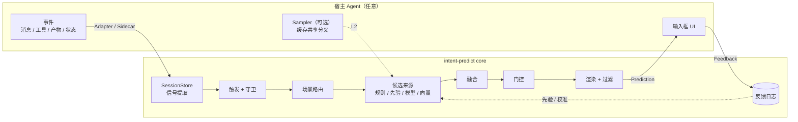
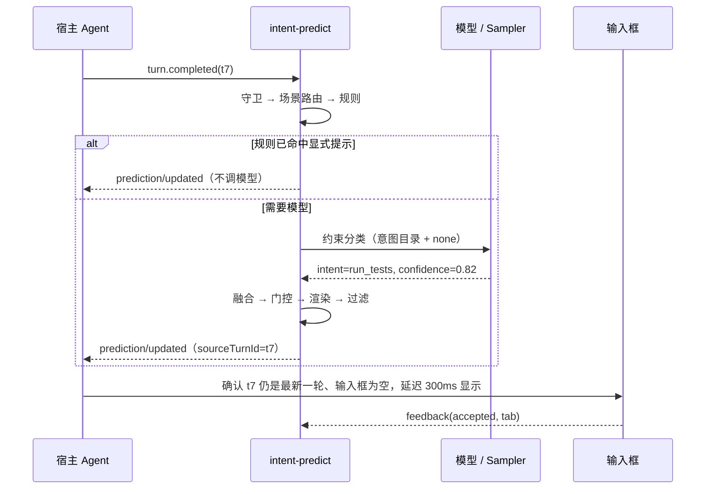

# intent-predict 设计文档

> 一个**有限场景意图预测** SDK，可接入任意 Agent。它借鉴 OpenAI Codex 的 composer predictions，但不预测任意一句话，只在识别出的场景里，从一个有限集合中预测用户的下一步意图。SDK 不依赖具体宿主。

| 项 | 内容 |
|---|---|
| 状态 | 草案 v0.1，处于设计阶段，还没有实现 |
| 日期 | 2026-11-09 |
| 调研依据 | [prior-art.md](prior-art.md)：Codex composer predictions 的开源后端、Qwen Code 的 NES 和推测执行、其他开源插件 |

## 目录

1. [背景](#1-背景)
2. [目标与非目标](#2-目标与非目标)
3. [核心思路：有限场景](#3-核心思路有限场景)
4. [概念与术语](#4-概念与术语)
5. [总体架构](#5-总体架构)
6. [数据模型](#6-数据模型)
7. [预测流水线](#7-预测流水线)
8. [接入：对任意 agent 通用](#8-接入对任意-agent-通用)
9. [Sidecar 协议](#9-sidecar-协议json-rpc-20)
10. [UI 交互规范](#10-ui-交互规范)
11. [安全与隐私](#11-安全与隐私)
12. [性能与成本预算](#12-性能与成本预算)
13. [评估](#13-评估)
14. [场景包示例](#14-场景包示例)
15. [包结构](#15-包结构)
16. [关键决策](#16-关键决策)
17. [路线图](#17-路线图)
18. [开放问题](#18-开放问题)

---

## 1. 背景

2026 年 10 月，OpenAI 在 Codex 桌面版以 beta 形式推出了 composer predictions。每轮回复结束后，输入框里可能出现一条预测，内容是用户接下来大概会发的话。按 Tab 可以接受，接受后还能编辑，不会自动发送。

这个功能分成两层（详见 [prior-art.md §1](prior-art.md#1-openai-codexcomposer-predictions)）：

- **后端是开源的**。codex-rs app-server 有一个实验接口 `thread/sample`。它在当前会话上开一个**临时分叉**，原样继承配置、工具和历史，目的是命中 prompt cache。然后追加一段 prompt，只取**一次**模型回复。如果模型试图调用工具，这次结果作废，返回 null。
- **产品层是闭源的**。预测用的 prompt、什么时候显示、UI 怎么交互，都写在桌面客户端里。开源 TUI 收到 `thread/prediction/updated` 通知后什么也不做。

开源实现里最完整的是 Qwen Code 的 Next-step Suggestion（NES），包括：
- 缓存共享分叉
- 12 条过滤规则
- 十几项守卫条件
- 不依赖 UI 框架的控制器
- 遥测
- 可选的推测执行

Qwen 的 Web Shell 里还有一个更接近"意图"的设计。它对用户正在输入的草稿做保守的封闭集合分类，输出 `btw | new_session | none` 外加置信度，再据此决定是否给出动作。

这些实现都绑定在各自的宿主里。除了 Qwen Web Shell 的分类器，它们预测的都是**开放文本**。对一个通用 SDK 来说，开放文本有四个问题：

1. **难评估**：只有接受率这一个指标，很难做离线回归。
2. **难控制**：文本上挂不了确定性动作，也没法给不同意图设不同的风险策略。
3. **难移植**：效果依赖宿主的分叉、缓存管线和 UI。
4. **成本高**：每轮都要让大模型生成一次。

## 2. 目标与非目标

### 目标

- **G1 不依赖宿主**：任何语言、任何框架都能接入，CLI、IDE、Web 形态的 agent 都行。最简单的接入方式（L0）只要求在每轮结束时传入一份消息数组。
- **G2 有限场景意图预测**：集成方声明场景和每个场景的有限意图集。输出是结构化的"意图 id + 槽位 + 置信度"，另附一句能直接填进输入框的文本。
- **G3 宁缺毋滥**：默认输出 `none`。出现任何异常时都不给建议（fail-closed）。第一指标是展示精度（precision@shown）。
- **G4 低延迟、低成本**：宿主支持分叉时，复用它的 prompt cache。过期的结果一律不展示。
- **G5 人在回路**：不自动发送消息，也不自动执行有副作用的动作。
- **G6 可度量**：反馈事件和离线回放评测是内置能力。
- **G7 隐私优先**：默认只使用当前会话的上下文，提供脱敏钩子，也支持完全本地运行。

### 非目标（v1）

- 开放域的整句预测（即 Codex 的做法）只作为可选的 `freeform` 意图提供，**默认关闭**。
- 不做边打字边补全。打字过程中的意图路由放到 M3（见 §17）。
- SDK 不是 agent 框架，不负责执行意图。它只给出动作描述，执行由宿主完成。
- 不做跨会话记忆和用户画像。唯一的例外是可选、只存在本地的意图转移先验。

## 3. 核心思路：有限场景

> **有限场景（bounded scenario）**：能从信号中识别出来的一种情境。在这种情境下，用户下一步想做的事可以列举成一个小的封闭集合（建议 3 到 15 个意图），外加一个 `none`。

举个例子：agent 刚改完代码、还没跑测试。这时用户的下一句话大多属于以下几类：跑测试、看 diff、提交、让它解释改动、继续下一步。

这样设计有以下好处：

| 好处 | 原因 |
|---|---|
| 准 | 候选集小，可以叠加规则和先验。没把握时输出 `none` |
| 可测 | 问题变成了分类，可以算 top-1/top-3 准确率、校准误差和覆盖率-精度曲线 |
| 可控 | 每个意图可以单独设置风险等级、阈值、冷却时间和动作 |
| 便宜 | 规则、先验、向量近邻都能在本地跑，常见情况不需要调用模型 |
| 可移植 | 场景包是数据（JSON/YAML），可以跨语言、跨宿主复用 |
| 可执行 | 意图可以绑定确定性动作，例如 `/review`，不必从文本里猜 |

与 Codex 的对比：

| | Codex composer predictions | intent-predict |
|---|---|---|
| 输出 | 一句自由文本 | 意图 id、槽位、置信度、文本，以及可选的动作 |
| 范围 | 开放 | 场景内的有限集合，加上 `none` |
| 生成方式 | 主模型在缓存共享的分叉上生成 | 融合规则、先验和模型的约束分类。分叉是可选项 |
| 何时展示 | 不保证每轮都有，策略没有公开 | 由门控显式决定：阈值、分差、冷却、风险等级 |
| 宿主 | 只有 Codex 桌面版（本地和 SSH 线程） | 任意 agent，通过适配器或 sidecar 接入 |
| 评估 | 接受率 | 分类指标、接受率、校准误差 |

## 4. 概念与术语

| 术语 | 含义 |
|---|---|
| Session | 一次 agent 会话，相当于 thread |
| Turn | 一轮：用户输入，agent 工作，agent 给出最终回复 |
| Event | 宿主上报的规范化事件，包括消息、工具调用和结果、产物、状态 |
| Signal | 从事件中派生的特征，例如"本轮改了几个文件"、"最后一条消息是不是以问句结尾" |
| Scenario | 由信号识别出的有限场景，带有一个意图目录 |
| Intent | 意图目录中的一项，包含 id、描述、样例、槽位、渲染模板、风险等级、动作 |
| Scenario Pack | 可以分发的一组场景，格式为 JSON、YAML 或 TS，带版本号 |
| Prediction | 针对某个 source turn 的预测结果：首选意图（或 none）、备选意图、文本、动作 |
| Feedback | 预测展示之后用户的处理结果：接受、编辑、忽略、关闭、过期 |
| Sampler | 宿主可以选择提供的能力：在会话的缓存共享分叉上调用一次模型，类似 Codex 的 `thread/sample` |

## 5. 总体架构



数据流程是：宿主送入事件，SDK 返回预测，宿主再把用户反馈传回来。UI 渲染和动作执行都由宿主负责。`@intent-predict/ui` 只是一个可选的参考实现。

一次典型的预测：



## 6. 数据模型

下面用 TypeScript 写出权威定义。`spec/` 目录里会生成同构的 JSON Schema，供其他语言使用。

### 6.1 事件（宿主 → SDK）

```ts
/** 宿主上报的规范化事件。字段尽量精简，SDK 忽略未知字段。 */
export type AgentEvent =
  | { type: 'turn.started'; turnId: string; at: number }
  | { type: 'message.user'; turnId: string; text: string; hasAttachments?: boolean }
  | { type: 'message.agent'; turnId: string; text: string; final?: boolean }
  | { type: 'tool.call'; turnId: string; callId: string; name: string; kind?: ToolKind; input?: unknown }
  | {
      type: 'tool.result'; turnId: string; callId: string;
      status: 'ok' | 'error' | 'denied';
      exitCode?: number;
      summary?: string;   // 一行摘要，可能进入模型上下文
      output?: unknown;   // 结构化输出，可选。只供 slot.from 读取，默认不发给模型
    }
  | { type: 'artifact'; turnId: string; kind: 'file_changed' | 'file_created' | 'file_deleted' | 'link' | 'other'; ref: string }
  | { type: 'state'; key: string; value: unknown }  // 例如 mode=plan、pendingApproval=true、composer.dirty=true
  | { type: 'turn.completed'; turnId: string; status: 'completed' | 'failed' | 'interrupted'; at: number };

/** 可以直接从 ACP 的 tool kind 映射过来 */
export type ToolKind = 'read' | 'search' | 'edit' | 'delete' | 'execute' | 'fetch' | 'ask_user' | 'other';

/** L0 接入时的最小输入 */
export interface SimpleMessage {
  role: 'user' | 'assistant' | 'tool';
  content: string;
  toolName?: string;
  isError?: boolean;
}
```

### 6.2 场景与意图（由集成方定义，可以序列化）

```ts
export interface ScenarioPack {
  id: string;                    // 'builtin/coding'
  version: string;               // semver。遥测数据按 packId@version/intentId 归档
  scenarios: ScenarioSpec[];
}

export interface ScenarioSpec {
  id: string;                    // 'coding.after_edit'
  description: string;           // 给模型看的一句话说明
  match: SignalPredicate;        // 可序列化的谓词。TS 包也能传函数，但函数无法跨语言使用
  priority?: number;             // 多个场景同时命中时，按此排序
  intents: IntentSpec[];         // 有限集合，建议 3 到 15 个。none 由 SDK 自动加入
  policy?: Partial<GatePolicy>;  // 覆盖全局门控策略
}

export interface IntentSpec {
  id: string;                    // 'run_tests'。在包内唯一，并保持稳定
  description: string;           // 给模型看，不超过 80 个字符
  examples?: string[];           // 用户的真实说法，建议中英文各 1 到 2 条
  when?: SignalPredicate;        // 前置条件。不满足时该意图不进入候选
  slots?: Record<string, SlotSpec>;
  render?: RenderSpec;           // 文本的生成方式
  risk: Risk;
  action?: ActionDescriptor;     // 宿主可以执行的确定性动作
  prior?: number;                // 场景内的默认先验。不填时平均分配
}

/** none：纯对话；read_only：只读；reversible：本地可撤销（编辑、跑测试、本地 commit）；
 *  side_effect：影响工作区之外（push、发消息、部署）；irreversible：删除、force-push、支付等 */
export type Risk = 'none' | 'read_only' | 'reversible' | 'side_effect' | 'irreversible';

export interface SlotSpec {
  type: 'string' | 'number' | 'enum' | 'path';
  enum?: string[];
  from?: SignalPath;             // 优先从信号中确定性地取值，取不到才让模型填写
  pattern?: string;              // 正则校验。不通过时整条预测作废
  required?: boolean;
}

export type RenderSpec =
  | string                                                       // 单一模板：'跑一下 {target} 的测试'
  | Record<string, string>                                       // 多语言模板：{ 'zh-CN': '…', en: '…' }
  | { mode: 'model'; fallback?: string | Record<string, string> }; // 由模型按用户的说话风格生成

export type ActionDescriptor =
  | { type: 'fill' }                                             // 默认值：只填入输入框
  | { type: 'command'; command: string }                         // 例如 '/review'
  | { type: 'tool'; name: string; input: Record<string, unknown> }
  | { type: 'custom'; name: string; payload?: unknown };
```

如果没有写 `render`，按以下顺序取文本：
1. 有模型结果时，用模型生成的文本。
2. 否则，用第一条与用户语言一致的 `examples`。

### 6.3 信号与谓词

谓词是一个很小的声明式 DSL，可以序列化成 JSON，因此场景包能跨语言使用：

```ts
export type SignalPredicate =
  | { all: SignalPredicate[] }
  | { any: SignalPredicate[] }
  | { not: SignalPredicate }
  | {
      signal: SignalPath;
      eq?: unknown; ne?: unknown;
      gt?: number; gte?: number; lt?: number; lte?: number;
      in?: unknown[]; contains?: unknown;
      matches?: string;   // 正则
      exists?: boolean;
    };
```

v0.1 内置的信号：

| 信号 | 类型 | 说明 |
|---|---|---|
| `session.turnCount` | number | 已完成的轮数 |
| `session.lastIntent` | string? | 上一次被接受或命中的意图 |
| `lastTurn.status` | enum | completed / failed / interrupted |
| `lastTurn.toolKinds` | string[] | 本轮出现过的工具类别 |
| `lastTurn.toolNames` | string[] | 本轮出现过的工具名 |
| `lastTurn.failedTools` | number | status=error 的工具结果数 |
| `lastTurn.failedExecs` | number | execute 类工具中退出码非 0 或报错的个数 |
| `lastTurn.filesChanged` | number | 文件类产物数 |
| `lastTurn.toolOutputs.<name>` | unknown | 指定工具最近一次的结构化输出，只供 `slot.from` 使用 |
| `lastAgentMessage.tail` | string | 最后一条 agent 消息的末尾，默认截取 1,500 字符 |
| `lastAgentMessage.endsWithQuestion` | boolean | 中英文问句检测 |
| `lastAgentMessage.options` | string[] | 提取出的编号选项，例如 "1. … 2. …" |
| `lastAgentMessage.hints` | Hint[] | 显式的下一步提示：斜杠命令、"Tip: type X"、"输入 X" 等 |
| `lastUserMessage.text` | string | 用户最近一条消息 |
| `user.locale` | string | 由用户最近的消息推断，**不是** UI 语言 |
| `state.<key>` | unknown | 宿主上报的任意状态 |

### 6.4 预测（SDK → 宿主）

```ts
export interface Prediction {
  id: string;
  sessionId: string;
  sourceTurnId: string;          // 用于判断是否过期，见 §7.9
  packId: string;
  packVersion: string;
  scenarioId: string;
  intent: { id: string; confidence: number; slots: Record<string, unknown> };
  text: string;                  // 渲染好的建议，使用用户的语言和说话风格
  locale: string;
  action?: ActionDescriptor;
  risk: Risk;
  alternatives: Array<{ intentId: string; confidence: number; text: string }>;
  sources: Array<'rule' | 'prior' | 'model' | 'embedding'>;
  createdAt: number;
  usage?: { inputTokens?: number; cachedInputTokens?: number; outputTokens?: number; latencyMs: number };
}

/** 形状与 Codex 的 ThreadPredictionResult（completed | failed）对应 */
export type PredictionResult =
  | { type: 'completed'; prediction: Prediction | null; suppressedReason?: string }  // null 表示主动放弃
  | { type: 'failed'; error: string };
```

### 6.5 反馈（宿主 → SDK）

```ts
export interface Feedback {
  predictionId: string;
  outcome: 'accepted' | 'edited' | 'ignored' | 'dismissed' | 'expired';
  method?: 'tab' | 'right' | 'enter' | 'click' | 'shortcut';
  finalText?: string;            // 用户最终发出的内容。默认不采集，需要显式开启
  msSinceShown?: number;
  msToFirstKeystroke?: number;
}
```

`suppressed`（被门控拦下、从未展示）由 SDK 自己记录，宿主不需要上报。

## 7. 预测流水线

### 7.1 触发

- 默认在 `turn.completed` 且 `status=completed` 时触发。`failed` 只在场景显式声明时才触发，例如场景里有"重试"类意图。`interrupted` 不触发。
- 触发后先等待 `settleMs`（默认 150ms），把末尾的事件收齐。
- 每个会话同时最多只有一个进行中的预测。新的触发会取消旧的。
- 以下情况会立即取消进行中的预测，并让已经交付的预测失效：
  - 收到 `turn.started`
  - 收到 `message.user`
  - `state composer.dirty=true`
  - 会话切换

### 7.2 守卫

这部分借鉴了 Qwen Code，并做了通用化处理：

| 守卫 | 判定条件 | 默认行为 |
|---|---|---|
| 开关 | 全局关闭或用户关闭 | 默认开启 |
| 交互性 | 宿主声明 `interactive=false`，例如 CI、headless、批处理 | 跳过 |
| 有待处理的交互 | `state.pendingApproval`、`state.pendingInput`，或有对话框打开 | 跳过 |
| 出错的轮次 | 本轮以 API 错误结束 | 跳过，除非场景声明要处理 |
| 会话太短 | `session.turnCount < minTurns` | `minTurns = 1` |
| 输入框非空 | `state.composer.dirty` | 跳过 |
| 模式 | 宿主声明的模式黑名单，例如 plan 模式 | 可以配置 |
| 预算 | 会话预算或每小时预算用完 | 跳过 |
| 隐私模式 | `state.incognito` | 跳过 |

### 7.3 场景路由

- 对所有场景求 `match`，先按 `priority` 排序，再按谓词命中的强度排序。取前 k 个场景（默认 k=2），把它们的意图合并成本次的候选目录。
- **没有场景命中时直接输出 `none`，不调模型。** 这是"有限场景"的硬边界：识别不出场景，就不做预测。
- 合并后的目录最多 15 个意图，超出部分按先验截掉。这样模型提示词能控制在 4,000 字节以内，满足 Codex `thread/sample` 的 prompt 上限。

### 7.4 候选来源

```ts
export interface CandidateSource {
  id: 'rule' | 'prior' | 'model' | 'embedding' | (string & {});
  propose(ctx: PredictContext, catalog: CatalogEntry[], signal: AbortSignal): Promise<Candidate[]>;
}

export interface Candidate {
  intentId: string;              // 必须在目录内，或者是 'none'
  score: number;                 // 取值 [0, 1]
  explicit?: boolean;            // 是否来自 agent 的显式提示
  slots?: Record<string, unknown>;
  text?: string;
  evidence?: string;             // 调试用
}
```

| 来源 | 阶段 | 说明 |
|---|---|---|
| **RuleSource** | M0 | 始终启用，本地执行，耗时小于 5ms。<br>① 用 `when` 过滤目录。<br>② 显式提示映射：agent 最后一条消息提到 `/review`，而某个意图的 `action.command` 正好是 `/review`，就生成 `explicit` 候选（借鉴 Qwen 的规则："助手给了 type X 的提示就取 X"）。<br>③ 最后一条消息是问句或编号选项时，映射到 `confirm` 或 `choose_option{index}` 这类意图 |
| **ModelSource** | M0 | 约束分类。宿主提供 Sampler 时走分叉（L2），否则在本地构建紧凑上下文，调用配置好的模型（L0/L1）。<br>关闭 thinking/reasoning，温度设为 0，最多输出约 120 个 token。<br>提供方支持结构化输出时，用带 enum 的 JSON Schema 约束输出；不支持时用严格解析，失败就放弃 |
| **PriorSource** | M2 | 计算 P(next \| scenario, lastIntent)，用场景包里的默认先验做 Dirichlet 平滑。数据来自本地反馈日志 |
| **EmbeddingSource** | M2 | 以"agent 消息末尾 + 信号"为查询，在本地已标注的样例上做 kNN。不需要调用 LLM |

**短路规则**：RuleSource 给出了 `explicit` 候选，并且该意图的风险不高于 `reversible`，就直接采用，不调模型。

### 7.5 模型提示词

模板用英文写，以兼容更多模型。输出文本跟随用户使用的语言。分叉模式下，会话本身已经在前缀里，因此省略 `Recent conversation` 一节。

```text
[INTENT PREDICTION — do not continue the task. Do not call tools.]
Predict the user's NEXT message in this session, choosing from a fixed catalog.

Scenario: {{scenario.description}}
Catalog (pick exactly one id):
{{#each intents}}- {{id}}: {{description}}{{#if examples}} e.g. {{examples}}{{/if}}
{{/each}}- none: nothing above fits, or you are not confident.

Rules:
1. Predict what THE USER would type, not what you think they should do.
2. If the assistant's last message explicitly offers a next step (a command,
   a question, numbered options), prefer the matching intent.
3. Prefer "none" over a guess. A wrong suggestion costs more than no suggestion.
4. "text" is what the user would type: in the user's language and style, one
   short sentence, no quotes, no markdown, never in the assistant's voice.
5. Fill "slots" only with values that literally appear in the conversation.

{{#if compact}}Recent conversation (oldest first):
{{transcript}}
{{/if}}Signals: {{signals_json}}

Reply with JSON only:
{"intent":"<id>","confidence":<0-1>,"slots":{},"text":"<suggestion or empty>"}
```

紧凑上下文（compact 模式）的构建规则：
- 只保留最近 K=3 轮。
- 每条用户消息最多 500 字符。
- agent 最终消息**保留末尾** 1,500 字符，因为下一步提示通常出现在结尾。
- 工具调用压缩成一行，例如 `exec_command(pytest) → exit 1: 3 failed`，最多 200 字符。
- 不包含推理内容。
- 先脱敏（见 §11）。
- 总量控制在 2k token 左右。

### 7.6 融合

v1 用简单、可解释的规则：
1. 有 `explicit` 候选时，它排第一，分数取 `max(0.9, 模型分)`。
2. 否则，`final(i) ∝ model(i)^α · prior(i)^(1−α)`，其中 α=0.8，在"目录 + none"上归一化。还没有 PriorSource 时，直接用 `model(i)`。
3. 没有配置模型（纯本地模式）时，用先验分加上规则加分。

v2 会改成可学习的对数线性权重，并加入置信度校准：优先用 logprobs，否则用温度缩放或保序回归。

### 7.7 门控

```ts
export interface GatePolicy {
  minConfidence: number;               // 默认 0.6
  minMargin: number;                   // top1 − top2，默认 0.15
  riskMinConfidence: Partial<Record<Risk, number>>;  // 默认 side_effect: 0.75
  ghostTextRisks: Risk[];              // 允许以 ghost text 出现的风险等级，默认排除 irreversible
  cooldownTurnsAfterDismiss: number;   // 某意图被 Esc 关闭后，几轮内不再出现，默认 3
  ignoredBackoff: { streak: number; raiseBy: number };  // 连续被忽略 3 次后阈值提高 0.1
  maxPerSession?: number;
}
```

- `none` 的分数大于等于 top1 时，放弃预测。
- **出现下列任一情况就不给建议，并记录 `suppressed` 及原因**：
  - 模型输出格式错误
  - 意图不在目录内
  - 槽位校验失败
  - 超时
  - 被取消
  - 过滤规则命中
  - 结果已过期
- `irreversible` 意图不以 ghost text 形式出现。它只能以需要确认的按钮出现，并且必须由场景显式开启。

### 7.8 渲染与过滤

- **语言**：以 `user.locale` 为准，它来自用户最近的消息，所以用户用中文提问时，建议也用中文。
- **槽位**：先从 `slot.from` 指定的信号取值，取不到再用模型给的值。所有值都要经过 `type`、`enum`、`pattern` 校验。
- **文本**：使用模板时，把槽位填进模板。`render.mode=model` 时用模型生成的文本，生成的文本同样必须通过下面的过滤规则。
- **过滤规则**：在 Qwen Code 12 条规则的基础上，增加了对中日韩文本（CJK）的处理：

| 规则 | 拦截示例 |
|---|---|
| empty / meta | `none`、`无`、`（无建议）`、`[no suggestion]` |
| label_prefix | `建议：提交`、`Suggestion: commit` |
| ai_voice | `我来…`、`我将…`、`让我…`、`Let me…`、`I'll…`、`Here's…` |
| evaluative | `谢谢`、`不错`、`looks good`、`thanks`（意图本身是 acknowledge 时除外） |
| multiple_sentences | `跑测试。然后提交。` |
| formatting | 换行、markdown、代码块 |
| length | 拉丁文字 1 到 12 个词，且少于 100 个字符；CJK 2 到 30 个字 |
| error_text | `API error: 500` |
| dangerous | `rm -rf`、`git push --force`、`DROP TABLE` 等，除非意图在白名单里 |

### 7.9 交付与失效

- 结果通过 `onPrediction` 回调或 `prediction/updated` 通知交付。
- 宿主**展示前必须再检查一次**：`sourceTurnId` 仍是最近一个已结束的 turn，并且输入框为空。这条借鉴了 Codex `thread/sample` 的 `expectedTurnId`，以及 Qwen 对过期会话的检查。
- 收到 §7.1 列出的失效事件后，SDK 会主动发出一次 `completed + null`，通知宿主撤下建议。
- 由宿主控制展示延迟（默认 300ms），避免一闪而过。

### 7.10 反馈与学习

| 结果 | 含义 | 作为学习信号 |
|---|---|---|
| accepted | 用户接受了建议，并且原样发送 | 强正例 |
| edited | 接受后改过再发送，附带相似度 | 意图大概率正确，文本需要改进 |
| ignored | 用户发送了别的内容 | 预测意图的负例。如果开启了 `finalText`，可以离线标注出真实意图作为正例 |
| dismissed | 用户按了 Esc | 强负例，触发该意图的冷却 |
| expired | 用户还没处理，新的一轮就开始了 | 中性 |
| suppressed | 被门控拦下（SDK 内部记录） | 用于分析阈值 |

- 反馈默认写入本地 JSONL 文件，存储接口可以替换。
- 遥测字段参考 Qwen Code 的 `PromptSuggestionEvent`：
  - outcome、method
  - time_to_accept / ignore / first_keystroke
  - 文本长度、相似度
  - 展示时窗口是否在前台
  - suppressed 的原因
  - scenario/intent id、来源、延迟、token 用量（含缓存命中）
- 各阶段的学习内容：M0 只记录。M2 开始用于先验、校准和阈值调优。

## 8. 接入：对任意 agent 通用

### 8.1 三级接入

| 级别 | 宿主需要提供 | 上下文 | 成本与效果 |
|---|---|---|---|
| **L0 消息数组** | 每轮结束时传一份 `SimpleMessage[]` | SDK 自己构建紧凑上下文 | 单独调一次小模型。接入最简单 |
| **L1 事件流** | 实时调用 `observe(event)` | 有工具、产物、状态等信号，规则更准，可以自动触发 | 与 L0 相同，但效果更好 |
| **L2 Sampler** | 实现 `Sampler.sample()`，在缓存共享的分叉上采样 | 和主对话的前缀完全一致 | 效果最好。命中缓存后成本很低 |

SDK 根据宿主声明的能力自动降级：L2 → L1 → L0 → 纯本地模式（只用规则和先验）。

### 8.2 TypeScript API 草案

```ts
import { createPredictor, fromOpenAIChat } from '@intent-predict/core';
import { openAICompatible } from '@intent-predict/models';
import coding from '@intent-predict/pack-coding';

const predictor = createPredictor({
  packs: [coding],
  model: openAICompatible({                // L0/L1 使用的模型。也可以指向本地的 Ollama 或 vLLM
    baseURL: process.env.IP_BASE_URL,
    apiKey: process.env.IP_API_KEY,
    model: process.env.IP_MODEL,
  }),
  policy: { minConfidence: 0.6, minMargin: 0.15 },
  privacy: { redact: 'default', collectFinalText: false },
});

const session = predictor.session('thread-123', { interactive: true });

// L0：每轮结束时调用一次
const result = await session.predict({
  sourceTurnId: 't7',
  messages: fromOpenAIChat(history),       // 也可以直接传 SimpleMessage[]
  signal: abort.signal,
});

// L1：实时上报事件，由 SDK 自动触发预测
session.observe({ type: 'tool.result', turnId: 't7', callId: 'c1', status: 'error', exitCode: 1 });
session.observe({ type: 'turn.completed', turnId: 't7', status: 'completed', at: Date.now() });
session.onPrediction((r) => {
  if (r.type === 'completed' && r.prediction) ui.suggest(r.prediction);
  else ui.clearSuggestion();
});

// 反馈
session.feedback({ predictionId, outcome: 'accepted', method: 'tab' });
```

`fromOpenAIChat`、`fromAnthropicMessages`、`fromAcpUpdates` 等转换函数负责把常见格式转成 `SimpleMessage[]` 或 `AgentEvent[]`。

### 8.3 Sampler 接口与实现规范

```ts
export interface Sampler {
  sample(req: {
    sessionId: string;
    expectedTurnId: string;        // 源会话最近一次已结束的 turn。不一致时必须拒绝
    prompt: string;                // SDK 生成的指令和意图目录，不超过 4,000 字节
    jsonSchema?: object;           // 宿主支持结构化输出时传入
    effort?: 'none' | 'minimal' | 'low';
    maxOutputTokens?: number;
    signal: AbortSignal;
  }): Promise<{
    text: string | null;           // 模型试图调用工具或没有输出文本时为 null
    usage?: { inputTokens?: number; cachedInputTokens?: number; outputTokens?: number };
  }>;
}
```

宿主实现 Sampler 时要遵守以下规范。它们来自 Codex `thread/sample` 和 Qwen `runForkedQuery` 的实践：

1. **前缀必须完全一致**：system prompt、工具声明、历史都不能改，**工具声明也不能删**。删掉工具会改变缓存前缀；Codex 专门加了 `prediction_preserve_parent_tools` 来保留工具声明。推理强度也不要通过修改请求参数来调整。Codex 的做法是在上下文末尾追加一条 `configuration_update`，请求级设置保持不变。
2. **使用临时分叉**：不持久化，不出现在会话记录里，不触发自动压缩，不在 UI 中显示。
3. **只采样一次**：模型如果发起工具调用，这次结果作废，返回 `text: null`。工具不实际执行。
4. **标记为内部调用**：使用专门的 prompt id，例如 `intent_prediction`，不进入用户可见的日志和统计。
5. **可以取消**：收到 `signal` 后立即停止，并清理分叉。
6. **只在空闲时运行**：源会话正在运行时直接拒绝。

### 8.4 适配器（计划）

| 宿主 | 事件来源 | Sampler（L2） | 说明 |
|---|---|---|---|
| Codex（app-server） | `turn/started`、`turn/completed`、`item/started`、`item/completed` | `thread/sample` | 实验接口，需要在 initialize 时声明 experimental API 能力。源线程必须空闲，且是持久化的根线程；prompt 不超过 4,000 字节 |
| ACP 代理 | `session/prompt`、`session/update` | 无，降级为 L0/L1 | 预测通过 `_` 开头的自定义通知下发，例如 `_intent_predict/prediction`，命名空间还没定。需要客户端支持才能显示 |
| Claude Agent SDK | 消息流和 hooks | 待验证（resume + fork session） | |
| OpenAI Agents SDK | run items 和 hooks | 无 | |
| Vercel AI SDK | `onStepFinish`、`onFinish` | 无 | |
| LangGraph | stream events | 无 | |
| 自研 agent | 直接调用 SDK，或者通过 sidecar | 自己实现 | 按 §8.3 的规范实现 |

## 9. Sidecar 协议（JSON-RPC 2.0）

非 JS 宿主（Python、Rust、Go 等）通过 sidecar 接入：`intent-predict serve --stdio`。传输用换行分隔的 JSON，和 Codex app-server、MCP 的 stdio 传输方式一致。HTTP/SSE 放到 M3。方法名对应 Codex 的 `thread/prediction/request` 和 `thread/prediction/updated`。

| 方向 | 方法 | 类型 | 说明 |
|---|---|---|---|
| 宿主 → SDK | `initialize` | 请求 | 声明客户端信息、能力（`sampler`、`interactive`）和要加载的场景包 |
| 宿主 → SDK | `session/observe` | 通知 | `{ sessionId, events: AgentEvent[] }` |
| 宿主 → SDK | `prediction/request` | 请求 | `{ sessionId, sourceTurnId, messages? }`。立即返回 `{}`，结果另行通知 |
| 宿主 → SDK | `prediction/cancel` | 请求 | `{ sessionId }` |
| 宿主 → SDK | `prediction/feedback` | 通知 | `Feedback` |
| SDK → 宿主 | `prediction/updated` | 通知 | `{ sessionId, sourceTurnId, result: PredictionResult }` |
| SDK → 宿主 | `sampler/sample` | 反向请求 | 只在宿主声明了 `sampler` 能力时使用，参数与 §8.3 一致 |

```jsonc
// 宿主 → SDK
{"jsonrpc":"2.0","id":1,"method":"initialize","params":{"client":{"name":"my-agent","version":"0.3.0"},"capabilities":{"sampler":true,"interactive":true},"packs":["builtin/coding"]}}
{"jsonrpc":"2.0","method":"session/observe","params":{"sessionId":"s1","events":[{"type":"turn.completed","turnId":"t7","status":"completed","at":1762675200000}]}}
// SDK → 宿主（反向请求：在宿主的分叉上采样）
{"jsonrpc":"2.0","id":"s-1","method":"sampler/sample","params":{"sessionId":"s1","expectedTurnId":"t7","prompt":"[INTENT PREDICTION ...]","maxOutputTokens":120}}
// SDK → 宿主（结果）
{"jsonrpc":"2.0","method":"prediction/updated","params":{"sessionId":"s1","sourceTurnId":"t7","result":{"type":"completed","prediction":{"id":"p1","intent":{"id":"run_tests","confidence":0.82,"slots":{}},"text":"跑一下测试","risk":"reversible"}}}}
```

## 10. UI 交互规范

可选的 `@intent-predict/ui` 提供一个不依赖 UI 框架的 `SuggestionController`，参考了 Qwen Code 的 `FollowupController`，同时提供 React 和 Ink（终端）两种绑定。

| 按键 | 默认行为 |
|---|---|
| Tab，或光标在末尾时按 → | 接受建议：填入输入框，**不发送** |
| Esc | 关闭建议：记为 dismissed，并让该意图进入冷却 |
| 直接打字或粘贴 | 隐藏建议。用户发送后，按实际内容记为 ignored |
| Enter | 默认**不接受**建议，按宿主原来的逻辑处理。可以配置成"填入并发送" |
| Alt+1..3 | 选择备选项（chips 形态时使用） |

- **展示形态**：
  - **ghost text**：只显示首选建议，是默认形态。
  - **chips**：显示前 3 个，适合场景识别准确、但意图分布比较平的情况。
  - **动作按钮**：用于 `command` 或 `tool` 类型的意图。点击后填入命令；要直接执行，必须二次确认。
- **控制器 API**：
  - `set(prediction | null)`：延迟 300ms 后显示，传 null 立即清除。
  - `accept(method)`：返回要填入的文本或动作，之后 100ms 内忽略重复操作。
  - `dismiss()`
  - `invalidate(reason)`
- **可访问性**：Web 端用 `aria-live="polite"` 播报建议；终端里 ghost text 使用暗色，并且不覆盖光标。

## 11. 安全与隐私

- **数据最小化**：默认只使用当前会话的上下文，不读记忆，也不读外部数据源，这一点和 Codex 一致。`tool.result.output` 只供 `slot.from` 读取，不发给模型。
- **脱敏**：任何内容发给模型之前都要先经过脱敏管道。内置规则覆盖 API key、token、私钥、邮箱和手机号，集成方可以挂自定义规则。
- **本地优先**：规则、先验、向量近邻都可以完全在本地运行。ModelSource 也可以指向本地的 OpenAI 兼容服务。
- **fail-closed**：任何异常都不给建议（见 §7.7）。
- **不自动发送、不自动执行**：接受建议只会填入输入框。带副作用的动作必须由用户确认，并且由宿主执行。
- **防提示注入**：工具输出和网页内容可能诱导模型给出有害建议，例如"推到生产"或"rm -rf"。应对措施：
  - 意图集合是封闭的，模型无法凭空造出新意图。
  - 使用模板渲染时，文本里只会出现模板和通过校验的槽位值。
  - 有专门拦截危险模式的 dangerous 过滤规则。
  - 风险等级越高，阈值越高。
  - `irreversible` 意图不以 ghost text 形式出现。
- **反馈数据**：默认只写本地。`finalText` 默认不采集。导出数据需要显式调用。
- **内部调用隔离**：预测请求带有专门的标记，不进入 agent 的会话记录和用户可见的日志。

## 12. 性能与成本预算

| 项目 | 目标或限制 |
|---|---|
| RuleSource 和 PriorSource | 少于 5ms，本地执行 |
| 从 turn 结束到可以展示（compact 模式） | p50 不超过 800ms，p95 不超过 2s |
| 从 turn 结束到可以展示（Sampler 模式，命中缓存） | p50 不超过 1s |
| 硬超时 | 默认 4s。Codex 的 30s 是服务端上限；用户一旦开始打字，建议就没有价值了，所以要更早放弃 |
| compact 模式的输入 | 约 2k token |
| 追加的 prompt（Sampler 模式） | 不超过 4,000 字节 |
| 输出 | 不超过约 120 token，关闭 thinking |
| 缓存命中比例（Sampler 模式） | 目标 90% 以上，通过 `usage.cachedInputTokens` 统计 |
| 并发 | 每个会话最多一个进行中的预测，新的取代旧的，用户一打字就取消 |
| 省钱的短路 | 规则命中 explicit 时跳过模型；没有场景命中时跳过模型；预算用完时跳过 |

## 13. 评估

**数据格式**：会话回放集使用 JSONL，每一行代表一个"turn 边界"：

```jsonc
{"sessionId":"s1","turnId":"t7","events":[/* 截至 t7 的 AgentEvent */],"next":{"text":"跑一下测试","intent":"run_tests","labelSource":"llm-judge"}}
```

- **标注**：把用户真实的下一句映射到意图 id，有两种来源：
  - 场景包样例加上 LLM 评审
  - 人工复核
  
  标注来源记录在 `labelSource` 字段里。
- **离线回放**：对每个满足 `turnCount ≥ minTurns` 的边界，只用这个边界之前的事件做预测，然后和标注比对。
- **指标**：

| 指标 | 定义 | 用途 |
|---|---|---|
| 覆盖率 coverage | 展示次数 ÷ 符合条件的轮数 | 衡量建议是否太频繁或太少 |
| **展示精度 precision@shown** | 意图命中次数 ÷ 展示次数 | **第一指标** |
| top-3 准确率 | 真实意图在前三名里的比例 | 评估 chips 形态 |
| 风险-覆盖曲线 / AURC | 不同阈值下精度和覆盖率的取舍 | 选择阈值 |
| ECE | 置信度的校准误差 | 判断置信度是否可信 |
| 文本相似度 | 建议文本与真实消息的 chrF 或向量相似度 | 评估渲染质量 |
| 接受率 | (accepted + edited) ÷ 展示次数 | 线上主指标 |
| 编辑率 | edited ÷ (accepted + edited) | 衡量文本是否贴合用户 |
| 延迟 p50/p95、每千轮成本、缓存命中比例 | — | 检查是否超出预算 |

- **CI**：每个场景包都带一组黄金样例。规则类样例必须确定性通过；模型类样例使用录制好的模型输出回放。

## 14. 场景包示例

### 14.1 内置 coding 包（v0.1 草案）

| 场景 | 识别信号 | 意图（有限集合） |
|---|---|---|
| `coding.checks_failed` | `lastTurn.failedExecs > 0` | fix_failures、show_details、rerun、skip_for_now |
| `coding.awaiting_reply` | agent 最终消息以问句结尾，或者列出了编号选项 | confirm、choose_option{index}、decline、ask_more |
| `coding.after_edit` | `lastTurn.filesChanged > 0`，并且本轮没有执行过测试 | run_tests、review_diff、commit、explain_changes、continue_task |
| `coding.task_done` | agent 声明完成，并且检查都通过了 | commit、open_pr、new_task（freeform，默认关闭）、end_session |
| `coding.explained` | 本轮只用了只读工具，并给出了较长的解释 | go_deeper{topic}、apply_suggestion、ask_example |

```yaml
id: builtin/coding
version: 0.1.0
scenarios:
  - id: coding.checks_failed
    description: agent 本轮运行的测试或构建失败了
    priority: 20
    match: { signal: lastTurn.failedExecs, gt: 0 }
    intents:
      - id: fix_failures
        description: 让 agent 修复失败的测试或构建
        examples: [修一下, fix the failing tests]
        render: { zh-CN: 修一下这些失败, en: fix the failures }
        risk: reversible
      - id: show_details
        description: 想先看具体的失败原因
        examples: [具体哪里错了, show me the error]
        render: { zh-CN: 先看看具体报错, en: show me the error details }
        risk: none
      - id: rerun
        description: 认为是偶发失败，想再跑一次
        render: { zh-CN: 再跑一次, en: run it again }
        risk: reversible
      - id: skip_for_now
        description: 先不管失败，继续做别的
        render: { zh-CN: 先跳过，继续, en: skip it for now }
        risk: none
```

### 14.2 非编程场景：客服 agent

这个例子说明 SDK 不局限于编程场景，也展示了如何从工具输出中确定性地提取槽位：

```yaml
id: example/support
version: 0.1.0
scenarios:
  - id: support.order_shown
    description: 客服 agent 刚查询并展示了一笔订单
    match: { signal: lastTurn.toolNames, contains: get_order }
    intents:
      - id: track_shipment
        description: 查物流进度
        examples: [到哪了, where is my package]
        render: { zh-CN: 帮我查下物流, en: where is my package? }
        risk: read_only
        slots:
          orderId: { type: string, from: lastTurn.toolOutputs.get_order.id, required: true }
        action: { type: tool, name: track_shipment, input: { orderId: "{orderId}" } }
      - id: request_refund
        description: 申请退款
        render: { zh-CN: 我要退款, en: I'd like a refund }
        risk: side_effect
      - id: talk_to_human
        description: 转人工客服
        render: { zh-CN: 转人工, en: talk to a human }
        risk: none
```

## 15. 包结构

计划使用 TypeScript monorepo（pnpm workspaces，Node ≥ 20，ESM）。core 包尽量不引入运行时依赖。

```text
intent-predict/
├─ docs/                    设计、调研、协议说明
├─ spec/                    语言无关的 JSON Schema：events、scenario-pack、prediction、feedback、rpc
├─ packages/
│  ├─ core/                 会话状态、信号、流水线、门控、过滤、反馈存储接口
│  ├─ models/               ModelClient：OpenAI、Anthropic、OpenAI 兼容服务、本地模型
│  ├─ ui/                   SuggestionController，以及 React 和 Ink 绑定
│  ├─ sidecar/              JSON-RPC 服务和 CLI
│  ├─ adapters/             codex、acp、claude-agent-sdk、openai-agents、vercel-ai、langgraph
│  └─ pack-coding/          内置的 coding 场景包
├─ eval/                    回放评测工具，以及数据格式说明
└─ examples/
```

Python 等其他语言先通过 sidecar 接入，后续再考虑原生移植。`spec/` 是唯一的事实来源，各语言实现都从它生成类型。

## 16. 关键决策

| # | 决策 | 考虑过的其他方案 | 理由 |
|---|---|---|---|
| D1 | 预测有限意图集合加 `none`，开放文本只作为默认关闭的 `freeform` 意图 | 开放整句预测，即 Codex 的方式 | 可评估、可控制、成本低，也能挂动作（§3） |
| D2 | 定义宿主无关的事件模型，再提供适配器和 sidecar | 绑定某一个 agent 框架 | 满足 G1 |
| D3 | 同时支持分叉（L2）和独立调用（L0/L1），按宿主能力降级 | 只支持其中一种 | 分叉效果最好，但需要宿主配合；独立调用适用于任何宿主 |
| D4 | v1 的置信度由模型自报，阈值通过离线回放调优；v2 改用 logprobs 并做校准 | 一开始就做校准 | 先保证能跑通，校准需要真实反馈数据 |
| D5 | Enter 默认不接受建议 | Qwen 的做法：Enter 填入并发送 | 满足 G5，和 Codex"接受后不自动发送"一致 |
| D6 | 推测执行只定义策略接口，执行交给宿主，放到 M3 | 在 SDK 里实现 overlay 文件系统，即 Qwen 的方式 | SDK 不碰宿主的文件系统和工具，否则就不再宿主无关 |
| D7 | 先用 TypeScript 实现，其他语言通过 JSON-RPC sidecar 接入 | Python 优先 | 主流 agent 宿主（Codex 桌面版、Claude Code、OpenCode、Qwen Code、Pi）多数是 TS 生态；sidecar 能覆盖其余语言 |
| D8 | 没有场景命中时直接输出 `none` | 退回到通用的开放预测 | 遵守"有限场景"的边界，宁缺毋滥 |

## 17. 路线图

| 里程碑 | 交付内容 | 完成标准 |
|---|---|---|
| **M0 骨架** | `spec/` JSON Schema；core（事件到信号、场景路由、RuleSource、compact 模式的 ModelSource、v1 融合、门控、模板渲染、过滤）；models（OpenAI 兼容）；pack-coding v0.1；JSONL 反馈；回放评测 CLI | 在不少于 200 个真实轮次的回放集上，precision@shown ≥ 0.7 且 coverage ≥ 0.3。这是初始目标，拿到数据后再校准 |
| **M1 接入** | Sampler 和 Codex 适配器（`thread/sample`）；Claude Agent SDK、OpenAI Agents、Vercel AI 适配器；ui（控制器、React、Ink）；stdio sidecar | 两个不同的宿主跑通 L1，至少一个跑通 L2，并给出缓存命中数据 |
| **M2 学习** | PriorSource、EmbeddingSource、置信度校准（logprobs 或温度缩放）、反馈分析报表 | 与 M0 相比，在同样的覆盖率下精度更高 |
| **M3 扩展** | 打字时的草稿意图路由（参考 Qwen 的 btw/new_session）；只读意图的推测执行策略接口；Python 原生 SDK；HTTP/SSE sidecar | 视需要再定 |

## 18. 开放问题

1. **许可证**：用 MIT 还是 Apache-2.0？仓库里还没有放 LICENSE。
2. **实现语言**：建议先做 TypeScript，其他语言走 sidecar。是否需要 Python 优先？
3. **第一个落地的宿主**：这决定 M1 先做哪个适配器。
4. **compact 模式的默认模型**：用云端小模型还是本地模型？
5. **是否采集 `finalText`**：它对学习最有用，也最敏感。
6. **包名和 npm scope**：目前用 `@intent-predict/*` 占位。
7. **ACP 自定义通知的命名空间**：ACP 建议用类似反向域名的前缀，需要确定一个。

## 附录：参考

- 调研笔记：[prior-art.md](prior-art.md)
- openai/codex @ `e54a5713`：`codex-rs/app-server-protocol/src/protocol/v2/thread_sample.rs`、`codex-rs/app-server/src/thread_sample.rs`、`codex-rs/app-server-protocol/src/protocol/v2/thread_prediction.rs`
- QwenLM/qwen-code @ `a237758b`：`docs/design/prompt-suggestion/*.md`、`docs/design/2026-07-28-web-shell-composer-intent-suggestions.md`
- ACP 扩展机制：<https://agentclientprotocol.com/protocol/extensibility>
