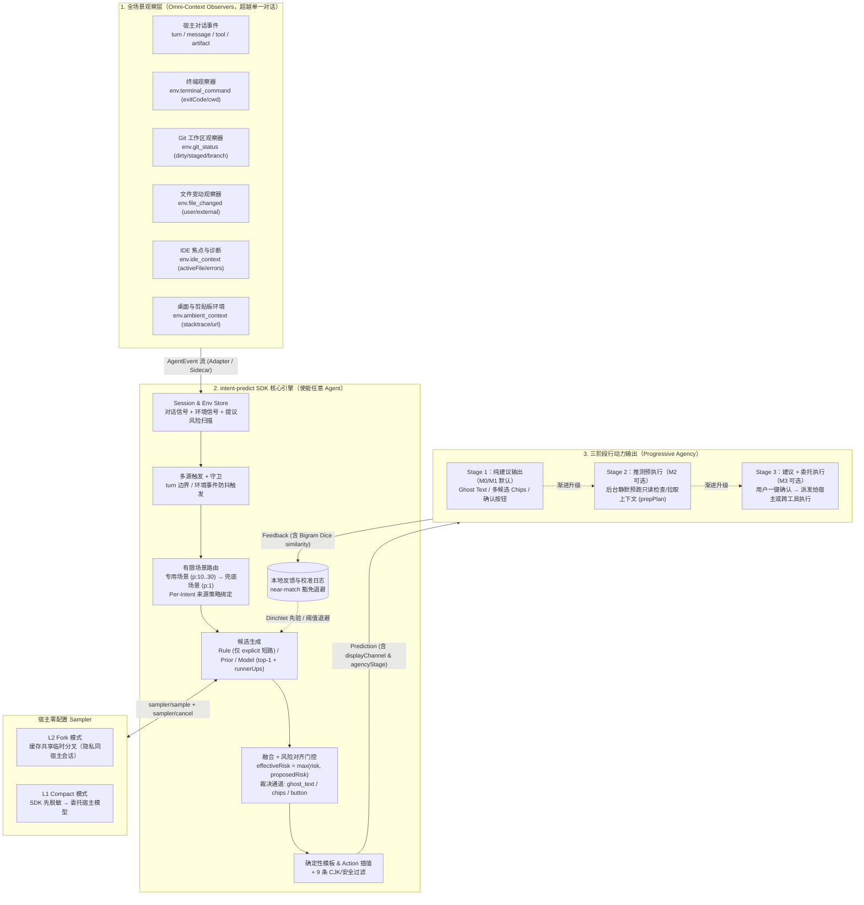
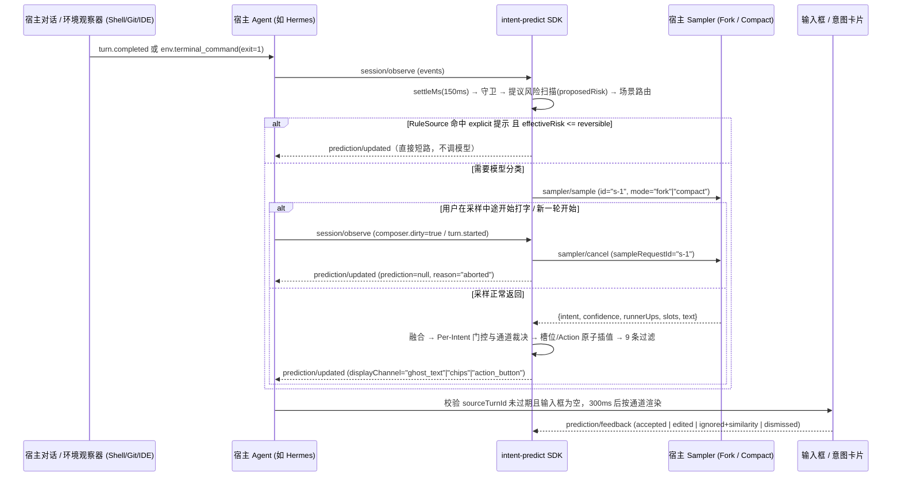
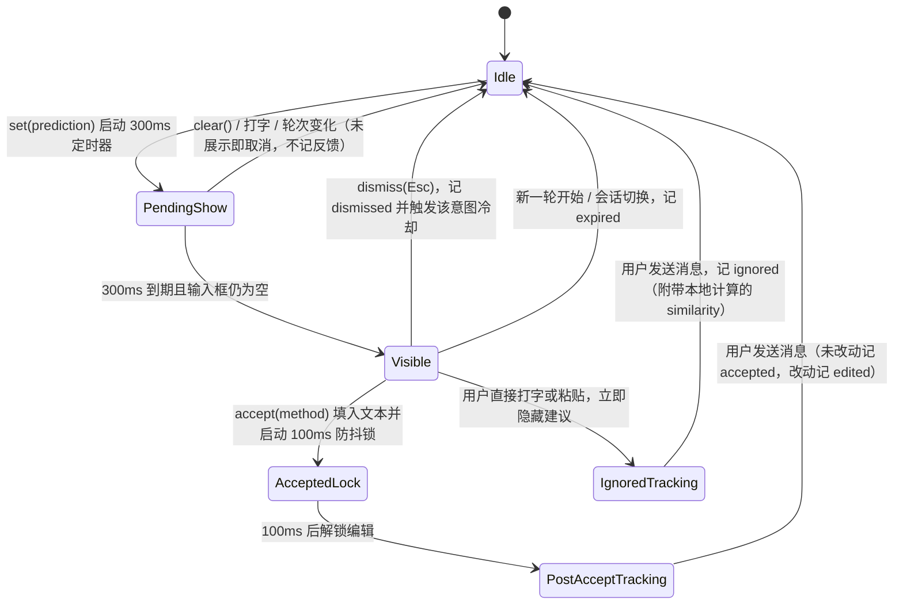

# intent-predict 设计文档

> 一个让**任意 Agent 成为全场景意图预测 Agent（Intent Predict Agent）**的通用 SDK。它不仅能观察宿主对话，还能观察终端命令、Git 工作区、文件变动、IDE 焦点与桌面/剪贴板环境（Omni-Context Observers），在识别出的有限场景里从封闭集合中预测用户下一步意图；默认零配置复用宿主自身模型，行动力从阶段 1「纯建议输出」渐进演进到阶段 2「推测预执行」与阶段 3「建议+委托执行」。

| 项 | 内容 |
|---|---|
| 状态 | v0.3（全场景 Intent Predict Agent 规范 + P0/P1/P2 安全与一致性闭环），含 `spec/*.schema.json` 与 `packages/pack-coding/pack.json` |
| 日期 | 2026-11-10 |
| 调研依据 | [prior-art.md](prior-art.md)：Codex composer predictions 的开源后端、Qwen Code 的 NES 和推测执行、其他开源插件 |

## 目录

1. [背景](#1-背景)
2. [目标与非目标](#2-目标与非目标)
3. [核心思路：有限场景](#3-核心思路有限场景)
4. [概念与术语](#4-概念与术语)
5. [总体架构](#5-总体架构)
6. [数据模型](#6-数据模型)
7. [预测流水线与算法细则](#7-预测流水线与算法细则)
8. [接入：对任意 agent 通用（零配置优先）](#8-接入对任意-agent-通用零配置优先)
9. [Sidecar 协议（JSON-RPC 2.0）](#9-sidecar-协议json-rpc-20)
10. [UI 交互规范](#10-ui-交互规范)
11. [安全与隐私](#11-安全与隐私)
12. [性能与成本预算](#12-性能与成本预算)
13. [评估](#13-评估)
14. [场景包示例](#14-场景包示例)
15. [包结构](#15-包结构)
16. [关键决策](#16-关键决策)
17. [路线图](#17-路线图)
18. [决议记录（原开放问题）](#18-决议记录原开放问题)

---

## 1. 背景

2026 年 10 月，OpenAI 在 Codex 桌面版以 beta 形式推出了 composer predictions。每轮回复结束后，输入框里可能出现一条预测，内容是用户接下来大概会发的话。按 Tab 可以接受，接受后还能编辑，不会自动发送。

这个功能分成两层（详见 [prior-art.md §1](prior-art.md#1-openai-codexcomposer-predictions)）：

- **后端是开源的**。codex-rs app-server 有一个实验接口 `thread/sample`。它在当前会话上开一个**临时分叉**，原样继承配置、工具和历史，目的是命中 prompt cache。然后追加一段 prompt，只取**一次**模型回复。如果模型试图调用工具，这次结果作废，返回 null。
- **产品层是闭源的**。预测用的 prompt、什么时候显示、UI 怎么交互，都写在桌面客户端里。开源 TUI 收到 `thread/prediction/updated` 通知后什么也不做。

开源实现里最完整的是 Qwen Code 的 Next-step Suggestion（NES），包括：
- 缓存共享分叉
- 12 条过滤规则
- 十几项守卫条件
- 不依赖 UI 框架的控制器
- 遥测
- 可选的推测执行

Qwen 的 Web Shell 里还有一个更接近"意图"的设计。它对用户正在输入的草稿做保守的封闭集合分类，输出 `btw | new_session | none` 外加置信度，再据此决定是否给出动作。

这些实现都绑定在各自的宿主里。除了 Qwen Web Shell 的分类器，它们预测的都是**开放文本**。对一个通用 SDK 来说，开放文本有四个问题：

1. **难评估**：只有接受率这一个指标，很难做离线回归。
2. **难控制**：文本上挂不了确定性动作，也没法给不同意图设不同的风险策略。
3. **难移植**：效果依赖宿主的分叉、缓存管线和 UI。
4. **成本高**：每轮都要让大模型生成一次。

## 2. 目标与非目标

### 目标

- **G1 不依赖宿主、零配置即用**：任何语言、任何框架都能接入，CLI、IDE、Web 形态的 agent 都行。默认复用宿主已配置的模型连接或 `Sampler` 能力，用户无需为 SDK 单独配置 API Key 或模型端点。
- **G2 有限场景意图预测**：集成方声明场景和每个场景的有限意图集。输出是结构化的"意图 id + 槽位 + 置信度"，另附一句能直接填进输入框的文本。
- **G3 宁缺毋滥**：默认输出 `none`。出现任何异常时都不给建议（fail-closed）。第一指标是展示精度（precision@shown）。
- **G4 低延迟、低成本**：宿主支持分叉时，复用它的 prompt cache；常见显式提示直接走本地规则短路。过期的结果一律不展示。
- **G5 人在回路**：不自动发送消息，也不自动执行有副作用的动作。
- **G6 可度量**：反馈事件和离线回放评测是内置能力。
- **G7 隐私优先**：默认只使用当前会话的上下文，提供脱敏钩子，也支持完全本地运行。

### 非目标（v1）

- 开放域的整句预测（即 Codex 的做法）只作为可选的 `freeform` 意图提供，**默认关闭**。
- 不做边打字边补全。打字过程中的意图路由放到 M3（见 §17）。
- SDK 不是 agent 框架，不负责执行意图。它只给出动作描述，执行由宿主完成。
- 不做跨会话记忆和用户画像。唯一的例外是可选、只存在本地的意图转移先验。

## 3. 核心思路：有限场景

> **有限场景（bounded scenario）**：能从信号中识别出来的一种情境。在这种情境下，用户下一步想做的事可以列举成一个小的封闭集合（建议 3 到 15 个意图），外加一个 `none`。

举个例子：agent 刚改完代码、还没跑测试。这时用户的下一句话大多属于以下几类：跑测试、看 diff、提交、让它解释改动、继续下一步。

这样设计有以下好处：

| 好处 | 原因 |
|---|---|
| 准 | 候选集小，可以叠加规则和先验。没把握时输出 `none` |
| 可测 | 问题变成了分类，可以算 top-1/top-3 准确率、校准误差和覆盖率-精度曲线 |
| 可控 | 每个意图可以单独设置风险等级、阈值、冷却时间和动作 |
| 便宜 | 规则、先验、向量近邻都能在本地跑，常见情况不需要调用模型 |
| 可移植 | 场景包是数据（JSON/YAML），可以跨语言、跨宿主复用 |
| 可执行 | 意图可以绑定确定性动作，例如 `/review`，不必从文本里猜 |

与 Codex 的对比：

| | | Codex composer predictions | intent-predict |
|---|---|---|---|
| 1 | 输出 | 一句自由文本 | 意图 id、槽位、置信度、文本，以及可选的动作 |
| 2 | 范围 | 开放 | 场景内的有限集合，加上 `none` |
| 3 | 生成方式 | 主模型在缓存共享的分叉上生成 | 融合规则、先验和模型的约束分类。默认复用宿主模型/分叉 |
| 4 | 何时展示 | 不保证每轮都有，策略没有公开 | 由门控显式决定：阈值、分差、冷却、风险等级 |
| 5 | 宿主 | 只有 Codex 桌面版（本地和 SSH 线程） | 任意 agent（首发落地 Hermes Agent），通过适配器或 sidecar 接入 |
| 6 | 评估 | 接受率 | 分类指标、接受率、校准误差 |

## 4. 概念与术语

| 术语 | 含义 |
|---|---|
| Session | 一次 agent 会话，相当于 thread |
| Turn | 一轮：用户输入，agent 工作，agent 给出最终回复 |
| Event | 宿主上报的规范化事件，包括消息、工具调用和结果、产物、状态 |
| Signal | 从事件中派生的特征，例如"本轮改了几个文件"、"最后一条消息是不是以问句结尾" |
| Scenario | 由信号识别出的有限场景，带有一个意图目录 |
| Intent | 意图目录中的一项，包含 id、描述、样例、槽位、渲染模板、风险等级、动作 |
| Scenario Pack | 可以分发的一组场景，格式为 JSON、YAML 或 TS，带版本号 |
| Prediction | 针对某个 source turn 的预测结果：首选意图（或 none）、备选意图、文本、动作 |
| Feedback | 预测展示之后用户的处理结果：接受、编辑、忽略、关闭、过期 |
| Sampler | 宿主提供的模型采样委托接口：既支持缓存共享分叉（`mode: 'fork'`），也支持委托宿主已有模型跑紧凑提示词（`mode: 'compact'`），实现零配置运行 |

## 5. 总体架构：让任意 Agent 成为全场景 Intent Predict Agent

接入 `intent-predict` 后，宿主不再只是被动等待用户输入的对话机器人，而是升级为具备**全场景感知（Omni-Context Observation）**与**三阶段行动力（3-Stage Agency）**的 **Intent Predict Agent**：



数据流与职责边界：
- **多源感知汇聚**：除了宿主自身的对话轮次事件（`turn.*`、`tool.*`），外部或宿主内置的轻量观察器（Shell Hook、Git Watcher、FS Watcher、IDE 插件、剪贴板监听）都可以向 SDK 投递 `env.*` 事件。例如用户在终端手敲 `pytest` 失败，即使还没跟 Agent 说话，SDK 也能立即感知并让 Agent 浮现「帮我修一下刚才终端里的 pytest 报错」。
- **三阶段行动力（Agency Stages）**：
  - **Stage 1（`suggest_only`，当前默认）**：只输出结构化预测与建议文本，按安全等级投递到宿主 UI（低风险走 `ghost_text`，确认类与外部副作用强制走 `chips` 或 `action_button`），绝不自动执行。
  - **Stage 2（`speculative_prep`，第二阶段）**：预测产出的同时附带只读预备计划 `prepPlan`（如预取报错文件、静默跑 `git diff` 或 AST 检查），等用户按 Tab 确认时直接秒回。
  - **Stage 3（`propose_and_dispatch`，第三阶段）**：用户在浮现的意图卡片上点击确认后，直接触发 `action` 派发给目标 Agent 或工具链完成闭环。

一次典型的全双工预测与取消时序：



## 6. 数据模型

下面用 TypeScript 写出权威定义。`spec/` 目录下提供严格对应的 JSON Schema Draft 2020-12 文件（`events.schema.json`、`scenario-pack.schema.json`、`prediction.schema.json`、`feedback.schema.json`、`rpc.schema.json`），供各语言代码生成与校验使用。

### 6.1 事件（宿主 → SDK）

对应 [`spec/events.schema.json`](../spec/events.schema.json)：

```ts
/** 宿主上报的规范化事件。字段尽量精简，SDK 忽略未知字段。 */
export type AgentEvent =
  | { type: 'turn.started'; turnId: string; at: number }
  | { type: 'message.user'; turnId: string; text: string; hasAttachments?: boolean }
  | { type: 'message.agent'; turnId: string; text: string; final?: boolean }
  | { type: 'tool.call'; turnId: string; callId: string; name: string; kind?: ToolKind; input?: unknown }
  | {
      type: 'tool.result'; turnId: string; callId: string;
      status: 'ok' | 'error' | 'denied';
      exitCode?: number;
      summary?: string;   // 一行摘要，可能进入模型上下文（经过脱敏）
      output?: unknown;   // 结构化输出，可选。只供 slot.from 读取，绝不发给模型
    }
  | {
      type: 'artifact'; turnId: string;
      kind: 'file_changed' | 'file_created' | 'file_deleted' | 'command_suggested' | 'link' | 'other';
      ref: string;
    }
  | { type: 'state'; key: string; value: unknown }  // 例如 mode=plan、pendingApproval=true、composer.dirty=true
  | {
      type: 'turn.completed'; turnId: string;
      status: 'completed' | 'failed' | 'interrupted';
      errorCode?: string;
      at: number;
    }
  // ── 全场景环境观察事件（Omni-Context Environment Events，超越单一对话边界） ──
  | {
      type: 'env.terminal_command';
      command: string;
      cwd?: string;
      exitCode: number;
      durationMs?: number;
      summary?: string;
      at: number;
    }
  | {
      type: 'env.git_status';
      branch: string;
      stagedCount?: number;
      dirtyCount: number;
      untrackedCount?: number;
      ahead?: number;
      behind?: number;
      hasConflicts?: boolean;
      at: number;
    }
  | {
      type: 'env.file_changed';
      paths: string[];
      actor?: 'user' | 'agent' | 'external';
      at: number;
    }
  | {
      type: 'env.ide_context';
      activeFile?: string;
      cursorLine?: number;
      selectionLength?: number;
      diagnosticsErrors?: number;
      diagnosticsWarnings?: number;
      at: number;
    }
  | {
      type: 'env.ambient_context';
      activeApp?: string;
      windowTitle?: string;
      clipboardKind?: 'stacktrace' | 'error_log' | 'url' | 'code_snippet' | 'plain_text';
      clipboardPreview?: string;
      at: number;
    };

/** 可以直接从 ACP 的 tool kind 或 Hermes toolset 映射过来 */
export type ToolKind = 'read' | 'search' | 'edit' | 'delete' | 'execute' | 'fetch' | 'ask_user' | 'other';

/** L0 接入时的最小输入 */
export interface SimpleMessage {
  role: 'user' | 'assistant' | 'tool';
  content: string;
  toolName?: string;
  toolKind?: ToolKind;
  exitCode?: number;
  isError?: boolean;
}
```

### 6.2 场景与意图（由集成方定义，可以序列化）

对应 [`spec/scenario-pack.schema.json`](../spec/scenario-pack.schema.json)：

```ts
export interface ScenarioPack {
  id: string;                    // 'builtin/coding'
  version: string;               // semver。遥测数据按 packId@version/intentId 归档
  description?: string;
  scenarios: ScenarioSpec[];
}

export interface ScenarioSpec {
  id: string;                    // 'coding.after_edit'
  description: string;           // 给模型看的一句话说明（≤ 160 字符）
  triggerOnTurnStatuses?: Array<'completed' | 'failed'>; // 默认 ['completed']
  match: SignalPredicate;        // 可序列化的谓词。TS 包也能传函数，但函数无法跨语言使用
  priority?: number;             // 多个场景同时命中时，按此排序（默认 0）
  intents: IntentSpec[];         // 有限集合，1 到 15 个。none 由 SDK 自动加入
  policy?: Partial<GatePolicy>;  // 覆盖全局门控策略
}

export interface IntentSpec {
  id: string;                    // 'run_tests'。在单个场景内唯一，禁止为 'none'
  description: string;           // 给模型看，不超过 80 个字符
  examples?: string[];           // 用户的真实说法，建议中英文各 1 到 2 条
  when?: SignalPredicate;        // 前置条件。不满足时该意图不进入候选
  slots?: Record<string, SlotSpec>;
  render?: RenderSpec;           // 文本的生成方式
  risk: Risk;                    // 基础风险等级
  dynamicRiskFromProposedAction?: boolean; // 为 true 时（如 confirm/choose_option），有效风险取 max(risk, lastAgentMessage.proposedRisk)
  allowedChannels?: Array<'ghost_text' | 'chips' | 'action_button'>; // 显式限定允许展示的 UI 通道
  action?: ActionDescriptor;     // 宿主可以执行的确定性动作
  prior?: number;                // 场景内的默认先验 [0, 1]。不填时平均分配
  enabledByDefault?: boolean;    // 默认 true；freeform 类意图设为 false
}

/** none：纯对话；read_only：只读；reversible：本地可撤销（编辑、跑测试、本地 commit）；
 *  side_effect：影响工作区之外（push、发消息、部署）；irreversible：删除、force-push、支付等 */
export type Risk = 'none' | 'read_only' | 'reversible' | 'side_effect' | 'irreversible';

export interface SlotSpec {
  type: 'string' | 'number' | 'enum' | 'path';
  description?: string;
  enum?: string[];
  from?: SignalPath;             // 优先从信号中确定性地取值，取不到才让模型填写
  pattern?: string;              // 正则校验。不通过时整条预测作废
  maxLength?: number;            // 默认 80
  required?: boolean;            // 默认 false
  default?: unknown;             // 取不到值时的兜底值
}

export type RenderSpec =
  | string                                                       // 单一模板：'跑一下 {target} 的测试'
  | Record<string, string>                                       // 多语言模板：{ 'zh-CN': '…', en: '…' }
  | { mode: 'model'; fallback?: string | Record<string, string> }; // 由模型按用户的说话风格生成

export type ActionDescriptor =
  | { type: 'fill' }                                             // 默认值：只填入输入框
  | { type: 'command'; command: string; args?: string }          // 例如 '/review'
  | { type: 'tool'; name: string; input: Record<string, unknown> }
  | { type: 'custom'; name: string; payload?: unknown };
```

如果没有写 `render`，按以下顺序取文本：
1. 有模型结果且非空时，用模型生成的文本。
2. 否则，用第一条与 `user.locale` 语言族一致的 `examples`。
3. 仍无匹配时，用 `examples[0]`。

### 6.3 信号与谓词

谓词是一个很小的声明式 DSL，可以序列化成 JSON，因此场景包能跨语言使用：

```ts
export type SignalPredicate =
  | { all: SignalPredicate[] }
  | { any: SignalPredicate[] }
  | { not: SignalPredicate }
  | {
      signal: SignalPath;
      eq?: unknown; ne?: unknown;
      gt?: number; gte?: number; lt?: number; lte?: number;
      in?: unknown[]; contains?: unknown;
      matches?: string;   // ECMA-262 正则源码
      exists?: boolean;
    };
```

#### 6.3.1 谓词求值规则与命中特异性（Specificity）

1. **缺失信号处理**：当 `signal` 指向的路径不存在或值为 `undefined` / `null` 时：
   - `{ exists: false }` 返回 `true`；
   - `{ exists: true }` 返回 `false`；
   - `{ ne: x }`（其中 `x !== null`）返回 `false`（**严格 fail-closed**：缺失信号不视为“不等于某值”而放行，除非显式搭配 `exists: false`）；
   - 其余所有比较算子（`eq`、`gt`、`gte`、`lt`、`lte`、`in`、`contains`、`matches`）一律返回 `false`。
2. **叶子多算子关系**：同一个叶子对象里若同时声明多个算子（如 `{ signal: 'x', gte: 1, lte: 5 }`），所有算子必须同时成立（逻辑与）。
3. **类型守卫**：
   - `gt / gte / lt / lte` 仅当信号值为有限 `number` 时求值，否则为 `false`。
   - `contains`：信号值为数组时检查元素相等（`Array.includes`）；信号值为字符串时检查子串包含（`String.includes`）；否则为 `false`。
   - `in`：算子参数必须为数组，检查信号值是否在该数组中（若信号值本身是数组，则检查两数组是否有交集）。
   - `matches`：仅当信号值为字符串时用 `new RegExp(pattern, 'u')` 匹配；正则表达式在加载场景包时预编译并限制最大长度（≤ 256 字符），若语法非法则拒绝加载该场景包。
4. **命中特异性分数 `specificity(pred)`**（用于同 `priority` 场景排序，见 §7.3）：
   - 命中为 `false` 时得分为 `0`。
   - 命中为 `true` 的叶子节点得分 `1`。
   - `{ all: [...] }` 得分为所有子节点得分之和 `∑ specificity(child)`。
   - `{ any: [...] }` 得分为命中子节点中的最大得分 `max specificity(child)`。
   - `{ not: child }` 命中时固定得分 `0.5`。

v0.1 内置的信号：

| 信号 | 类型 | 提取规则与说明 |
|---|---|---|
| `session.turnCount` | `number` | 当前会话已收到 `turn.completed` 的总轮数 |
| `session.lastIntent` | `string?` | 上一轮被 `accepted` 或 `edited` 的意图 id |
| `lastTurn.status` | `string` | `completed` \| `failed` \| `interrupted` |
| `lastTurn.toolKinds` | `ToolKind[]` | 本轮调用过的去重 `ToolKind` 列表（若宿主未传 `kind`，按 §6.3.3 默认表推断） |
| `lastTurn.toolNames` | `string[]` | 本轮调用过的去重工具名列表 |
| `lastTurn.failedTools` | `number` | 本轮 `tool.result.status === 'error'` 的次数 |
| `lastTurn.failedExecs` | `number` | 本轮 `kind === 'execute'` 且（`status === 'error'` 或 `exitCode !== undefined && exitCode !== 0`）的次数 |
| `lastTurn.filesChanged` | `number` | 本轮 `artifact.kind` 属于 `file_changed \| file_created \| file_deleted` 的去重文件数；若宿主未发 `artifact` 事件，则统计 `kind` 属于 `edit \| delete` 且 `status === 'ok'` 的工具调用次数 |
| `lastTurn.changedPaths` | `string[]` | 本轮变更的文件路径数组（供 `slot.from` 取值，如 `lastTurn.changedPaths.0`） |
| `lastTurn.toolOutputs.<name>` | `unknown` | 工具 `<name>` 本轮最近一次 `tool.result.output`，**仅允许 `slot.from` 读取，绝不进入模型提示词** |
| `lastAgentMessage.tail` | `string` | 最后一条 `message.agent` 的末尾，默认截取 1,500 字符 |
| `lastAgentMessage.length` | `number` | 最后一条 `message.agent.text` 的字符长度 |
| `lastAgentMessage.endsWithQuestion` | `boolean` | 中英文问句检测（算法见 §6.3.3） |
| `lastAgentMessage.options` | `string[]` | 提取出的编号选项文本数组（算法见 §6.3.3） |
| `lastAgentMessage.optionsCount` | `number` | `lastAgentMessage.options.length` |
| `lastAgentMessage.preferredOptionIndex` | `number` | 若某选项含 `(Recommended)` / `（推荐）` 标记则取其 1-based 序号，否则默认 `1` |
| `lastAgentMessage.proposedRisk` | `Risk` | 从助手最后一条消息的提议内容中检测出的潜在操作风险等级（算法见 §6.3.3），专门用于防止 `confirm` / `choose_option` 低摩擦放行高危操作 |
| `lastAgentMessage.hints` | `Hint[]` | 显式的下一步提示，结构为 `{ kind: 'slash' \| 'type_literal', value: string }` |
| `lastUserMessage.text` | `string` | 用户最近一条消息原文 |
| `user.locale` | `string` | 由用户最近的消息推断（算法见 §6.3.3），**不是** UI 语言 |
| `env.lastTerminalCommand.command` | `string?` | 最近一次观察到的用户终端命令 |
| `env.lastTerminalCommand.exitCode` | `number?` | 最近一次用户终端命令的退出码 |
| `env.git.branch` | `string?` | 当前 Git 分支名 |
| `env.git.dirtyCount` | `number?` | 工作区未提交改动文件数 |
| `env.git.hasConflicts` | `boolean?` | 是否存在合并冲突 |
| `env.ide.activeFile` | `string?` | IDE 当前焦点文件 |
| `env.ide.diagnosticsErrors` | `number?` | IDE 当前活动文件的 LSP 报错数 |
| `env.ambient.clipboardKind` | `string?` | 剪贴板内容分类（如 `stacktrace`、`error_log`） |
| `state.<key>` | `unknown` | 宿主上报的任意状态 |

#### 6.3.3 派生信号的具体提取规则

1. **工具类别默认推断（当宿主未传 `tool.call.kind` 时）**：
   - `read`：`read_file`、`view`、`cat`、`head`、`tail`
   - `search`：`search_files`、`grep`、`rg`、`find`、`glob`、`web_search`、`session_search`
   - `edit`：`patch`、`write_file`、`edit`、`apply_patch`、`notebook_edit`
   - `delete`：`remove_file`、`delete_file`、`rm`
   - `execute`：`terminal`、`bash`、`exec_command`、`execute_code`、`run_command`
   - `fetch`：`web_extract`、`fetch`、`curl`、`browser_exec`
   - `ask_user`：`clarify`、`ask_user`、`request_user_input`
   - 其余归为 `other`。
2. **问句检测 `lastAgentMessage.endsWithQuestion`**：
   - 取 `lastAgentMessage.tail`，先剥离末尾代码块（```` ``` ````），再取最后一段非空文本行。
   - 若该行在去掉末尾空白、括号、右引号（`”`、`'`、`"`、`）`、`]`）后以 `?` 或 `？` 结尾，或者 匹配句尾疑问词 `/(?:吗|呢|好吗|可以吗|对吗|是吗|如何|怎样|哪一个|哪个)\s*[。！!.]?$/u`，则判定为 `true`。
3. **编号选项提取 `lastAgentMessage.options`**：
   - 在 `lastAgentMessage.tail` 的非代码块行中，扫描**末尾连续**的编号列表行：匹配 `/^\s*(?:(\d{1,2})[.)、]|[(（](\d{1,2})[)）])\s+(.+)$/u`。
   - 仅当提取出的编号从 `1` 开始连续递增且总数在 `2..9` 之间时，记录为有效 `options`。
4. **显式提示提取 `lastAgentMessage.hints`**：
   - 在 `lastAgentMessage.tail` 最后 5 行非代码块文本中匹配：
     - **斜杠命令**（`kind: 'slash'`）：反引号、引号或行首的 `/[a-z][a-z0-9_-]{1,30}`，且命令名不含第二个 `/`（排除 `/usr/bin` 之类的路径）。
     - **显式输入引导**（`kind: 'type_literal'`）：匹配 `/(?:type|run|enter|reply with|输入|发送|回复)\s+["'「『]([^"'」』\n]{1,40})["'」』]/iu`。
5. **助手提议风险检测 `lastAgentMessage.proposedRisk`**（解决确认类意图的风险错位问题）：
   - `confirm` / `choose_option` 等同意类意图本身的文本看似无害（如「可以，继续」），但真正的风险取决于**助手刚刚请求确认的操作**。SDK 对 `lastAgentMessage.tail`（含代码块）执行确定性风险扫描：
     - **命中 `irreversible`**：匹配 `/(?:\brm\s+-[rRf]+\b|\bgit\s+push\s+[^\n]*--force\b|\bgit\s+reset\s+--hard\b|\bgit\s+clean\s+-[fd]+|\bdrop\s+(?:table|database|schema)\b|\btruncate\s+table\b|\bdelete\s+from\b|\bkubectl\s+delete\b|\bterraform\s+destroy\b|删库|强制推送|清空数据|不可恢复|永久删除)/iu`。
     - **命中 `side_effect`**：匹配 `/(?:\bgit\s+push\b|\bgh\s+pr\s+(?:create|merge)\b|\bnpm\s+publish\b|\bcargo\s+publish\b|\bdeploy\b|\bkubectl\s+apply\b|\bterraform\s+apply\b|\bdocker\s+push\b|推送到远端|推到生产|发布到|部署到|合并\s*PR|发送邮件)/iu`。
     - **默认**：未命中上述模式时返回 `'reversible'`。
   - 任何声明了 `dynamicRiskFromProposedAction: true` 的意图（如 `confirm`、`choose_option`），其运行时的**有效风险等级**强制升级为 `effectiveRisk = max(intent.risk, lastAgentMessage.proposedRisk)`，且在内置 coding 包中默认通过 `when` 谓词直接排除 `proposedRisk ∈ {'side_effect', 'irreversible'}` 的自动确认候选，并限定 `allowedChannels: ['chips', 'action_button']`（禁止进入单键 Tab 接受的 ghost text）。
6. **用户语言推断 `user.locale`**：
   - 拼接当前会话最近最多 3 条 `message.user.text`（剥离代码块与 URL）。
   - 统计 Unicode 字符占比：假名 `[\u3040-\u30ff]` > 5% → `'ja'`；谚文 `[\uac00-\ud7af]` > 5% → `'ko'`；CJK 表意文字 `[\u4e00-\u9fff]` ≥ 10%（或 CJK 字符数 ≥ 2 且拉丁字母词数 < 5）→ `'zh-CN'`；其余默认 → `'en'`。

### 6.4 预测（SDK → 宿主）

对应 [`spec/prediction.schema.json`](../spec/prediction.schema.json)：

```ts
export interface Prediction {
  id: string;
  sessionId: string;
  sourceTurnId: string;          // 用于判断是否过期，见 §7.9
  packId: string;
  packVersion: string;
  scenarioId: string;
  qualifiedIntentId: string;     // 全局唯一归档键：'<packId>@<packVersion>/<scenarioId>#<intentId>'
  displayChannel: 'ghost_text' | 'chips' | 'action_button'; // 经门控裁定后的推荐展示通道
  intent: { id: string; confidence: number; slots: Record<string, unknown> };
  text: string;                  // 渲染好的建议，使用用户的语言和说话风格
  locale: string;
  action?: ActionDescriptor;
  risk: Risk;
  alternatives: Array<{
    intentId: string;
    confidence: number;
    slots?: Record<string, unknown>;
    text: string;
    risk: Risk;
    action?: ActionDescriptor;
  }>;
  sources: Array<'rule' | 'prior' | 'model' | 'embedding'>;
  createdAt: number;
  usage?: { inputTokens?: number; cachedInputTokens?: number; outputTokens?: number; latencyMs: number };
}

/** 规范化的抑制原因枚举，便于遥测聚合与阈值诊断。全集定义见 spec/prediction.schema.json */
export type SuppressedReason =
  | 'disabled' | 'non_interactive' | 'pending_interaction' | 'failed_turn_unhandled'
  | 'interrupted_turn' | 'min_turns_not_met' | 'composer_dirty' | 'mode_blocked'
  | 'budget_exhausted' | 'budget_exhausted_no_explicit_rule' | 'incognito'
  | 'no_scenario_matched' | 'empty_catalog' | 'no_rule_hit_in_local_mode'
  | 'model_none' | 'below_min_confidence' | 'below_risk_confidence' | 'below_min_margin'
  | 'in_cooldown' | 'max_per_session_reached' | 'risk_disallowed_for_ghost_text'
  | 'invalid_model_output' | 'unknown_intent' | 'slot_validation_failed'
  | 'filter_empty_or_meta' | 'filter_label_prefix' | 'filter_ai_voice' | 'filter_evaluative'
  | 'filter_multiple_sentences' | 'filter_formatting' | 'filter_length'
  | 'filter_error_text' | 'filter_dangerous' | 'timeout' | 'aborted' | 'stale_turn';

/** 形状与 Codex 的 ThreadPredictionResult（completed | failed）对应 */
export type PredictionResult =
  | { type: 'completed'; prediction: Prediction | null; suppressedReason?: SuppressedReason }  // null 表示主动放弃
  | { type: 'failed'; error: string };
```

### 6.5 反馈（宿主 → SDK）

对应 [`spec/feedback.schema.json`](../spec/feedback.schema.json)：

```ts
export interface Feedback {
  predictionId: string;
  sessionId?: string;
  sourceTurnId?: string;
  outcome: 'accepted' | 'edited' | 'ignored' | 'dismissed' | 'expired';
  method?: 'tab' | 'right' | 'enter' | 'click' | 'shortcut';
  selectedIntentId?: string;     // 当用户在 chips 模式下选了备选意图时填写
  similarity?: number;           // [0, 1]，在宿主或 UI 控制器本地计算的编辑相似度
  finalText?: string;            // 用户最终发出的内容。默认不采集，需要显式开启 collectFinalText
  wasFocusedWhenShown?: boolean;
  msSinceShown?: number;
  msToFirstKeystroke?: number;
}
```

`suppressed`（被门控拦下、从未展示）由 SDK 自己记录，宿主不需要上报。

## 7. 预测流水线与算法细则

### 7.1 触发

- 默认在 `turn.completed` 且 `status=completed` 时触发。`status=failed` 只在存在声明了 `triggerOnTurnStatuses: ['completed', 'failed']` 的场景（如 `coding.checks_failed`）时才进入场景路由。`interrupted` 一律不触发（记为 `interrupted_turn`）。
- 触发后先等待 `settleMs`（默认 150ms），把末尾滞后的 `artifact` / `state` 事件收齐。
- 每个会话同时最多只有一个进行中的预测。新的触发会通过 `AbortController` 取消旧的。
- 以下情况会立即取消进行中的预测，并向宿主发送一次 `completed + null`，让已经交付的预测立即失效：
  - 收到 `turn.started`
  - 收到 `message.user`
  - 收到 `state composer.dirty=true`
  - 会话切换

### 7.2 守卫

这部分借鉴了 Qwen Code，并做了通用化处理：

| 守卫 | 判定条件 | 命中时的 `suppressedReason` | 默认行为 |
|---|---|---|---|
| 开关 | 全局关闭或用户关闭 | `disabled` | 默认开启 |
| 交互性 | 宿主声明 `interactive=false`，例如 CI、headless、批处理 | `non_interactive` | 跳过 |
| 有待处理的交互 | `state.pendingApproval`、`state.pendingInput`，或有对话框打开 | `pending_interaction` | 跳过 |
| 出错的轮次 | 本轮以 API 错误结束 | `failed_turn_unhandled` | 跳过，除非场景声明要处理 |
| 会话太短 | `session.turnCount < minTurns` | `min_turns_not_met` | `minTurns = 1` |
| 输入框非空 | `state.composer.dirty` | `composer_dirty` | 跳过 |
| 模式 | 宿主声明的模式黑名单，例如 plan 模式 | `mode_blocked` | 可以配置 |
| 模型预算 | 会话或每小时**模型调用预算**用完 | `budget_exhausted_no_explicit_rule` | **仅跳过 `ModelSource`**（降级为 `L-Local`）：若 `RuleSource` 命中 `explicit: true` 候选仍正常产出建议；若未命中 `explicit` 规则则放弃并记录 `budget_exhausted_no_explicit_rule` |
| 隐私模式 | `state.incognito` | `incognito` | 跳过 |

### 7.3 场景路由、意图合并与作用域隔离

1. **过滤与排序**：
   - 遍历已加载的所有 `ScenarioPack` 中的场景，先检查 `triggerOnTurnStatuses` 是否包含当前 `lastTurn.status`，再求值 `match` 谓词。
   - 命中的场景按以下优先级降序排列：
     1. `scenario.priority ?? 0`（从高到低）
     2. `specificity(scenario.match)`（谓词命中特异性，从高到低，见 §6.3.1）
     3. 声明顺序（先声明的优先）
2. **硬边界与覆盖梯度**：
   - 若没有任何场景命中，立即返回 `{ type: 'completed', prediction: null, suppressedReason: 'no_scenario_matched' }`，**绝不调用模型**。
   - 为避免场景条件过窄导致覆盖率悬崖，场景包采用“**高特异度场景（priority 10–30）+ 保守兜底场景（如 `coding.general_followup`，priority 1，自带高门控阈值 `minConfidence: 0.75, minMargin: 0.25`）**”的斜坡结构；且当已有 `priority ≥ 10` 的专用场景命中时，不再把 `priority ≤ 1` 的兜底场景混入 top-k。
3. **Top-k 合并、来源场景绑定与全局唯一键**：
   - 取排名前 `k` 个命中场景（默认 `k = 2`）。
   - 遍历这 `k` 个场景中的意图，每个候选条目保留其**来源场景引用** `originScenario`（含 `packId`、`packVersion`、`scenarioId`、`scenario.policy`）：
     - 过滤掉 `enabledByDefault === false`（且未被宿主显式开启）的意图；
     - 若意图带有 `when` 谓词且求值为 `false`，剔除该意图；
     - 若多个命中场景包含相同 `intent.id`，保留高优先级场景中的定义及其 `originScenario`。
   - **策略归属（Per-Intent Origin Policy）**：门控阶段对最终胜出的首选意图 $i_{(1)}$ 求值时，使用的是**该意图所属 `originScenario.policy`** 与全局 `GatePolicy` 的合并结果（而非盲目使用第 1 场景的 policy），且最终 `Prediction.scenarioId` 与 `qualifiedIntentId`（格式：`<packId>@<packVersion>/<originScenarioId>#<intentId>`）均精确指向该意图的来源场景，彻底杜绝跨场景门控错位与遥测串味。
   - **上限截断**：合并后的候选目录最多保留 **15 个意图**（超出时按 `(scenarioRank, intent.prior ?? 1/N)` 截断）。这样模型提示词能稳定控制在 4,000 字节以内，满足 Codex `thread/sample` 的字节上限。
   - 若过滤后候选目录为空，返回 `suppressedReason: 'empty_catalog'`。

### 7.4 候选来源与规则定位

```ts
export interface CandidateSource {
  id: 'rule' | 'prior' | 'model' | 'embedding' | (string & {});
  propose(ctx: PredictContext, catalog: CatalogEntry[], signal: AbortSignal): Promise<Candidate[]>;
}

export interface Candidate {
  intentId: string;              // 必须在目录内，或者是 'none'
  score: number;                 // 取值 [0, 1]
  explicit?: boolean;            // 是否来自 agent 的显式提示（唯一可短路模型的规则类型）
  slots?: Record<string, unknown>;
  text?: string;
  evidence?: string;             // 调试用
}
```

| 来源 | 阶段 | 说明 |
|---|---|---|
| **RuleSource** | M0 | 始终启用，本地执行，耗时 < 5ms。严格区分两类产出：<br>① **显式提示候选（`explicit: true`）**：当 `lastAgentMessage.hints` 含 `{ kind: 'slash', value: '/review' }` 且匹配某意图的 `action.command` / `examples`，或含 `{ kind: 'type_literal', value: X }` 且匹配某意图的 `examples` 时，产出 `score: 0.92, explicit: true`。此类候选直接短路模型。<br>② **结构化槽位预填与结构加分（`explicit: false`）**：当 `optionsCount > 1` 时为 `choose_option` 预填确定性槽位 `index = preferredOptionIndex` 并赋予结构加分 `b_rule = 0.20`；当 `endsWithQuestion === true` 时为 `confirm` 赋予结构加分 `b_rule = 0.15`。**非显式规则绝不伪造高置信度独立候选，避免与模型 `none` 打架** |
| **ModelSource** | M0 | 约束分类。**优先走宿主的 `Sampler`（L2 分叉或 L1 宿主零配置模型委托）**，其次走独立配置的 `ModelClient`（L0）。<br>关闭 thinking/reasoning，温度设为 0，最多输出约 120 个 token。<br>要求模型返回首选意图 `intent`、置信度 `confidence` 以及最多 2 个备选 `runnerUps`（见 §7.5），为 chips 模式提供真实分布 |
| **PriorSource** | M2 | 计算狄利克雷平滑转移概率 `P(i \| scenario, lastIntent) = (c(s, i_prev, i) + α₀·p₀(i)) / (Σⱼ c(s, i_prev, j) + α₀)`，其中 `α₀ = 5`，`p₀(i)` 为场景包声明的默认先验（未声明时均分，并为 `none` 预留 `p₀(none) = 0.25`）。数据来自本地反馈日志 |
| **EmbeddingSource** | M2 | 以"agent 消息末尾 + 信号摘要"为查询，在本地已标注的样例上做余弦近邻检索。不需要调用 LLM |

**短路规则（Short-circuit）**：
- 当且仅当 `RuleSource` 给出了 `explicit: true` 候选，且该意图的有效风险 `effectiveRisk ∈ {'none', 'read_only', 'reversible'}`，且所有必填槽位已由 `slot.from` 或 `default` 解析完毕时，**直接采用该候选，跳过模型调用**。
- 当没有 `explicit: true` 候选时：
  - 若存在可用的 `Sampler` 或 `ModelClient`（且模型预算未耗尽），调用 `ModelSource`；此时 `RuleSource` 的非显式规则仅负责**确定性槽位预填**与**备选排序加分**，裁决权归模型。
  - 若处于 `L-Local`（无模型或 `budget_exhausted`），不产生物理猜测，直接返回 `no_rule_hit_in_local_mode`（或 `budget_exhausted_no_explicit_rule`）。

### 7.5 模型提示词与输出解析

模板用英文写，以兼容更多模型并节省 token。输出文本要求跟随 `user.locale` 与用户说话风格。宿主 `Sampler` 的 fork 分叉模式下，会话本身已经在前缀里，因此省略 `Recent conversation` 一节。

```text
[INTENT PREDICTION — do not continue the task. Do not call tools.]
Predict the user's NEXT message in this session, choosing from a fixed catalog.

Scenario: {{scenario.description}}
Catalog (pick from these ids):
{{#each intents}}- {{id}}: {{description}}{{#if slots}} (slots: {{slots_spec}}){{/if}}{{#if examples}} e.g. {{examples}}{{/if}}
{{/each}}- none: nothing above fits, or you are not confident.

Rules:
1. Predict what THE USER would type next, not what you think they should do.
   THE TEST: Would the user think "I was just about to type that"?
2. Read the last few lines of the assistant's message carefully: if it explicitly
   offers a next step (a slash command, a direct question, or numbered options),
   prefer the matching intent. If the assistant asks to confirm a destructive or
   external side-effect action, return "none".
3. Prefer "none" over a guess. A wrong suggestion costs more than no suggestion.
4. "text" is what the user would type in locale "{{user.locale}}": one short
   sentence matching the user's tone, no quotes, no markdown, never in the
   assistant's voice. Leave "text" empty if intent is "none".
5. Fill "slots" ONLY with values that literally appear in the conversation.
6. Optionally list up to 2 plausible runner-up intents in "runnerUps" with their
   probabilities; total probability (confidence + sum(runnerUps) + P(none)) <= 1.

{{#if compact}}Recent conversation (oldest first):
{{transcript}}
{{/if}}Signals: {{signals_json}}

Reply with a single JSON object only:
{"intent":"<id>","confidence":0.0,"slots":{},"text":"","runnerUps":[{"intent":"<id2>","confidence":0.0}]}
```

#### 7.5.1 紧凑上下文（compact 模式）的确定性构建规则

1. **轮次窗口**：截取最近 `K = 3` 个已完成轮次（按时间正序排列）。
2. **先脱敏后截断**：所有进入 `transcript` 和 `signals_json` 的文本，必须先经过 §11.1 的脱敏管道。
3. **单轮裁剪**：
   - 用户消息（`User:`）：保留前 500 字符，超出部分替换为 `…`。
   - 工具调用与结果（`Tool:`）：每条压缩为单行 `<name>(<keyArg>) -> <status>[ exit=<code?>]: <summary>`，例如 `exec_command(pytest) -> error exit=1: 3 failed`，最长 200 字符；同一轮超过 6 次工具调用时，保留前 2 次与最后 4 次（优先保留报错的工具）。
   - 助手最终消息（`Assistant:`）：**保留末尾** 1,500 字符（超出时前置 `…`），因为下一步提示通常出现在结尾。
   - 完全剔除 thinking/reasoning 块与 `tool.result.output` 原始对象。
4. **总预算**：整个 compact prompt 字符数上限为 8,000 字符（约 2k tokens）；若超出，优先从最早的一轮（`t - 2`）开始丢弃。

#### 7.5.2 模型输出严格解析器

1. 若返回 `text === null` 或空串，判定为 `invalid_model_output`。
2. 允许剥离外围单个 ` ```json ... ``` ` 围栏（兼容不支持 structured outputs 的本地/代理模型），随后执行 `JSON.parse`。不尝试正则硬抠残缺 JSON。
3. 校验字段：
   - `intent` 必须是字符串，且属于 `catalogIds ∪ {'none'}`（否则记为 `unknown_intent`）。
   - `confidence` 必须是有限数字且在 `[0, 1]` 内（否则记为 `invalid_model_output`）。
   - `slots` 若存在必须是纯对象（plain object）。
   - `runnerUps` 若存在必须是数组（最多取前 2 项），每项的 `intent` 必须在 `catalogIds` 内且不等于主 `intent`，`confidence` 在 `[0, 1]` 内；非法项直接忽略。

### 7.6 融合算法（消除规则与模型冲突，支持多候选 Chips）

设候选目录加上 `'none'` 构成集合 $\mathcal{I} = \{i_1, \dots, i_m, \text{none}\}$。

1. **路径 A：显式提示短路（Explicit Rule Short-circuit）**
   - 若 `RuleSource` 产出了 `explicit: true` 候选 $i^*$（且满足 §7.4 短路条件），直接令 $\text{final}(i^*) = 0.92$，不调用模型。
   - 备选 `alternatives` 直接从同场景下其余满足 `when` 条件的意图中按先验 $P_{\text{prior}}(j)$ 选取前 2 项（分数设为 $0.25 \cdot P_{\text{prior}}(j) / \max_k P_{\text{prior}}(k)$）。
2. **路径 B：模型分类与先验/结构加分融合（Standard Model Path）**
   - **当模型返回 `intent === "none"` 时**：因为 `explicit: true` 已在路径 A 短路，走到这里的只剩非显式结构信号（如句子末尾有问号）。模型在阅读完整语义后判定 `none`（例如问句只是修辞、或涉及高危操作），**无条件尊重模型的否决权**，直接以 `suppressedReason: 'model_none'` 终止，不让非显式规则强行推翻模型。
   - **当模型返回首选意图 $i_1$（置信度 $c_1$）及可选的 `runnerUps` $(i_2, c_2), (i_3, c_3)$ 时**：
     - 记已知模型概率和 $S = \min(0.98, c_1 + c_2 + c_3)$，令 $P_{\text{model}}(\text{none}) = \max(1 - c_1, 1 - S)$。
     - 对模型未显式列出的其余目录内意图 $j \notin \{i_1, i_2, i_3\}$，分配极小平滑底数 $\epsilon_0 = 0.02 / m$。
     - 结合场景先验 $P_{\text{prior}}(i)$ 与非显式规则结构加分 $b_{\text{rule}}(i) \in [0, 0.20]$（见 §7.4）：
       $$\tilde{S}(i) = \left(P_{\text{model}}(i) + 0.15 \cdot b_{\text{rule}}(i)\right)^{\alpha} \cdot P_{\text{prior}}(i)^{1 - \alpha}, \quad \text{final}(i) = \frac{\tilde{S}(i)}{\sum_{k \in \mathcal{I}} \tilde{S}(k)}$$
       其中默认 $\alpha = 0.85$。
   - **备选 `alternatives` 生成（确保 Chips 模式可用）**：
     - 备选意图按 $\text{altScore}(j) = 0.65 \cdot P_{\text{model}}(j) + 0.35 \cdot P_{\text{prior}}(j) + 0.15 \cdot b_{\text{rule}}(j)$（$j \neq i_1, j \neq \text{none}$）降序排列。
     - 只要主意图 $i_1$ 通过门控，且备选意图 $j$ 满足未冷却、有效风险非 `irreversible`、且 $\text{altScore}(j) \ge 0.18$，即可入选 `alternatives`（最多 2 项，使用各自模板确定性渲染文本）。这样即使模型只输出了 top-1，高先验或带规则加分的第二顺位意图（如 `after_edit` 下的 `review_diff`）依然能稳定进入 Chips。

### 7.7 门控、风险对齐与展示通道裁决

```ts
export interface GatePolicy {
  minConfidence: number;               // 默认 0.60
  minMargin: number;                   // top1 − top2（含 none），默认 0.15
  riskMinConfidence: Record<Risk, number>;
  ghostTextRisks: Risk[];              // 允许以单键 Tab ghost text 出现的风险等级
  cooldownTurnsAfterDismiss: number;   // 某意图被 Esc 关闭后，几轮内不再出现，默认 3
  ignoredBackoff: {
    streak: number;                    // 默认 3
    raiseBy: number;                   // 默认 0.10
    maxRaise: number;                  // 默认 0.25
    nearMatchSimilarityThreshold: number; // 默认 0.75：忽略但打出高相似文本时视为弱正例
  };
  maxPerSession?: number;
}
```

默认门控参数表：

| 参数 | 默认值 | 说明 |
|---|---|---|
| `minConfidence` | `0.60` | 全局最低置信度（场景级 `policy` 可覆盖，如兜底场景设为 `0.75`） |
| `minMargin` | `0.15` | $\text{final}(i_{(1)}) - \max_{j \neq i_{(1)}} \text{final}(j) \ge 0.15$ |
| `riskMinConfidence.none` | `0.55` | 纯对话问答 |
| `riskMinConfidence.read_only` | `0.60` | 只读检查/查看 |
| `riskMinConfidence.reversible` | `0.65` | 跑测试、本地修改、本地提交 |
| `riskMinConfidence.side_effect` | `0.80` | 推送远端、创建 PR、发外部请求 |
| `riskMinConfidence.irreversible` | `0.95` | 破坏性操作，默认禁止展示 |
| `ghostTextRisks` | `['none', 'read_only', 'reversible']` | **默认仅允许无副作用或本地可逆意图进入单键 Tab 的 ghost text**；`side_effect` 与 `irreversible` 一律排除在 ghost text 之外 |
| `cooldownTurnsAfterDismiss` | `3` | 用户按 Esc 关闭某意图后，接下来 3 轮内屏蔽该 `qualifiedIntentId` |
| `ignoredBackoff` | `{ streak: 3, raiseBy: 0.10, maxRaise: 0.25, nearMatchSimilarityThreshold: 0.75 }` | 仅当 `outcome === 'ignored'` 且 `similarity < 0.75` 时计入未命中连击；若 `similarity >= 0.75`（用户手打了高度相似的话），视为**近似命中（near-match）**，直接清零退避计数 |

**门控与通道判定顺序**（使用胜出意图所属 `originScenario.policy` 覆盖后的策略，任一不满足即返回 `prediction: null` 并记录对应的 `suppressedReason`）：
1. **计算有效风险 `effectiveRisk`**：若意图声明了 `dynamicRiskFromProposedAction: true`（如 `confirm`、`choose_option`），令 $\text{effectiveRisk} = \max(\text{intent.risk}, \text{lastAgentMessage.proposedRisk})$；否则为 $\text{intent.risk}$。
2. 若首选是 `'none'` 或 $\text{final}(\text{none}) \ge \text{final}(i_{(1)})$ → `model_none`。
3. 检查会话展示次数上限 `maxPerSession` → `max_per_session_reached`。
4. 检查冷却表 `dismissedUntilTurn[qualifiedIntentId] > session.turnCount` → `in_cooldown`。
5. 检查有效阈值（含 `ignoredBackoff` 的 `backoffDelta`）：
   - 若 $\text{final}(i_{(1)}) < \text{minConfidence} + \text{backoffDelta}$ → `below_min_confidence`
   - 若 $\text{final}(i_{(1)}) < \text{riskMinConfidence}[\text{effectiveRisk}] + \text{backoffDelta}$ → `below_risk_confidence`
6. 检查领先幅度 $\text{final}(i_{(1)}) - \text{final}(i_{(2)}) < \text{minMargin}$ → `below_min_margin`。
7. **裁决展示通道 `displayChannel`**：
   - 计算该意图允许的通道集合：`allowed = intent.allowedChannels ?? (ghostTextRisks.includes(effectiveRisk) ? ['ghost_text', 'chips', 'action_button'] : effectiveRisk === 'side_effect' ? ['chips', 'action_button'] : ['action_button'])`。
   - 如此设计后：
     - **`confirm` / `choose_option`**（声明了 `allowedChannels: ['chips', 'action_button']`）与 **`side_effect` 意图**（如 `open_pr`）**永远不会以单键 Tab 即可上屏的 ghost text 出现**，只能以显式的 Chip（需 `Alt+1` 或点击）或需二次确认的动作按钮展示。
     - 若宿主仅支持 `ghost_text` 通道（未开启 chips/button），而该意图的 `allowed` 不含 `'ghost_text'`，则门控直接拦截并记录 `risk_disallowed_for_ghost_text`。

### 7.8 渲染、槽位校验、Action 载荷绑定与过滤规则

- **语言**：以 `user.locale` 为准，它来自用户最近的消息，所以用户用中文提问时，建议也用中文。
- **模板语言回退链**：`user.locale`（如 `zh-CN`）→ 语言主标签（`zh`）→ `en` → 第一个可用键。

#### 7.8.1 槽位解析与校验（Slot Resolution）

对意图声明的每个 `slotSpec`（键名为 `k`）：
1. **确定性优先**：若声明了 `slotSpec.from`，从当前信号树中读取对应路径的值（支持点号路径与数组下标，如 `lastTurn.changedPaths.0`）。
2. **模型回退**：若信号路径无值，取模型返回的 `slots[k]`，且**必须满足字面出现约束**（对于 `string | path` 类型，若值来自模型而非信号，该字符串必须是最近 3 轮对话文本的子串，防止模型幻觉捏造文件名或订单号）。
3. **默认值兜底**：仍无值时使用 `slotSpec.default`。
4. **严格校验**：
   - 若 `required: true` 且值为 `undefined / null / ''` → 失败（`slot_validation_failed`）。
   - `type === 'number'`：必须为有限数字（若为数字字符串则转为 `Number`）。
   - `type === 'enum'`：必须在 `slotSpec.enum` 列表中。
   - `type === 'path'`：长度 ≤ 120，禁止包含 `..`、控制字符、空白换行或 shell 元字符（`` ; | & $ ` > < ``）。
   - `type === 'string'`：长度 ≤ `slotSpec.maxLength ?? 80`，禁止包含换行或控制字符。
   - 若声明了 `slotSpec.pattern`，用 `new RegExp(pattern, 'u')` 校验字符串表示。
   - 任一槽位校验不通过，**整条预测立即作废**，记录 `suppressedReason: 'slot_validation_failed'`。

#### 7.8.2 模板与 Action 载荷渲染（Action Payload Interpolation）

1. **文本模板渲染**：把通过校验的槽位填进 `render` 模板的 `{slotName}` 占位符。若模板中引用了未定义或值为空的槽位名，按 `slot_validation_failed` 作废。
2. **Action 载荷插值与执行边界**：
   - 若意图声明了 `action`（如 `{ type: 'command', command: '/review', args: '{path}' }` 或 `{ type: 'tool', name: 'track_shipment', input: { orderId: '{orderId}' } }`），SDK 会递归遍历 `action.args`、`action.input`、`action.payload` 中的字符串值，将 `{slotName}` 替换为已通过 §7.8.1 校验的槽位值。
   - **严格原子性**：若 `action` 中引用的任何 `{slotName}` 未定义或未解析出有效值，**整条预测按 `slot_validation_failed` 作废**（绝不向宿主交付带未替换 `{slotName}` 字面量的半成品 `action`）。
   - **宿主执行契约**：
     - 当用户在 `ghost_text` 或 `chips` 中按 `Tab` / `Alt+1..3` 接受建议时，默认行为始终是**将文本（或 `action.type === 'command'` 对应的斜杠命令字符串）填入输入框，不直接执行工具**。
     - `action.type === 'tool' | 'custom'` 仅作为结构化元数据随 `Prediction` 提供给宿主；宿主若将其渲染为快捷动作按钮，点击后**必须经用户显式确认**方可调用对应工具。

#### 7.8.3 过滤规则（Filter Pipeline）

无论文本来自模板还是模型生成，交付前都必须依次通过以下 9 条确定性过滤规则（扩展自 Qwen Code 的 12 条规则并加入中日韩文本 CJK 适配）：

| # | 规则名（`SuppressedReason`） | 精确判定条件与正则 | 拦截示例 |
|---|---|---|---|
| 1 | `filter_empty_or_meta` | 去除首尾空白后为空，或匹配 `/^(?:none\|null\|n\/a\|nothing\|无\|没有建议\|无需回复\|\(.*\)\|\[.*\]\|<.*>)$/iu` | `none`、`（无建议）`、`[no suggestion]` |
| 2 | `filter_label_prefix` | 匹配 `/^(?:suggestion\|next\s*step\|user\|prompt\|reply\|建议\|下一步\|用户输入\|回复)\s*[:：]/iu` | `建议：提交`、`Suggestion: commit` |
| 3 | `filter_ai_voice` | 匹配助手口吻前缀：`/^(?:I\s+will\|I'll\|Let\s+me\|Here\s+is\|Here's\|Sure[,!]\|Certainly\|我来\|我将\|让我\|好的，我\|当然，\|需要我帮你)/iu` | `我来帮你跑测试`、`Let me run the tests` |
| 4 | `filter_evaluative` | 当 `intent.id !== 'acknowledge'` 时，纯寒暄/评价文本：`/^(?:thanks\|thank\s+you\|looks\s+good\|lgtm\|great\|awesome\|nice\s+work\|谢谢\|多谢\|太好了\|不错\|辛苦了)[.!！。]?$/iu` | `谢谢`、`不错`、`looks good`、`thanks` |
| 5 | `filter_multiple_sentences` | 剥离末尾标点后，内部仍包含句末终止符 `/(?:[。！？!?]\|\.\s+[A-Z])/`（路径/版本号中的点号如 `v0.1`、`a.ts` 不计入） | `跑测试。然后提交。` |
| 6 | `filter_formatting` | 包含换行符 `\r` / `\n`、代码块围栏、Markdown 标题 `/^#+\s/` 或列表前缀 `/^[-*]\s/` | 换行、markdown、代码块 |
| 7 | `filter_length` | 总字符数 > 100；若含 CJK 字符（`[\u4e00-\u9fff\u3040-\u30ff\uac00-\ud7af]`），有效字符数须在 `2..30` 之间；若为纯拉丁文本，按空白切分的词数须在 `1..12` 之间（单个斜杠命令如 `/review` 允许 1 个词） | 过长段落或单字 `好` |
| 8 | `filter_error_text` | 匹配常见报错文本：`/(?:API\s+error\|rate\s+limit\|status\s+code\s+\d{3}\|ECONNREFUSED\|ETIMEDOUT\|UnhandledPromiseRejection\|Traceback\s+\(most\s+recent)/iu` | `API error: 500` |
| 9 | `filter_dangerous` | 匹配高危破坏性指令：`/(?:\brm\s+-[rRf]+\b\|\bgit\s+push\s[^\n]*--force\b\|\bgit\s+reset\s+--hard\b\|\bdrop\s+(?:table\|database)\b\|\bformat\s+[a-z]:\|\bchmod\s+777\b\|\bcurl\b[^\n]*\|\s*(?:sh\|bash)\b)/iu`，除非意图在白名单里 | `rm -rf`、`git push --force`、`DROP TABLE` 等 |

### 7.9 交付与失效

- 结果通过 `onPrediction` 回调或 `prediction/updated` 通知交付。
- 宿主**展示前必须再检查一次**：`sourceTurnId` 仍是最近一个已结束的 turn，并且输入框为空。这条借鉴了 Codex `thread/sample` 的 `expectedTurnId`，以及 Qwen 对过期会话的检查。
- 收到 §7.1 列出的失效事件后，SDK 会主动发出一次 `completed + null`，通知宿主撤下建议。
- 由宿主控制展示延迟（默认 300ms），避免一闪而过。

### 7.10 反馈、相似度计算与学习

| 结果 | 含义 | 作为学习信号 |
|---|---|---|
| accepted | 用户接受了建议，并且原样发送（`similarity = 1.0`） | 强正例，立即清零 `ignoredBackoff` 连击 |
| edited | 用户按 Tab 填入后修改了文本再发送（`similarity ∈ (0, 1)`） | 意图大概率正确，文本需要改进；立即清零 `ignoredBackoff` 连击 |
| ignored（near-match） | 用户未按 Tab，但手打了与建议高度相似的话（`similarity ≥ 0.75`） | **弱正例（近似命中）**，不计入负例退避，并清零 `ignoredBackoff` 连击 |
| ignored（mismatch） | 用户未接受建议，直接输入并发送了不相关的内容（`similarity < 0.75`） | 预测意图的负例，累加 `ignoredBackoff` 连击。如果开启了 `collectFinalText`，可以离线标注出真实意图作为正例 |
| dismissed | 用户按了 Esc 显式关闭建议 | 强负例，触发该 `qualifiedIntentId` 进入 `cooldownTurnsAfterDismiss` 轮冷却 |
| expired | 用户还没处理，新的一轮就开始了 | 中性，不计入负例退避 |
| suppressed | 被门控或过滤器拦下（SDK 内部记录） | 用于分析阈值与覆盖率 |

- **本地隐私安全的编辑相似度计算**：在宿主或 `SuggestionController` 内，当用户提交最终输入 `actual` 时，先对建议文本 `suggested` 与 `actual` 做空白归一化，再计算字符级 Bigram Dice 系数（兼容中英文分词）：
  $$\text{similarity}(A, B) = \frac{2 \cdot |\text{bigrams}(A) \cap \text{bigrams}(B)|}{|\text{bigrams}(A)| + |\text{bigrams}(B)|}$$
  该标量值随 `Feedback.similarity` 上报，无需保存 `finalText` 原文。
- 反馈默认写入本地 JSONL 文件（路径可由宿主指定，如 `$HERMES_HOME/logs/intent_predict_feedback.jsonl`），存储接口 `FeedbackStore` 可以替换。
- 遥测字段参考 Qwen Code 的 `PromptSuggestionEvent`：
  - outcome、method、selectedIntentId
  - time_to_accept / ignore / first_keystroke
  - 文本长度、Bigram Dice 相似度
  - 展示时窗口是否在前台（`wasFocusedWhenShown`）
  - suppressed 的原因（标准化的 `SuppressedReason` 枚举）
  - scenario/intent id、来源、延迟、token 用量（含缓存命中）
- 各阶段的学习内容：M0 只记录。M2 开始用于先验、校准和阈值调优。

## 8. 接入：对任意 agent 通用（零配置优先）

### 8.1 零配置设计原则与四级接入

**核心原则：绝不要求最终用户单独为 `intent-predict` 配置一套新的 API Key 或模型端点。** 任何 Agent 宿主本身都已经持有可用的模型客户端与会话上下文，因此 SDK 把"复用宿主自身模型"作为默认路径：

| 级别 | 宿主需要提供 | 模型调用方式 | 上下文与成本 |
|---|---|---|---|
| **L2 分叉采样（Fork Sampler）** | 实现 `Sampler.sample({ mode: 'fork' })` | 复用宿主当前会话的缓存共享临时分叉（如 Codex `thread/sample`、Hermes 同前缀旁路请求） | 前缀 100% 命中 Prompt Cache，延迟最低、效果最好、零额外配置 |
| **L1 宿主委托（Host-Delegated）** | 实时调用 `observe(event)`，并把 `Sampler.sample({ mode: 'compact' })` 桥接到宿主自己的模型客户端 | SDK 生成紧凑 prompt（约 2k tokens），交由宿主现成的模型通道完成一次无工具单轮调用 | **零配置**，具备完整的工具/产物/状态信号与自动触发，效果更好 |
| **L0 消息数组** | 每轮结束时传一份 `SimpleMessage[]`，外加宿主的一个模型调用回调（或可选的独立 `ModelClient`） | SDK 从消息数组提取基础信号并构建紧凑上下文 | 单独调一次小模型。接入最简单（约 10 行代码） |
| **L-Local 纯本地** | 仅传入事件或消息，不提供 `Sampler` 也未配置 `ModelClient` | 仅运行 `RuleSource`（显式命令/提示/问答提取）和 `PriorSource` | 零网络请求、耗时小于 5ms，离线可用 |

SDK 根据宿主声明的能力自动按 `L2 → L1 → L0 → L-Local` 降级。

### 8.2 TypeScript API 草案

```ts
import { createPredictor } from '@intent-predict/core';
import coding from '@intent-predict/pack-coding';

// 典型接入：直接复用宿主自己的模型调用函数，无需用户额外配置任何 API Key
const predictor = createPredictor({
  packs: [coding],
  sampler: {
    // 宿主只需把已有的 LLM client 桥接进来（支持 fork 分叉或 compact 单次调用）
    async sample(req) {
      return hostAgent.sampleForPrediction(req);
    },
  },
  policy: { minConfidence: 0.6, minMargin: 0.15 },
  privacy: { redact: 'default', collectFinalText: false },
});

const session = predictor.session('thread-123', { interactive: true });

// L0：每轮结束时调用一次（可传入 state 快照让守卫完整生效）
const result = await session.predict({
  sourceTurnId: 't7',
  messages: history,        // SimpleMessage[]，也接受 fromOpenAIChat(history) 等转换结果
  state: {                  // 可选：L0 下一次性传入宿主当前状态快照
    'composer.dirty': false,
    pendingApproval: false,
    pendingInput: false,
    mode: 'code',
    incognito: false,
  },
  signal: abort.signal,
});

// L1/L2：实时上报事件，由 SDK 自动触发预测
session.observe({ type: 'tool.result', turnId: 't7', callId: 'c1', status: 'error', exitCode: 1 });
session.observe({ type: 'turn.completed', turnId: 't7', status: 'completed', at: Date.now() });
session.onPrediction((r) => {
  if (r.type === 'completed' && r.prediction) ui.suggest(r.prediction);
  else ui.clearSuggestion();
});

// 反馈
session.feedback({ predictionId, outcome: 'accepted', method: 'tab' });
```

`fromOpenAIChat`、`fromAnthropicMessages`、`fromAcpUpdates` 等转换函数负责把常见格式转成 `SimpleMessage[]` 或 `AgentEvent[]`。

### 8.3 Sampler 接口与实现规范

```ts
export interface Sampler {
  /**
   * 声明宿主支持的采样模式：
   * - 'fork'：在当前会话上开临时分叉，追加简短指令（≤ 4,000 字节），共享 prompt cache
   * - 'compact'：接收 SDK 组装好的紧凑上下文 prompt，用宿主当前模型或辅助快模型跑一次单轮生成
   */
  modes?: Array<'fork' | 'compact'>;

  sample(req: {
    sessionId: string;
    expectedTurnId: string;        // 源会话最近一次已结束的 turn。不一致时必须拒绝
    mode: 'fork' | 'compact';
    prompt: string;                // fork 模式下 ≤ 4,000 字节；compact 模式下 ≤ 8,000 字符
    jsonSchema?: object;           // 宿主支持结构化输出时传入
    effort?: 'none' | 'minimal' | 'low';
    maxOutputTokens?: number;      // 默认 120
    signal: AbortSignal;
  }): Promise<{
    text: string | null;           // 模型试图调用工具或没有输出文本时为 null
    usage?: { inputTokens?: number; cachedInputTokens?: number; outputTokens?: number };
  }>;
}
```

宿主实现 Sampler 时要遵守以下规范。它们来自 Codex `thread/sample` 和 Qwen `runForkedQuery` 的实践（以及 Hermes Agent"绝不破坏 prompt caching"的缓存不变量）：

1. **Fork 模式下前缀必须完全一致**：system prompt、工具声明、历史都不能改，**工具声明也不能删**。删掉工具会改变缓存前缀；Codex 专门加了 `prediction_preserve_parent_tools` 来保留工具声明。推理强度也不要通过修改请求参数来调整。Codex 的做法是在上下文末尾追加一条 `configuration_update`，请求级设置保持不变。
2. **Compact 模式下直接复用宿主已有凭证**：在宿主内部调用其已配置的辅助模型（auxiliary / fast model，如未单独配置则用当前激活的主模型与凭证池），设置 `temperature: 0`、`max_tokens: 120`，不挂载任何工具。
3. **使用临时分叉**：不持久化，不出现在会话记录里，不触发自动压缩，不在 UI 中显示。
4. **只采样一次**：模型如果发起工具调用，这次结果作废，返回 `text: null`。工具不实际执行。
5. **标记为内部调用**：使用专门的 prompt id，例如 `intent_prediction`，不进入用户可见的日志和统计。
6. **可以取消**：收到 `signal` 后立即停止，并清理分叉。
7. **只在空闲时运行**：源会话正在运行时直接拒绝。

### 8.4 首发宿主适配：Hermes Agent 深度设计

本项目将 **Hermes Agent** 定为首个落地宿主（M1 首发 Adapter）。Hermes 拥有 Python 核心循环（`run_agent.py`）、Ink TUI（`hermes --tui`）、Electron 桌面端（`hermes desktop`）以及 ACP 服务，恰好能完整验证 SDK 的跨语言与多端架构：

1. **零配置模型委托（Sampler 实现）**：
   - **L2 Fork 路径**：Hermes 的核心不变量是"绝不破坏 Prompt Caching"（会话中固定 system prompt、toolsets 和历史消息前缀）。当一轮对话在 `run_agent.py` 结束（模型返回最终文本回复）时，Hermes 的消息数组 `[system, ...history, last_assistant_msg]` 已经在提供商侧建立了热缓存。Sampler 直接克隆该消息列表副本，在末尾追加一条 `role: 'user'` 的 4KB 意图分类 prompt（保留原 `tools` 声明以维持缓存前缀一致，`tool_choice: 'none'` 或在收到 `tool_calls` 时作废），直接命中 90%+ 的 `cachedInputTokens`。
   - **L1 Compact 路径**：若当前提供商不支持分叉缓存，Hermes 直接复用内部已配置的辅助模型路由（或当前活动 profile 的主模型凭证池）响应 `sampler/sample (mode: 'compact')`，用户无需做任何额外配置。
2. **事件映射（Hermes → `AgentEvent`）**：
   - `AIAgent.run_conversation()` 开始一轮 → `turn.started` + `message.user`
   - `handle_function_call()` 分发工具 → `tool.call`（按 `toolsets.py` 映射 `ToolKind`：`read_file`→`read`、`patch/write_file`→`edit`、`terminal/execute_code`→`execute`、`clarify`→`ask_user` 等）
   - 工具返回 JSON → `tool.result`（从 `terminal` 结果提取 `exit_code`；从 `write_file`/`patch` 提取 `files_modified` 生成 `artifact(file_changed)`）
   - 遇到 `clarify` 或危险命令审批挂起 → `state(pendingInput=true)` / `state(pendingApproval=true)`
   - 一轮结束 → `message.agent(final=true)` + `turn.completed`
3. **三端 UI 呈现**：
   - **Ink TUI（`hermes --tui`）**：直接集成 `@intent-predict/ui` 的 Ink 绑定，在底部输入框渲染暗色 ghost text（Tab 填入、Esc 关闭）。
   - **Hermes Desktop（Electron）**：在 composer 输入框组件挂载 React `useSuggestionController`，支持 ghost text 与可选的备选 chips（`Alt+1..3`）。
   - **经典 CLI（`prompt_toolkit`）**：通过 `AutoSuggest` 接口将 `prediction.text` 映射为光标后的灰色补全建议，按 `→` 或 `Tab` 填入。

### 8.5 其他宿主适配器（计划）

| 宿主 | 事件来源 | Sampler（零配置模型来源） | 说明 |
|---|---|---|---|
| **Hermes Agent（首发）** | `run_agent.py` 钩子 / Gateway 事件流 | 同前缀 Fork 采样，或复用 Hermes 当前模型/辅助模型 | 通过 `@intent-predict/sidecar`（Python 侧）与 `@intent-predict/ui`（TUI/Desktop 侧）协同 |
| Codex（app-server） | `turn/started`、`turn/completed`、`item/started`、`item/completed` | `thread/sample`（L2 Fork） | 实验接口，需要在 initialize 时声明 experimental API 能力。源线程必须空闲，且是持久化的根线程；prompt 不超过 4,000 字节 |
| ACP 代理 | `session/prompt`、`session/update` | 委托代理内部模型 (L1) | 预测通过 `_` 开头的自定义通知下发：`_intent_predict/prediction`（下行）与 `_intent_predict/feedback`（上行），命名空间已定。需要客户端支持才能显示 |
| Claude Agent SDK | 消息流和 hooks | 复用 Agent SDK 当前 client / session fork（待验证） | |
| OpenAI Agents SDK | run items 和 hooks | 复用 Runner 当前 model | |
| Vercel AI SDK | `onStepFinish`、`onFinish` | 复用传入的 `LanguageModelV1` | |
| LangGraph | stream events | 复用图节点的 ChatModel | |
| 自研 agent | 直接调用 SDK，或者通过 sidecar | 自己实现 | 按 §8.3 的规范实现 |

## 9. Sidecar 协议（JSON-RPC 2.0）

非 JS 宿主（如 Hermes 的 Python 后端、Rust、Go 等）通过 sidecar 接入：`intent-predict serve --stdio`。传输用换行分隔的 JSON（NDJSON），和 Codex app-server、MCP 的 stdio 传输方式一致。HTTP/SSE 放到 M3。方法名对应 Codex 的 `thread/prediction/request` 和 `thread/prediction/updated`。完整 Schema 见 [`spec/rpc.schema.json`](../spec/rpc.schema.json)。

| 方向 | 方法 | 类型 | 说明 |
|---|---|---|---|
| 宿主 → SDK | `initialize` | 请求 | 声明客户端信息、能力（`sampler`、`interactive`）、策略和要加载的场景包 |
| 宿主 → SDK | `session/observe` | 通知 | `{ sessionId, events: AgentEvent[] }` |
| 宿主 → SDK | `prediction/request` | 请求 | `{ sessionId, sourceTurnId, messages?, state? }`。立即返回 `{}`，结果另行通知 |
| 宿主 → SDK | `prediction/cancel` | 请求 | `{ sessionId, reason? }` |
| 宿主 → SDK | `prediction/feedback` | 通知 | `Feedback` |
| SDK → 宿主 | `prediction/updated` | 通知 | `{ sessionId, sourceTurnId, result: PredictionResult }` |
| SDK → 宿主 | `sampler/sample` | 反向请求 | 只在宿主声明了 `sampler` 能力时使用。支持 `mode: 'fork' \| 'compact'`：fork 走宿主缓存分叉，compact 委托宿主已有模型完成推理 |
| SDK → 宿主 | `sampler/cancel` | 反向通知 | `{ sampleRequestId, sessionId, reason? }`。通知宿主立即中止正在进行中的采样请求 |

### 9.1 全双工并发、ID 命名空间与取消时序（Hermes 落地规范）

由于 stdio 上“宿主 → SDK”与“SDK → 宿主”共享同一对管道，必须严格遵守以下多路复用与取消规范：

1. **JSON-RPC 请求 ID 命名空间隔离**：
   - **宿主发起的请求**（`initialize`、`prediction/request`、`prediction/cancel`）：`id` 使用正整数 `1, 2, 3, ...` 或以 `"h-"` 开头（如 `"h-42"`）。
   - **SDK 发起的反向请求**（`sampler/sample`）：`id` 固定以 `"s-"` 开头加单调递增序号（如 `"s-1"`, `"s-2"`），绝对不会与宿主请求 ID 碰撞。
2. **宿主侧非阻塞事件循环（防死锁）**：
   - 宿主在处理 `turn.completed` 发送 `session/observe` 通知后，其 stdio 读取协程必须保持持续消费：在等待 `prediction/updated` 期间，随时可能收到 SDK 发来的 `sampler/sample` 反向请求并异步派发给 LLM 客户端，不得同步阻塞主读取循环。
3. **单会话 In-Flight 上限**：
   - 每个 `sessionId` 在同一时刻最多只允许有 **1 个** in-flight 的预测流水线与最多 **1 个** in-flight 的 `sampler/sample` 请求。
4. **中断与取消传播时序（Abort Propagation）**：
   - 当预测处于 `sampler/sample`（假设请求 ID 为 `"s-1"`）等待期间，若 SDK 收到以下任一事件：
     - `session/observe` 携带 `turn.started`、`message.user` 或 `state(composer.dirty=true)`；
     - 宿主显式调用 `prediction/cancel`；
     - SDK 内部 4s 硬超时到期；
   - SDK 会**立即**执行三步原子清理：
     1. 触发内部 `AbortController.abort()`；
     2. 向宿主发送 `sampler/cancel` 通知：`{"jsonrpc":"2.0","method":"sampler/cancel","params":{"sampleRequestId":"s-1","sessionId":"s1","reason":"user_typing"}}`；
     3. 向宿主发送 `prediction/updated (prediction: null, suppressedReason: 'aborted' | 'stale_turn' | 'timeout')` 以确保 UI 撤下任何残留状态。
   - 宿主收到 `sampler/cancel` 后立即 close/abort 底层模型 HTTP 流，并对 `"s-1"` 返回错误码 `-32003 (SAMPLER_ABORTED)`（SDK 收到迟到的 `"s-1"` 正常响应或错误响应时均直接静默忽略）。

**标准 JSON-RPC 错误码约定**：
- `-32001` `SESSION_BUSY`：源会话仍在运行中，拒绝采样
- `-32002` `TURN_MISMATCH`：`expectedTurnId` 与源会话最新已结束的 turn 不一致
- `-32003` `SAMPLER_ABORTED`：采样被取消或超时

```jsonc
// 宿主 → SDK：初始化并声明支持 sampler 委托（零配置，无需传任何 API Key）
{"jsonrpc":"2.0","id":1,"method":"initialize","params":{"protocolVersion":"0.1","client":{"name":"hermes-agent","version":"3.3.0"},"capabilities":{"sampler":true,"interactive":true},"packs":["builtin/coding"]}}
// 宿主 → SDK：上报事件流
{"jsonrpc":"2.0","method":"session/observe","params":{"sessionId":"s1","events":[{"type":"artifact","turnId":"t7","kind":"file_changed","ref":"src/index.ts"},{"type":"turn.completed","turnId":"t7","status":"completed","at":1762675200000}]}}
// SDK → 宿主（反向请求：让宿主用自己的分叉或当前模型采样）
{"jsonrpc":"2.0","id":"s-1","method":"sampler/sample","params":{"sessionId":"s1","expectedTurnId":"t7","mode":"fork","prompt":"[INTENT PREDICTION ...]","maxOutputTokens":120}}
// 宿主 → SDK（返回模型输出）
{"jsonrpc":"2.0","id":"s-1","result":{"text":"{\"intent\":\"run_tests\",\"confidence\":0.84,\"slots\":{},\"text\":\"跑一下测试验证看看\"}","usage":{"inputTokens":4200,"cachedInputTokens":4050,"outputTokens":24}}}
// SDK → 宿主（下发经过门控和过滤的最终预测）
{"jsonrpc":"2.0","method":"prediction/updated","params":{"sessionId":"s1","sourceTurnId":"t7","result":{"type":"completed","prediction":{"id":"p1","sessionId":"s1","sourceTurnId":"t7","packId":"builtin/coding","packVersion":"0.1.0","scenarioId":"coding.after_edit","intent":{"id":"run_tests","confidence":0.82,"slots":{}},"text":"跑一下测试验证看看","locale":"zh-CN","risk":"reversible","alternatives":[{"intentId":"review_diff","confidence":0.24,"text":"检查一下刚才的改动","risk":"read_only"}],"sources":["model","prior"],"createdAt":1762675200450}}}}
```

## 10. UI 交互规范

可选的 `@intent-predict/ui` 提供一个不依赖 UI 框架的纯状态机 `SuggestionController`，参考了 Qwen Code 的 `FollowupController`，同时提供 React 和 Ink（终端）两种绑定。

### 10.1 控制器状态机



### 10.2 按键与展示规范

| 按键 | 默认行为 |
|---|---|
| Tab，或输入框为空时按 → | 接受建议：填入输入框，**不发送** |
| Esc | 关闭建议：记为 dismissed，并让该意图进入冷却 |
| 直接打字、退格或粘贴 | 立即隐藏建议。用户发送后，按实际内容记为 ignored |
| Enter | 默认**不接受**建议，按宿主原来的逻辑处理。可以配置成"填入并发送" |
| Alt+1..3 | 选择备选项（chips 形态时使用） |

- **展示形态**：
  - **ghost text**：只显示首选建议，是默认形态。
  - **chips**：显示最多 3 个建议（首选 + 最多 2 个 `alternatives`），适合前两名分差较小（如 `0.15 ≤ margin < 0.25`）、意图分布比较平的情况。
  - **动作按钮**：用于 `command` 或 `tool` 类型的意图。点击后填入命令；要直接执行，必须二次确认。
- **控制器 API**：
  - `set(prediction | null)`：延迟 300ms 后显示，传 null 立即清除。
  - `accept(method)`：返回要填入的文本或动作，之后 100ms 内忽略重复操作。
  - `dismiss()`
  - `invalidate(reason)`
- **可访问性**：Web 端用 `aria-live="polite"` 播报建议；终端里 ghost text 使用暗色，并且不覆盖光标。

## 11. 安全与隐私

### 11.1 按采样模式划分的隐私边界与内置脱敏管道

SDK 严格区分 **`fork` 模式**与 **`compact` 模式**的隐私保证，绝不做虚假承诺：

1. **Fork 模式（`mode: 'fork'`）的隐私边界 = 宿主会话边界**：
   - 在 `fork` 模式下，采样直接在宿主已有的会话上下文上开临时分叉以复用 Prompt Cache。SDK **不会、也无法重写宿主已经发给过当前模型提供商的历史消息前缀**。
   - 因此，`fork` 模式下的历史消息脱敏由宿主自身的隐私层（如 Hermes 的 secret redaction）负责；SDK 仅保证新追加的 4KB 预测指令与 `signals_json` 经过脱敏。由于 `fork` 请求发往的正是当前会话同一个模型与同一个提供商，**不会产生任何跨厂商或跨边界的数据外流**。
2. **Compact 模式（`mode: 'compact'`）与独立 `ModelClient` 的全量脱敏保证**：
   - 当使用 `compact` 模式（可能路由到辅助小模型或不同端点）时，所有进入 `transcript`、`signals_json` 与环境观察摘要（`env.*`）的文本，在拼入 prompt 前**必须 100% 经过 SDK 内置脱敏管道**（命中后替换为 `[REDACTED_<TYPE>]`）：

| 类别 | 匹配规则摘要 | 替换标记 |
|---|---|---|
| PEM 私钥块 | `-----BEGIN ... PRIVATE KEY-----[\s\S]*?-----END ... PRIVATE KEY-----` | `[REDACTED_PRIVATE_KEY]` |
| 主流云与 AI 密钥 | `sk-[A-Za-z0-9_-]{20,}`、`sk-ant-…`、`gh[pousr]_…`、`github_pat_…`、`xox[baprs]-…`、`AKIA[0-9A-Z]{16}`、`AIza[0-9A-Za-z_-]{35}`、`hf_…` | `[REDACTED_API_KEY]` |
| Authorization / Bearer | `(?:Bearer|Basic)\s+[A-Za-z0-9._~+/=-]{16,}` | `[REDACTED_TOKEN]` |
| URL 内嵌凭证 | `(https?:\/\/)([^/\s:@]+):([^/\s:@]+)@` | `[REDACTED_AUTH]` |
| 配置赋值 | `(?:api[_-]?key|secret|token|password|access[_-]?key)\s*[:=]\s*['"]?[A-Za-z0-9._~+/=-]{8,}['"]?` | `[REDACTED_SECRET]` |
| 邮箱与手机号（strict 模式） | 标准邮箱正则与国际/国内手机号正则（`privacy.redact = 'strict'` 时启用） | `[REDACTED_PII]` |

集成方可通过 `privacy.customRedactors`（`Array<{ pattern: RegExp; replacement: string }>`）追加自定义规则。

### 11.2 纵深防御机制

- **数据最小化**：默认只使用当前会话的上下文，不读记忆，也不读外部数据源，这一点和 Codex 一致。`tool.result.output` 只供 `slot.from` 读取，不发给模型。
- **本地优先**：规则、先验、向量近邻都可以完全在本地运行。ModelSource 也可以指向本地的 OpenAI 兼容服务（Ollama / vLLM）。
- **fail-closed**：任何异常都不给建议（见 §7.7）。
- **不自动发送、不自动执行**：接受建议只会填入输入框。带副作用的动作必须由用户确认，并且由宿主执行。
- **防提示注入（Prompt Injection Defense）**：工具输出和网页内容可能诱导模型给出有害建议，例如"推到生产"或"rm -rf"。五层防线：
  1. **封闭意图目录**：模型只能从当前场景的有限 `intent.id` 枚举中选择，无法凭空造出新意图（层 1）。
  2. **确定性模板优先**：内置场景包全部采用多语言模板渲染，最终展示给用户的文本仅由模板和通过严格校验的槽位拼成，不直接使用模型自由生成的句子（层 2）。
  3. **槽位字面约束与路径消毒**：来自模型的 `path` 类型槽位禁止 `..` 与 shell 元字符；模型给出的值必须字面出现在最近对话中，防止幻觉捏造文件名或订单号（层 3）。
  4. **9 条后置过滤规则**：第 9 条 `filter_dangerous` 专门拦截高危破坏性指令（层 4）。
  5. **人在回路与风险分级门控**：接受建议只填入输入框、绝不自动发送；`side_effect` 要求 ≥ 0.80 置信度；`irreversible` 意图永不以 ghost text 形式出现（层 5）。
- **反馈数据**：默认只写本地。`finalText` 默认不采集（本地只记录 `similarity` 相似度标量）。导出数据需要显式调用。
- **内部调用隔离**：预测请求带有专门的标记（如 prompt id `intent_prediction`），不进入 agent 的会话记录和用户可见的日志。

## 12. 性能与成本预算

| 项目 | 目标或限制 |
|---|---|
| RuleSource 和 PriorSource | 少于 5ms，本地执行 |
| 从 turn 结束到可以展示（compact 模式） | p50 不超过 800ms，p95 不超过 2s |
| 从 turn 结束到可以展示（Sampler Fork 模式，命中缓存） | p50 不超过 1s |
| 硬超时 | 默认 4s。Codex 的 30s 是服务端上限；用户一旦开始打字，建议就没有价值了，所以要更早放弃 |
| compact 模式的输入 | 约 2k token（≤ 8,000 字符） |
| 追加的 prompt（Fork Sampler 模式） | 不超过 4,000 字节 |
| 输出 | 不超过约 120 token，关闭 thinking |
| 缓存命中比例（Fork Sampler 模式） | 目标 90% 以上，通过 `usage.cachedInputTokens` 统计 |
| 并发 | 每个会话最多一个进行中的预测，新的取代旧的，用户一打字就取消 |
| 省钱的短路 | 规则命中 explicit 时跳过模型；没有场景命中时跳过模型；预算用完时跳过 |

## 13. 评估

**数据格式**：会话回放集使用 JSONL，每一行代表一个"turn 边界"：

```jsonc
{"sessionId":"s1","turnId":"t7","events":[/* 截至 t7 的 AgentEvent */],"next":{"text":"跑一下测试","intent":"run_tests","labelSource":"llm-judge"}}
```

- **标注**：把用户真实的下一句映射到意图 id，有两种来源：
  - 场景包样例加上 LLM 评审
  - 人工复核
  
  标注来源记录在 `labelSource` 字段里。
- **离线回放**：对每个满足 `turnCount ≥ minTurns` 的边界，只用这个边界之前的事件做预测，然后和标注比对。
- **指标**：

| 指标 | 定义 | 用途 |
|---|---|---|
| 覆盖率 coverage | 展示次数 ÷ 符合条件的轮数 | 衡量建议是否太频繁或太少 |
| **展示精度 precision@shown** | 意图命中次数 ÷ 展示次数 | **第一指标** |
| top-3 准确率 | 真实意图在前三名里的比例 | 评估 chips 形态 |
| 风险-覆盖曲线 / AURC | 不同阈值下精度和覆盖率的取舍 | 选择阈值 |
| ECE | 置信度的校准误差 | 判断置信度是否可信 |
| 文本相似度 | 建议文本与真实消息的 chrF 或向量相似度 | 评估渲染质量 |
| 接受率 | (accepted + edited) ÷ 展示次数 | 线上主指标 |
| 编辑率 | edited ÷ (accepted + edited) | 衡量文本是否贴合用户 |
| 延迟 p50/p95、每千轮成本、缓存命中比例 | — | 检查是否超出预算 |

- **CI**：每个场景包都带一组黄金样例。规则类样例必须确定性通过；模型类样例使用录制好的模型输出回放。

## 14. 场景包示例

### 14.1 内置 coding 包（`packages/pack-coding/pack.json`）

完整可序列化定义已落地在 [`packages/pack-coding/pack.json`](../packages/pack-coding/pack.json)，符合 [`spec/scenario-pack.schema.json`](../spec/scenario-pack.schema.json)。采用“**5 个高特异度场景 + 1 个只读执行场景 + 1 个高阈值保守兜底场景**”的斜坡梯度结构（共 7 个场景、26 个意图），避免覆盖率悬崖：

| 场景 ID | 优先级 | 识别信号（`match`） | 意图集合（`id (risk, prior, 特殊约束)`） |
|---|---|---|---|
| `coding.checks_failed` | 30 | `lastTurn.failedExecs > 0`（`triggerOnTurnStatuses: [completed, failed]`） | `fix_failures (reversible, 0.55)`、`show_details (none, 0.20)`、`rerun_checks (reversible, 0.15)`、`skip_for_now (none, 0.10)` |
| `coding.awaiting_reply` | 25 | `endsWithQuestion == true` 或 `optionsCount > 1` | `confirm (reversible + dynamicRiskFromProposedAction, 0.45, 禁 ghost_text)`、`choose_option{index} (reversible + dynamicRiskFromProposedAction, 0.35, 禁 ghost_text)`、`ask_tradeoffs (none, 0.12)`、`decline (none, 0.08)` |
| `coding.after_edit` | 20 | `filesChanged > 0` 且本轮未运行 `execute` 类工具 | `run_tests (reversible, 0.42)`、`review_diff (read_only, 0.22, action=/review)`、`explain_changes (none, 0.14)`、`continue_task (reversible, 0.14)`、`commit_changes (reversible, 0.08)` |
| `coding.task_verified` | 18 | `filesChanged > 0` 且运行过 `execute` 且 `failedExecs == 0` | `commit_changes (reversible, 0.45)`、`review_diff (read_only, 0.25, action=/review)`、`open_pr (side_effect, 0.15, 仅 chips/button)`、`continue_task (reversible, 0.15)` |
| `coding.exec_succeeded` | 14 | `filesChanged == 0` 且运行过 `execute` 且 `failedExecs == 0` | `continue_task (reversible, 0.50)`、`explain_output (none, 0.30)`、`apply_suggestion (reversible, 0.20)` |
| `coding.explained` | 10 | `filesChanged == 0`、`failedExecs == 0`、`lastAgentMessage.length ≥ 200` 且用过 `read/search` | `apply_suggestion (reversible, 0.50)`、`write_plan (read_only, 0.25)`、`ask_example (none, 0.25)` |
| `coding.general_followup` | 1 | `status == completed`、`failedExecs == 0`、`length ≥ 60`（保守兜底，`minConfidence: 0.75, minMargin: 0.25`） | `apply_suggestion (reversible, 0.45)`、`write_plan (read_only, 0.30)`、`ask_example (none, 0.25)` |

### 14.2 非编程场景：客服 agent

这个例子说明 SDK 不局限于编程场景，也展示了如何从工具输出中确定性地提取槽位：

```yaml
id: example/support
version: 0.1.0
scenarios:
  - id: support.order_shown
    description: 客服 agent 刚查询并展示了一笔订单
    match: { signal: lastTurn.toolNames, contains: get_order }
    intents:
      - id: track_shipment
        description: 查物流进度
        examples: [到哪了, where is my package]
        render: { zh-CN: 帮我查下物流, en: where is my package? }
        risk: read_only
        slots:
          orderId: { type: string, from: lastTurn.toolOutputs.get_order.id, required: true }
        action: { type: tool, name: track_shipment, input: { orderId: "{orderId}" } }
      - id: request_refund
        description: 申请退款
        render: { zh-CN: 我要退款, en: I'd like a refund }
        risk: side_effect
      - id: talk_to_human
        description: 转人工客服
        render: { zh-CN: 转人工, en: talk to a human }
        risk: none
```

## 15. 包结构

计划使用 TypeScript monorepo（pnpm workspaces，Node ≥ 20，ESM）。core 包保持零运行时第三方依赖。

```text
intent-predict/
├─ docs/
│  ├─ design.md                 总体与施工级设计规范
│  └─ prior-art.md              现有实现调研笔记
├─ spec/                        语言无关的权威 JSON Schema（Draft 2020-12），唯一的事实来源
│  ├─ events.schema.json        宿主事件与 SimpleMessage
│  ├─ scenario-pack.schema.json 场景包、意图、谓词 DSL、槽位与动作
│  ├─ prediction.schema.json    预测结果与标准化的 SuppressedReason
│  ├─ feedback.schema.json      用户反馈与本地遥测记录格式
│  └─ rpc.schema.json           JSON-RPC 2.0 Sidecar 协议定义
├─ packages/
│  ├─ core/                     会话状态、信号提取、谓词求值、流水线、门控、过滤、脱敏、反馈存储接口
│  ├─ models/                   可选的独立 ModelClient（OpenAI、Anthropic、OpenAI 兼容服务、本地模型）
│  ├─ ui/                       SuggestionController 状态机，以及 React 和 Ink 绑定
│  ├─ sidecar/                  JSON-RPC stdio 服务和 CLI
│  ├─ adapters/                 hermes（首发）、codex、acp、claude-agent-sdk、openai-agents、vercel-ai、langgraph
│  └─ pack-coding/              内置的 coding 场景包（pack.json + TS 导出）
├─ eval/                        回放评测工具与黄金测试集
└─ examples/
```

Python 等宿主（如 Hermes Agent 后端）通过 sidecar 接入或直接复用 `spec/` 生成的数据结构。`spec/` 是唯一的事实来源，各语言实现都从它生成类型与校验逻辑。

## 16. 关键决策

| # | 决策 | 考虑过的其他方案 | 理由 |
|---|---|---|---|
| D1 | 预测有限意图集合加 `none`，开放文本只作为默认关闭的 `freeform` 意图 | 开放整句预测，即 Codex 的方式 | 可评估、可控制、成本低，也能挂动作（§3） |
| D2 | 定义宿主无关的事件模型，再提供适配器和 sidecar | 绑定某一个 agent 框架 | 满足 G1 |
| D3 | **默认零配置委托宿主自身模型**（通过 `Sampler` 支持 `fork` 缓存共享分叉与 `compact` 宿主模型调用），独立 `ModelClient` 仅作可选兜底 | 要求用户为 SDK 单独配一套 API Key 和模型端点 | 宿主本身已有配置好的模型与凭证池；复用宿主既省去用户配置负担，又能享受缓存命中和主模型质量（§8.1） |
| D4 | v1 的置信度由模型自报加规则显式分，阈值通过离线回放调优；v2 改用 logprobs 并做校准 | 一开始就做校准 | 先保证能跑通，校准需要真实反馈数据 |
| D5 | Enter 默认不接受建议 | Qwen 的做法：Enter 填入并发送 | 满足 G5，和 Codex"接受后不自动发送"一致 |
| D6 | 推测执行只定义策略接口，执行交给宿主，放到 M3 | 在 SDK 里实现 overlay 文件系统，即 Qwen 的方式 | SDK 不碰宿主的文件系统和工具，否则就不再宿主无关 |
| D7 | 先用 TypeScript 实现，Python 等宿主通过 JSON-RPC sidecar 接入；首发落地宿主为 **Hermes Agent** | Python 优先 / Codex 优先 | 主流 agent 宿主多数是 TS 生态；而 Hermes 同时具备 Python 核心、Ink TUI、Electron 桌面端和 CLI，能一次性验证 Sidecar、L2 零配置分叉采样和三端 UI 控制器（§8.4） |
| D8 | 没有场景命中时直接输出 `none` | 退回到通用的开放预测 | 遵守"有限场景"的边界，宁缺毋滥 |

## 17. 路线图

| 里程碑 | 交付内容 | 完成标准 |
|---|---|---|
| **M0 骨架** | `spec/` JSON Schema（已完成）；`pack-coding` v0.1（已完成）；core（事件到信号、谓词引擎、场景路由、RuleSource、Sampler/ModelSource、v1 融合、门控、模板渲染、9 条过滤、脱敏）；JSONL 反馈；回放评测 CLI | 黄金测试集 100% 通过；在不少于 200 个真实轮次的回放集上，precision@shown ≥ 0.7 且 coverage ≥ 0.3。这是初始目标，拿到数据后再校准 |
| **M1 接入（Hermes 首发）** | `sidecar`（stdio JSON-RPC，支持 `sampler/sample` 反向调用）；Hermes Agent 适配器（Python 会话钩子 + 零配置 Sampler 委托）与三端 UI 接入（Hermes TUI / Desktop / CLI）；Codex 与 ACP 适配器 | 在 Hermes Agent 中实现零配置开箱即用，跑通 L1 与 L2 缓存共享采样，并给出真实缓存命中率与延迟数据 |
| **M2 学习** | PriorSource、EmbeddingSource、置信度校准（logprobs 或温度缩放）、反馈分析报表 | 与 M0 相比，在同样的覆盖率下精度更高 |
| **M3 扩展** | 打字时的草稿意图路由（参考 Qwen 的 btw/new_session）；只读意图的推测执行策略接口；Python 原生轻量 SDK；HTTP/SSE sidecar | 视需要再定 |

## 18. 决议记录（原开放问题）

1. ~~**许可证**~~：已定为 MIT（2026-11-10），见 [LICENSE](../LICENSE)。
2. **实现语言**：先做 **TypeScript**（core 与 UI），同时将 [`spec/*.schema.json`](../spec) 作为跨语言单一事实来源；Python 宿主（如 Hermes Agent）通过 JSON-RPC stdio sidecar 接入，暂不做 Python 优先。
3. **第一个落地的宿主**：定为 **Hermes Agent**（覆盖 Python 核心循环、Ink TUI、Electron 桌面端与 CLI，见 §8.4）。
4. **compact 模式的默认模型**：**默认不需要用户额外配置**。SDK 通过 `Sampler` 接口（`mode: 'fork' | 'compact'`）直接委托宿主 Agent 使用其自身已配置的模型或辅助模型完成推理；仅当宿主不提供模型能力时，才允许可选注入独立 `ModelClient` 或自动退回纯本地规则模式。
5. **是否采集 `finalText`**：默认关闭（`collectFinalText: false`）。在宿主或 UI 控制器本地计算 Bigram Dice 相似度标量（`Feedback.similarity`）上报，兼顾学习信号与隐私安全。
6. **包名和 npm scope**：保持 `@intent-predict/*`。
7. **ACP 自定义通知的命名空间**：定为 `_intent_predict/prediction`（下行通知）与 `_intent_predict/feedback`（上行通知）。

## 附录：参考

- 调研笔记：[prior-art.md](prior-art.md)
- 形式化规范：[spec/events.schema.json](../spec/events.schema.json)、[spec/scenario-pack.schema.json](../spec/scenario-pack.schema.json)、[spec/prediction.schema.json](../spec/prediction.schema.json)、[spec/feedback.schema.json](../spec/feedback.schema.json)、[spec/rpc.schema.json](../spec/rpc.schema.json)
- 内置编程场景包：[packages/pack-coding/pack.json](../packages/pack-coding/pack.json)
- openai/codex @ `e54a5713`：`codex-rs/app-server-protocol/src/protocol/v2/thread_sample.rs`、`codex-rs/app-server/src/thread_sample.rs`、`codex-rs/app-server-protocol/src/protocol/v2/thread_prediction.rs`
- QwenLM/qwen-code @ `a237758b`：`docs/design/prompt-suggestion/*.md`、`docs/design/2026-07-28-web-shell-composer-intent-suggestions.md`
- ACP 扩展机制：<https://agentclientprotocol.com/protocol/extensibility>
