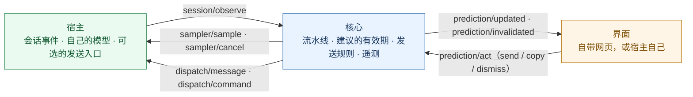
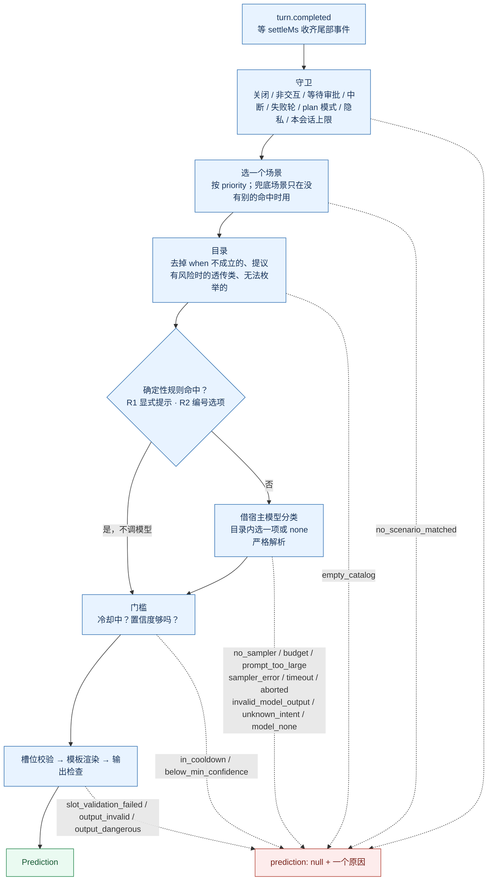
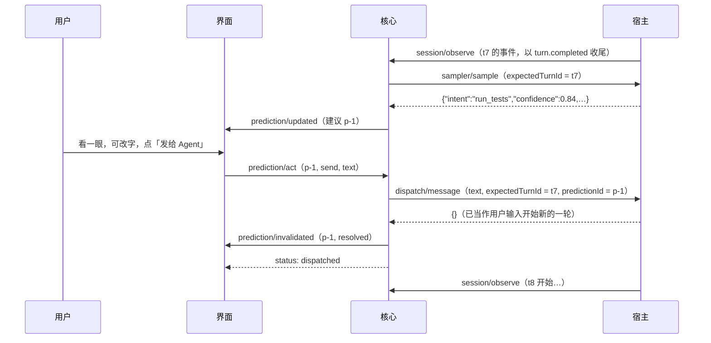
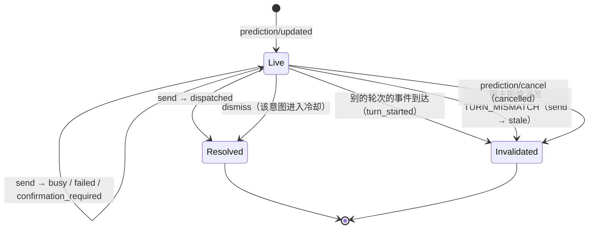

# 说明图（Phase 1：O1 × A1）

只画当前阶段。后续阶段的草案在 [future.md](future.md)。图与 [SPEC.md](../SPEC.md) 冲突时以 SPEC 为准。

## 1. 三个角色

## 2. 一条建议从哪来、在哪被挡下

每一级都有一条通往「不给建议」的出口；出口上的名字就是记录下来的 `SuppressedReason`。

## 3. 时序：出建议，用户发送

用户没用建议、自己在宿主里发了下一句时：`t8` 的第一个事件到达，核心发 `prediction/invalidated（turn_started）`；等 `message.user` 到达时把结果记为 `passed`，附字面相似度。

采样途中下一轮开始时：核心发 `sampler/cancel`，以 `aborted` 结束这次求值；宿主之后送来的回复被丢弃。

## 4. 一条建议的一生

「有效」与「结果已记录」是两件事：一条建议在下一轮开始时就失效（不能再发送），但它的结果要等到用户的下一条消息到达才定为 `passed`，或者在下一轮没有任何用户消息就结束时定为 `expired`。每条建议恰好有一条结果记录。
