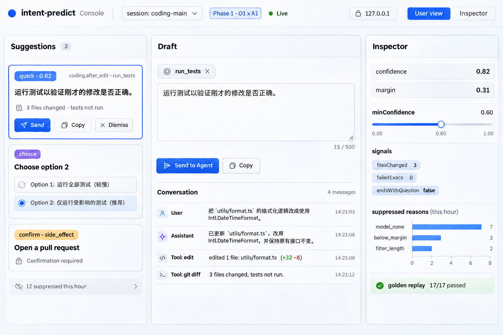
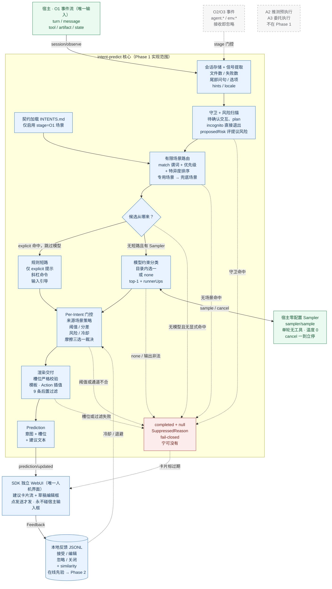
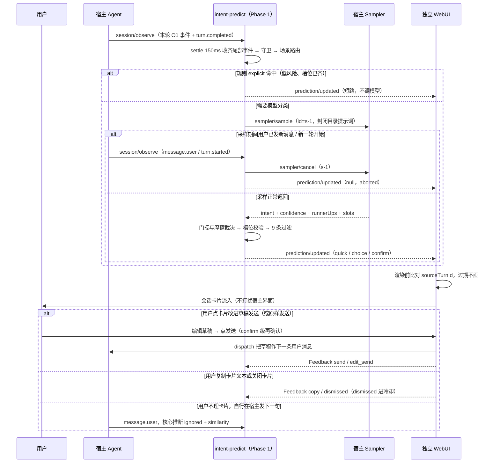
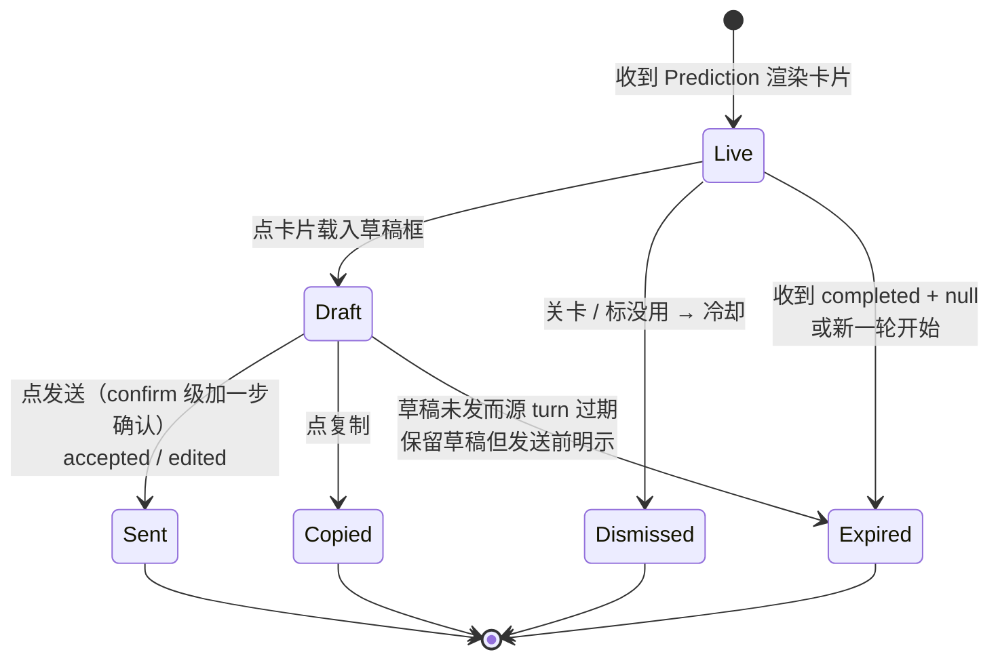
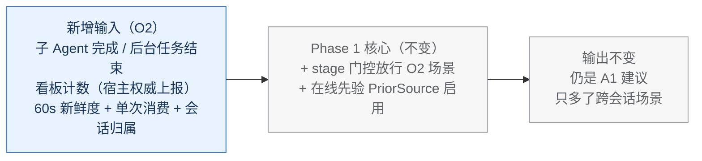
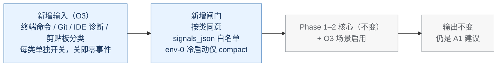
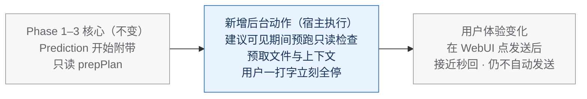
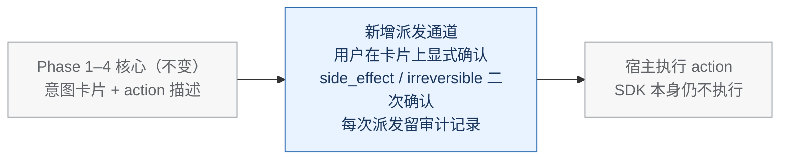

# 说明图（按阶段拆分）

所有图按 [ROADMAP.md](../ROADMAP.md) 的五阶段拆开维护，每阶段只画自己这一格。统一约定：

- **实线蓝框**：该阶段的实现范围。
- **虚线灰框**：规范已定、后续阶段才启用的部分（画出来只为标明边界，不进当前实现）。
- **红框汇点**：fail-closed 抑制出口——任何异常都收束到「不给建议」。

当前阶段是 **Phase 1（O1 × A1）**，只有第 1 节的三张图需要精修到可照着写代码；第 2–5 节是每个后续阶段的单页增量图（只画新增输入/输出，既有核心收成一个框）。

## 0. 全景：双轴总图（完整愿景，不是当前范围）

```text
          A1 纯建议    A2 推测预执行   A3 委托执行
O3 全局    Phase 3  →   Phase 4    →   Phase 5
O2 全Agent Phase 2  ↗
O1 单会话  Phase 1（当前，只做这一格）
```

双轴的完整 mermaid 总图见 [SPEC.md](../SPEC.md) §1.1 与 [design.md](design.md) §5，此处不复制第二份。

## 1. Phase 1（O1 × A1）：当前精修范围

独立 WebUI 界面示意图（概念图，非规范；信息架构以本文与 [design.md](design.md) §10 为准，视觉随实现迭代）：



### 1.1 架构主图：一条建议从哪来、在哪被挡下

读图顺序：进来只有 O1 事件，出去只有 SDK 独立 WebUI 里的卡片——宿主输入框整张图里不存在。中间核心从上到下是一条单向流水线，每一级都有虚线通向最下方红框——任何一级不通过都不给建议。



这张图特意画出的三条 Phase 1 不变量：

1. **输入只有一扇门**：O1 事件进来，O2/O3 事件在门上就被 stage 门控挡下，不产生任何信号。
2. **每条路都有红框出口**：守卫、路由、模型、门控、渲染五级里任何一级出问题，都归入同一个抑制汇点并附标准 `SuppressedReason`，便于回放时逐条计数。
3. **输出只有一个面、且是自家面**：`Prediction` 只能落到独立 WebUI 的卡片流里，图上没有一条边通向宿主输入框；A2/A3 是虚线孤岛，Phase 1 没有任何边连过去。

### 1.2 时序图：一次完整的建议（含取消）



### 1.3 WebUI 卡片生命周期图（A1 的全部交互）



生命周期只活在 WebUI 与核心之间：过期由核心的 `completed + null` 和 `sourceTurnId` 比对驱动，与用户此刻在宿主输入框打什么字无关（顶多是他真发了消息后，核心据此推断一条 ignored 反馈）。摩擦分级已由核心在 `displayChannel` 里定好，WebUI 不重新裁决、更不许降低摩擦（[SPEC.md](../SPEC.md) §5.6）。


---

以下四张是**增量图**：灰框是上一阶段已完成的部分收成的整体，每张图只画本阶段新增的输入或输出。进入某阶段时，再把它的增量图展开成 1.1 那样可以照着写的全图。

## 2. Phase 2（O2 × A1）增量：多看，一个动作不多做



## 3. Phase 3（O3 × A1）增量：多看工作台，先过隐私关



## 4. Phase 4（× A2）增量：建议在场时，先悄悄备好料



## 5. Phase 5（× A3）增量：确认之后，才准动手


